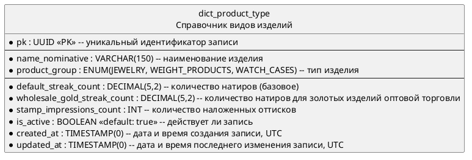

# ТРЕБОВАНИЯ К ДАННЫМ {#dr}

## DR-PT-001. Сущность «Вид изделий» {#dr-pt-001 .collapsed}

- **Использует**: [F-PT][]
- **Используется в**: [DR-PT-CREATE-001][], [DR-PT-LIST-001][], [DR-PT-UPDATE-001][], [UI-PT-001][],
[AR-PT-CREATE-001][], [AR-PT-READ-001][], [AR-PT-UPDATE-001][], [AR-PT-LIST-001][], [AR-PT-DELETE-001][]
- **Описание**: Единственное место, где описана таблица `dict_product_type`: поля, типы, ограничения, допустимые
значения, формат даты и времени и индексы. Требования к данным детальных функциональностей описывают только то, что
относится к их операции, и ссылаются сюда. В JSON-схемах API эти же правила записаны один раз — в `$defs` схемы
[AR-PT-001][].

### Поля {#dr-pt-001-fields .collapsed}

Все поля обязательны: пустые значения (`NULL`) не допускаются.

| Поле | Тип | Ограничения | Описание |
| :--- | :--- | :--- | :--- |
| `pk` | UUID | Формирует система, не меняется | Идентификатор записи |
| `name_nominative` | VARCHAR(150) | Хранится без пробелов по краям, не пустое, до 150 символов | Наименование изделия |
| `product_group` | ENUM | Одно из значений таблицы ниже | Тип изделия |
| `default_streak_count` | DECIMAL(5,2) | > 0, ≤ 999.99, до 2 знаков после точки | Количество натиров (базовое) |
| `wholesale_gold_streak_count` | DECIMAL(5,2) | То же | Натиры для золотых изделий оптовой торговли |
| `stamp_impressions_count` | INT | > 0, ≤ 2 147 483 647 | Количество наложенных оттисков |
| `is_active` | BOOLEAN | По умолчанию `true` | Статус: «Действует» или «Не действует» |
| `created_at` | TIMESTAMP(0) | UTC, точность до секунды, не меняется | Дата и время создания |
| `updated_at` | TIMESTAMP(0) | UTC, точность до секунды | Дата и время последнего изменения |

Примеры значений: наименование — «Кольцо», «Браслеты», «Серьги»; базовые натиры — 1, 2, 3; натиры для золотых
изделий — 0.5, 1; оттиски — 1, 3.

### Значения `product_group` {#dr-pt-001-groups .collapsed}

Порядковый номер задаёт порядок значений в полях выбора (форма записи, фильтр списка). Сортировка списка по типу
изделия идёт по алфавиту названий ([DR-PT-LIST-001][]).

| № | Код | Название |
| :--- | :--- | :--- |
| 1 | `JEWELRY` | Ювелирные изделия |
| 2 | `WEIGHT_PRODUCTS` | Весовые изделия |
| 3 | `WATCH_CASES` | Часовые корпуса |

### Дата и время {#dr-pt-001-datetime .collapsed}

- `created_at` и `updated_at` хранятся в UTC с точностью до секунды: доли секунды отбрасываются при записи.
- API передаёт их в формате ISO 8601 без долей секунды: `ГГГГ-ММ-ДДTЧЧ:ММ:ССZ`, например `2026-11-23T08:36:44Z`.
- Значение `updated_at`, которое клиент получил при чтении, совпадает с хранимым до секунды, поэтому его можно
  использовать для проверки одновременного изменения ([DR-PT-UPDATE-001][]).

### Ограничения {#dr-pt-001-constraints .collapsed}

- **Первичный ключ**: `pk`.
- **Уникальность**: пара из наименования и типа изделия не повторяется. Наименование сравнивается без учёта
  регистра (оно уже хранится без пробелов по краям): «Кольцо» может быть в типе `JEWELRY` и в другом типе, но не
  дважды в одном.
- **Ссылки**: таблицы, которые ссылаются на запись, объявляют внешний ключ с запретом удаления
  (`ON DELETE RESTRICT`); запись, на которую есть ссылки, считается используемой ([SF-PT-DELETE][]).

### Индексы {#dr-pt-001-indexes .collapsed}

| Индекс | Поля | Назначение |
| :--- | :--- | :--- |
| `ux_dict_product_type_name_group` | `lower(name_nominative)`, `product_group` | Уникальный: наименование в типе |
| `ix_dict_product_type_created_at` | `created_at`, `pk` | Порядок списка по умолчанию |
| `ix_dict_product_type_name_trgm` | `name_nominative` (триграммный) | Поиск по вхождению подстроки |
| `ix_dict_product_type_group_active` | `product_group`, `is_active` | Фильтры по типу и статусу |

Уникальный индекс по `lower(name_nominative)` используется и для сортировки по наименованию.

### Открытые вопросы {#dr-pt-001-questions .collapsed}

- **DR-PT-001.Q01**
    - **Статус**: открыт
    - **Решает**: владелец справочника
    - **Вопрос**: Сколько записей ожидается в справочнике через пять лет эксплуатации? Показатели времени ответа в FR
      рассчитаны на 10 000 записей с запасом; если ожидаемый объём больше, показатели и индексы нужно пересмотреть.

### Допущения {#dr-pt-001-assumptions .collapsed}

- **DR-PT-001.H01**
    - **Статус**: требует подтверждения
    - **Подтверждает**: архитектор
    - **Допущение**: Время хранится с точностью до секунды, чтобы `updated_at` из ответа API совпадал с хранимым и
      проверка одновременного изменения работала. Остаточный риск: два изменения одной записи в одну и ту же секунду
      не различаются, и второе может перезаписать первое без отказа. Риск принимается, потому что справочник
      меняют редко и вручную.
- **DR-PT-001.H02**
    - **Статус**: требует подтверждения
    - **Подтверждает**: архитектор
    - **Допущение**: Индексы рассчитаны на СУБД PostgreSQL (триграммный индекс — расширение `pg_trgm`); при другой
      СУБД состав индексов определяет архитектор.

[F-PT]: <index.md#f-pt>
[UI-PT-001]: <ui.md#ui-pt-001>
[SF-PT-DELETE]: <sf-delete/index.md#sf-pt-delete>
[DR-PT-CREATE-001]: <sf-create/dr.md#dr-pt-create-001>
[DR-PT-LIST-001]: <sf-list/dr.md#dr-pt-list-001>
[DR-PT-UPDATE-001]: <sf-update/dr.md#dr-pt-update-001>
[AR-PT-CREATE-001]: <sf-create/fr.md#ar-pt-create-001>
[AR-PT-READ-001]: <sf-read/fr.md#ar-pt-read-001>
[AR-PT-UPDATE-001]: <sf-update/fr.md#ar-pt-update-001>
[AR-PT-LIST-001]: <sf-list/fr.md#ar-pt-list-001>
[AR-PT-DELETE-001]: <sf-delete/fr.md#ar-pt-delete-001>
[AR-PT-001]: <ar.md#ar-pt-001>
