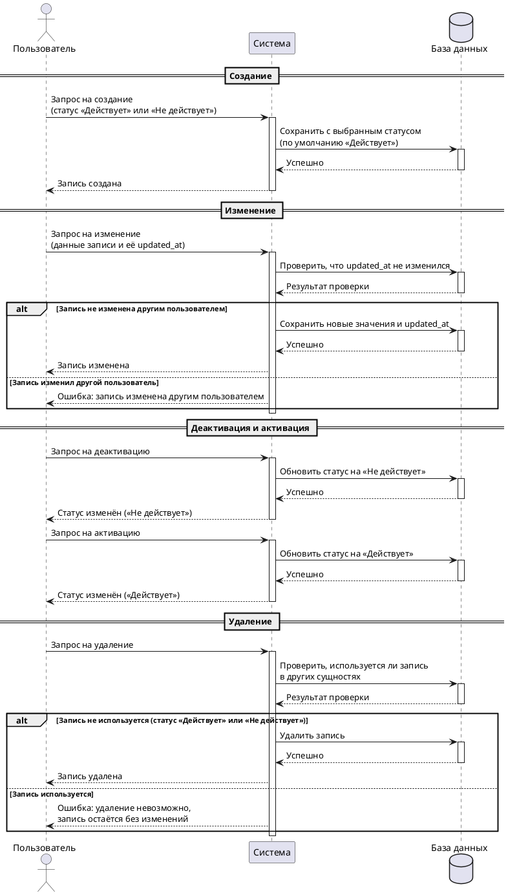
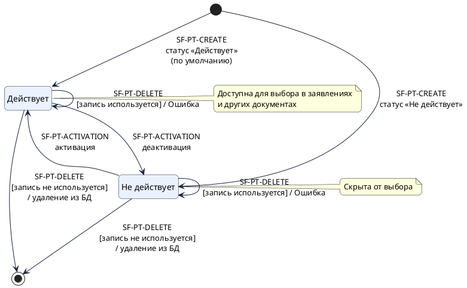

# ОСНОВНАЯ ФУНКЦИОНАЛЬНОСТЬ {#f}

## Журнал изменений {#change-history .collapsed}

- [Версия 0.01.03 (24.11.2026 22:01:52; uc.md)](https://github.com/DmitryKhilko/example-app-requirements-v2/commit/ce2ce3e1eb7f656676dc245841d0e3986a672b2f){target="_blank" rel="noopener"}. Редактор: Dmitry Khilko
- [Версия 0.01.02 (24.11.2026 22:01:40; index.md)](https://github.com/DmitryKhilko/example-app-requirements-v2/commit/38f3c2b6c6680ec17338b4041dc6e8eeade2436b){target="_blank" rel="noopener"}. Редактор: Dmitry Khilko
- [Версия 0.01.01 (24.11.2026 20:56:35; uc.md)](https://github.com/DmitryKhilko/example-app-requirements-v2/commit/a1ae4bde9356edea1b161ac20256866c0a335812){target="_blank" rel="noopener"}. Редактор: Dmitry Khilko
- [Версия 0.01.00 (23.11.2026 21:46:17; index.md)](https://github.com/DmitryKhilko/example-app-requirements-v2/commit/eb7e9fd789284f42fedb9e43cc6ef620160eb2ee){target="_blank" rel="noopener"}. Редактор: Dmitry Khilko
- [Версия 0.00.48 (23.11.2026 21:44:23; index.md)](https://github.com/DmitryKhilko/example-app-requirements-v2/commit/6bb18975e9f90b0b63143fc41986aff2e69e06e1){target="_blank" rel="noopener"}. Редактор: Dmitry Khilko
- [Версия 0.00.47 (23.11.2026 21:41:57; index.md)](https://github.com/DmitryKhilko/example-app-requirements-v2/commit/b37d51656c6ff85304b89ecdcdf8c415656ffbe9){target="_blank" rel="noopener"}. Редактор: Dmitry Khilko
- [Версия 0.00.46 (23.11.2026 21:37:20; index.md)](https://github.com/DmitryKhilko/example-app-requirements-v2/commit/1f2ce8a2bcdf3b35a3668890ea8cbda8abde21db){target="_blank" rel="noopener"}. Редактор: Dmitry Khilko
- [Версия 0.00.45 (23.11.2026 21:08:45; uc.md)](https://github.com/DmitryKhilko/example-app-requirements-v2/commit/8514a00dd0f658952a29c5fc88ffc95f46686e66){target="_blank" rel="noopener"}. Редактор: Dmitry Khilko
- [Версия 0.00.44 (23.11.2026 21:04:59; fr.md)](https://github.com/DmitryKhilko/example-app-requirements-v2/commit/a6eeee44d7ff7045af9743faf1c338682e58c853){target="_blank" rel="noopener"}. Редактор: Dmitry Khilko
- [Версия 0.00.43 (23.11.2026 21:04:45; dr.md)](https://github.com/DmitryKhilko/example-app-requirements-v2/commit/54b8b3f48b2fe1f34dc6b2daff8fd200f055cc1f){target="_blank" rel="noopener"}. Редактор: Dmitry Khilko
- [Версия 0.00.42 (21.11.2026 20:41:48; index.md)](https://github.com/DmitryKhilko/example-app-requirements-v2/commit/73927cce6a0bc91620c10cce5e3512b1a2a905fb){target="_blank" rel="noopener"}. Редактор: Dmitry Khilko
- [Версия 0.00.41 (21.11.2026 20:29:40; dr.md, fr.md, index.md, uc.md)](https://github.com/DmitryKhilko/example-app-requirements-v2/commit/b9d11e1ba751a4f7d5596281dab33423f7c4627a){target="_blank" rel="noopener"}. Редактор: Dmitry Khilko
- [Версия 0.00.40 (21.11.2026 20:14:46; index.md)](https://github.com/DmitryKhilko/example-app-requirements-v2/commit/01c111ed253592bf390810c7adb7c6ed99c602ae){target="_blank" rel="noopener"}. Редактор: Dmitry Khilko
- [Версия 0.00.39 (21.11.2026 19:59:05; index.md)](https://github.com/DmitryKhilko/example-app-requirements-v2/commit/ce4c13d276206994f26026121bf4f8ca9d8a2b64){target="_blank" rel="noopener"}. Редактор: Dmitry Khilko
- [Версия 0.00.38 (21.11.2026 19:54:14; index.md)](https://github.com/DmitryKhilko/example-app-requirements-v2/commit/eacb93df80070cc3376f1a7b6ed67e21f316a601){target="_blank" rel="noopener"}. Редактор: Dmitry Khilko
- [Версия 0.00.37 (21.11.2026 19:46:36; index.md)](https://github.com/DmitryKhilko/example-app-requirements-v2/commit/1748fa16bd005248f3daec11ad61dea2adb90af9){target="_blank" rel="noopener"}. Редактор: Dmitry Khilko
- [Версия 0.00.36 (21.11.2026 19:44:22; index.md)](https://github.com/DmitryKhilko/example-app-requirements-v2/commit/fcf2cbc0720dfd6e8610f869dc62837068f56ce7){target="_blank" rel="noopener"}. Редактор: Dmitry Khilko
- [Версия 0.00.35 (21.11.2026 18:35:14; index.md)](https://github.com/DmitryKhilko/example-app-requirements-v2/commit/a4205492b9be87ae44fc976434b722d8472a21df){target="_blank" rel="noopener"}. Редактор: Dmitry Khilko
- [Версия 0.00.34 (21.11.2026 18:19:04; index.md)](https://github.com/DmitryKhilko/example-app-requirements-v2/commit/e5f4e3570cdcebfd7051583656dc3f07a2d6c409){target="_blank" rel="noopener"}. Редактор: Dmitry Khilko
- [Версия 0.00.33 (21.11.2026 18:16:16; index.md)](https://github.com/DmitryKhilko/example-app-requirements-v2/commit/413d4d71a57e37b35dd5ba01dc1bd5426ed3c22f){target="_blank" rel="noopener"}. Редактор: Dmitry Khilko
- [Версия 0.00.32 (21.11.2026 18:14:41; index.md)](https://github.com/DmitryKhilko/example-app-requirements-v2/commit/53b5ea45c7113c8195c38098d24d4f45a9b9dc77){target="_blank" rel="noopener"}. Редактор: Dmitry Khilko
- [Версия 0.00.31 (21.11.2026 18:13:14; index.md)](https://github.com/DmitryKhilko/example-app-requirements-v2/commit/792757615d6a912c97d7a57e2344781f37cee860){target="_blank" rel="noopener"}. Редактор: Dmitry Khilko
- [Версия 0.00.30 (21.11.2026 18:06:53; index.md)](https://github.com/DmitryKhilko/example-app-requirements-v2/commit/bb7a17df7e72850616401b8cc968fcb2654d6bdd){target="_blank" rel="noopener"}. Редактор: Dmitry Khilko
- [Версия 0.00.29 (21.11.2026 00:50:44; dr.md, fr.md, index.md, uc.md)](https://github.com/DmitryKhilko/example-app-requirements-v2/commit/0d325e28c422f92bb1e637e5d256bb4cfb14df14){target="_blank" rel="noopener"}. Редактор: Dmitry Khilko
- [Версия 0.00.28 (20.11.2026 09:06:31; index.md)](https://github.com/DmitryKhilko/example-app-requirements-v2/commit/884164e398123425b273028c270469323ed2f588){target="_blank" rel="noopener"}. Редактор: Khilko Dmitry
- [Версия 0.00.27 (19.11.2026 18:56:02; index.md)](https://github.com/DmitryKhilko/example-app-requirements-v2/commit/8358f4953a6766f03f1ab2ae5e7d3944fa78a1ce){target="_blank" rel="noopener"}. Редактор: Khilko Dmitry
- [Версия 0.00.26 (19.11.2026 15:03:17; index.md)](https://github.com/DmitryKhilko/example-app-requirements-v2/commit/881ea491d9c85fdd8ca65431db3a86f446590cd9){target="_blank" rel="noopener"}. Редактор: Khilko Dmitry
- [Версия 0.00.25 (19.11.2026 01:35:11; index.md)](https://github.com/DmitryKhilko/example-app-requirements-v2/commit/2f44c7827ba88d7fbc60939a96d20e677a7e8d96){target="_blank" rel="noopener"}. Редактор: Dmitry Khilko
- [Версия 0.00.24 (19.11.2026 01:27:08; uc.md)](https://github.com/DmitryKhilko/example-app-requirements-v2/commit/4082b95180e4398f51303bd862525a1224ae2f45){target="_blank" rel="noopener"}. Редактор: Dmitry Khilko
- [Версия 0.00.23 (19.11.2026 01:23:07; index.md)](https://github.com/DmitryKhilko/example-app-requirements-v2/commit/d5a992f2efc250a7d4108a91708fad5be68f5933){target="_blank" rel="noopener"}. Редактор: Dmitry Khilko
- [Версия 0.00.22 (19.11.2026 00:16:42; index.md)](https://github.com/DmitryKhilko/example-app-requirements-v2/commit/bb25c0b26b0b79a6a4a897e7c97878614511e4d7){target="_blank" rel="noopener"}. Редактор: Dmitry Khilko
- [Версия 0.00.21 (19.11.2026 00:02:57; dr.md, fr.md, uc.md)](https://github.com/DmitryKhilko/example-app-requirements-v2/commit/6e0d0e8dc23198779df49f48de7bcdc9fa99bc9a){target="_blank" rel="noopener"}. Редактор: Dmitry Khilko
- [Версия 0.00.20 (18.11.2026 23:39:32; index.md)](https://github.com/DmitryKhilko/example-app-requirements-v2/commit/61466b3220f439e28dde1f36f3910aa6bd3e063d){target="_blank" rel="noopener"}. Редактор: Dmitry Khilko
- [Версия 0.00.19 (18.11.2026 23:11:07; index.md)](https://github.com/DmitryKhilko/example-app-requirements-v2/commit/3fd269e70797a46a2339553b60415410daeacb8b){target="_blank" rel="noopener"}. Редактор: Dmitry Khilko
- [Версия 0.00.18 (18.11.2026 22:58:37; dr.md, f/index.md, fr.md, index.md, uc.md)](https://github.com/DmitryKhilko/example-app-requirements-v2/commit/24f3f2a2465c1e206ce31df29a16bfdd7b611855){target="_blank" rel="noopener"}. Редактор: Dmitry Khilko
- [Версия 0.00.17 (18.11.2026 22:37:02; f/dr.md, f/fr.md, f/index.md, f/uc.md)](https://github.com/DmitryKhilko/example-app-requirements-v2/commit/b5b489e340173371cad9253b5207cdfa6fa79e33){target="_blank" rel="noopener"}. Редактор: Dmitry Khilko
- [Версия 0.00.16 (18.11.2026 22:23:34; general/dr.md, general/fr.md, general/index.md, general/uc.md, index.md)](https://github.com/DmitryKhilko/example-app-requirements-v2/commit/541f07664fce781fbd1562aeff77439ac16cb14e){target="_blank" rel="noopener"}. Редактор: Dmitry Khilko
- [Версия 0.00.15 (18.11.2026 21:30:37; index.md)](https://github.com/DmitryKhilko/example-app-requirements-v2/commit/373fed80dfdc504e35cfeb1acb34a90ab8398aa2){target="_blank" rel="noopener"}. Редактор: Dmitry Khilko
- [Версия 0.00.14 (18.11.2026 21:18:35; dr.md, f/ar.md, f/fr.md, f/index.md, f/nfr.md, f/ui.md, fr.md, uc.md)](https://github.com/DmitryKhilko/example-app-requirements-v2/commit/3d15f043d0b45e951c8210c4be581171db654939){target="_blank" rel="noopener"}. Редактор: Dmitry Khilko
- [Версия 0.00.13 (18.11.2026 21:03:35; index.md)](https://github.com/DmitryKhilko/example-app-requirements-v2/commit/135ba2305442954674ef729b3716a781fb86ab12){target="_blank" rel="noopener"}. Редактор: Dmitry Khilko
- [Версия 0.00.12 (18.11.2026 18:04:38; f/index.md)](https://github.com/DmitryKhilko/example-app-requirements-v2/commit/bcf6b4a5d10ffc3beb6e0bc0219b07931dc0ec54){target="_blank" rel="noopener"}. Редактор: Khilko Dmitry
- [Версия 0.00.11 (18.11.2026 17:57:42; f/index.md)](https://github.com/DmitryKhilko/example-app-requirements-v2/commit/e0f4286f1a65a6832f85710d091b661bcab7781a){target="_blank" rel="noopener"}. Редактор: Khilko Dmitry
- [Версия 0.00.10 (18.11.2026 17:49:18; f/index.md)](https://github.com/DmitryKhilko/example-app-requirements-v2/commit/7481027bc787f18934df073fc44b498443b9e95f){target="_blank" rel="noopener"}. Редактор: Khilko Dmitry
- [Версия 0.00.09 (18.11.2026 16:05:24; f/index.md)](https://github.com/DmitryKhilko/example-app-requirements-v2/commit/ce6dbe8cdaeeb1170c90f99fc0a135df1291b56f){target="_blank" rel="noopener"}. Редактор: Khilko Dmitry
- [Версия 0.00.08 (18.11.2026 15:59:45; f/index.md)](https://github.com/DmitryKhilko/example-app-requirements-v2/commit/ec92bbdcf22e6e42e54724f0feb97a10440c7366){target="_blank" rel="noopener"}. Редактор: Khilko Dmitry
- [Версия 0.00.07 (18.11.2026 15:58:05; f/index.md)](https://github.com/DmitryKhilko/example-app-requirements-v2/commit/40090faa2fb69b2f18ab8f6e803b2afb4bbfd5a4){target="_blank" rel="noopener"}. Редактор: Khilko Dmitry
- [Версия 0.00.06 (18.11.2026 15:45:38; f/index.md)](https://github.com/DmitryKhilko/example-app-requirements-v2/commit/32a8006df7a74f063553cb5b7c0786053c0f8506){target="_blank" rel="noopener"}. Редактор: Khilko Dmitry
- [Версия 0.00.05 (18.11.2026 15:41:47; f/index.md)](https://github.com/DmitryKhilko/example-app-requirements-v2/commit/23ac9988a7b69f2578a843f03e39ae31eb53bcfe){target="_blank" rel="noopener"}. Редактор: Khilko Dmitry
- [Версия 0.00.04 (18.11.2026 15:36:57; f/index.md)](https://github.com/DmitryKhilko/example-app-requirements-v2/commit/f2f5d265063a44ea9eb385e2066c9856efebfacd){target="_blank" rel="noopener"}. Редактор: Khilko Dmitry
- [Версия 0.00.03 (18.11.2026 15:32:40; f/index.md)](https://github.com/DmitryKhilko/example-app-requirements-v2/commit/d2c0c2459abfcc488ceb4126908ecd86d54661e2){target="_blank" rel="noopener"}. Редактор: Khilko Dmitry
- [Версия 0.00.02 (18.11.2026 15:29:03; f/index.md)](https://github.com/DmitryKhilko/example-app-requirements-v2/commit/188d8553540aef8b5c024107a612e48b266fe59a){target="_blank" rel="noopener"}. Редактор: Khilko Dmitry
- [Версия 0.00.01 (18.11.2026 15:25:56; f/index.md)](https://github.com/DmitryKhilko/example-app-requirements-v2/commit/5f474b87bab6beed5b6043409ac4fba10307c505){target="_blank" rel="noopener"}. Редактор: Khilko Dmitry

## F-PT. Справочник видов изделий {#f-pt .collapsed}

- **Относится**: [BG-002][]
- **Использует**: [SF-G-DICT][] и подключаемые им глобальные функциональности: [SF-G-CATALOG][], [SF-G-TABLE][],
[SF-G-PAG][], [SF-G-SORT][], [SF-G-SEARCH][], [SF-G-FILTER][], [SF-G-COLUMNS][], [SF-G-SELECT][], [SF-G-CONFIRM][],
[SF-G-FORM][], [SF-G-LOCK][], [SF-G-TOAST][], [SF-G-SESSION][]
- **Используется в**: [SF-PT-LIST][], [SF-PT-READ][], [SF-PT-CREATE][], 
[SF-PT-UPDATE][], [SF-PT-ACTIVATION][], [SF-PT-DELETE][], [UI-PT-001][]
- **Описание**: Справочник видов изделий является единым, достоверным и управляемым источником данных для документов
всех подсистем, что исключает расхождение и дублирование информации. Справочник обеспечивает единый перечень видов
изделий из драгоценных металлов (ювелирные и весовые изделия, часовые корпуса) для сквозного учёта на всех этапах
жизненного цикла работ: от формирования заявления до оформления выдачи. Для поддержания его актуальности пользователь
может управлять записями вручную: просматривать, искать, создавать, редактировать, изменять статус и удалять.
- **Границы**:
    - **Входит**: Просмотр, поиск, создание, изменение, деактивация и удаление записей, права доступа и аудит изменений.
    - **Не входит**: Загрузка из файла, загрузка из внешних классификаторов, импорт из НСИ АСФР.

### Права доступа {#f-pt-access .collapsed}

Роли описаны в [глоссарии][roles]. «Да» — операция доступна роли, «Нет» — недоступна: элементы интерфейса для неё
не выводятся, а API отвечает `403`.

| Операция | `ais` | `pgipn` | `sgipn` | `igipn` | `pko` | `psh` |
| :--- | :--- | :--- | :--- | :--- | :--- | :--- |
| Просмотр списка и записи ([SF-PT-LIST][], [SF-PT-READ][]) | Да | Да | Да | Да | Да | Да |
| Создание ([SF-PT-CREATE][]) | Да | Нет | Нет | Нет | Нет | Нет |
| Изменение и смена статуса ([SF-PT-UPDATE][], [SF-PT-ACTIVATION][]) | Да | Нет | Нет | Нет | Нет | Нет |
| Удаление ([SF-PT-DELETE][]) | Да | Нет | Нет | Нет | Нет | Нет |

Пользователь без аутентификации не получает доступа ни к одной операции. Аутентифицированный пользователь, у
которого нет ни одной из перечисленных ролей (например, пользователь другой подсистемы), получает отказ `403` на
любую операцию справочника.

### Диаграмма последовательности {#sequence-diagram .collapsed}

Ниже представлена UML-диаграмма последовательности (Sequence Diagram), описывающая жизненный цикл сущности через 
взаимодействие пользователя, системы и базы данных.

### Диаграмма состояний {#f-pt-state-diagram .collapsed}

Схема показывает, в каком статусе находится запись справочника и какая детальная функциональность переводит её из 
статуса в статус. Просмотр и поиск ([SF-PT-LIST][], [SF-PT-READ][]) и редактирование ([SF-PT-UPDATE][]) статус
записи не меняют.

Удаление физическое: запись, которая не используется в других сущностях, удаляется из базы данных из любого статуса
и не может быть восстановлена; статуса «Удалена» нет. Запись, которая используется, удалить нельзя — её можно
деактивировать. Условия удаления задаются в [SF-PT-DELETE][].

[BG-002]: <../../business-context/business-requirements.md#bg-002>
[SF-G-TOAST]: <../../global/sf-g-toast/index.md#sf-g-toast>
[SF-PT-LIST]: <sf-list/index.md#sf-pt-list>
[SF-PT-READ]: <sf-read/index.md#sf-pt-read>
[SF-PT-CREATE]: <sf-create/index.md#sf-pt-create>
[SF-PT-UPDATE]: <sf-update/index.md#sf-pt-update>
[SF-PT-ACTIVATION]: <sf-activation/index.md#sf-pt-activation>
[SF-PT-DELETE]: <sf-delete/index.md#sf-pt-delete>
[UI-PT-001]: <ui.md#ui-pt-001>
[roles]: <../../business-context/glossary.md#roles>
[SF-G-PAG]: <../../global/sf-g-pag/index.md#sf-g-pag>
[SF-G-SORT]: <../../global/sf-g-sort/index.md#sf-g-sort>
[SF-G-SEARCH]: <../../global/sf-g-search/index.md#sf-g-search>
[SF-G-FILTER]: <../../global/sf-g-filter/index.md#sf-g-filter>
[SF-G-DICT]: <../../global/sf-g-dict/index.md#sf-g-dict>
[SF-G-CATALOG]: <../../global/sf-g-catalog/index.md#sf-g-catalog>
[SF-G-TABLE]: <../../global/sf-g-table/index.md#sf-g-table>
[SF-G-COLUMNS]: <../../global/sf-g-columns/index.md#sf-g-columns>
[SF-G-SELECT]: <../../global/sf-g-select/index.md#sf-g-select>
[SF-G-CONFIRM]: <../../global/sf-g-confirm/index.md#sf-g-confirm>
[SF-G-FORM]: <../../global/sf-g-form/index.md#sf-g-form>
[SF-G-LOCK]: <../../global/sf-g-lock/index.md#sf-g-lock>
[SF-G-SESSION]: <../../global/sf-g-session/index.md#sf-g-session>
