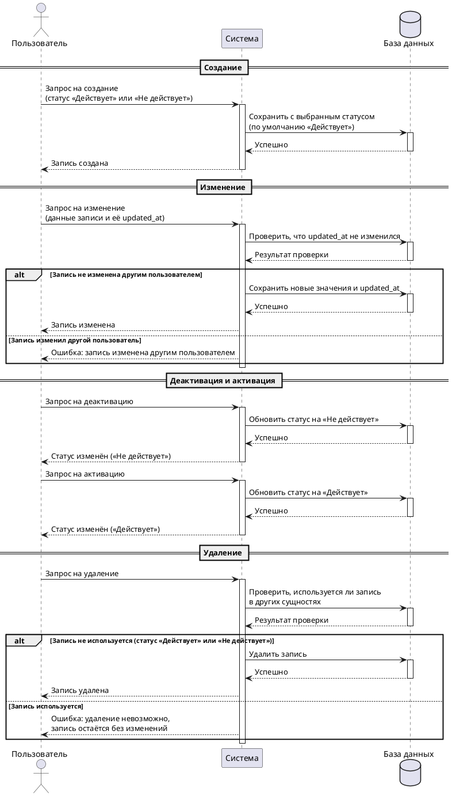
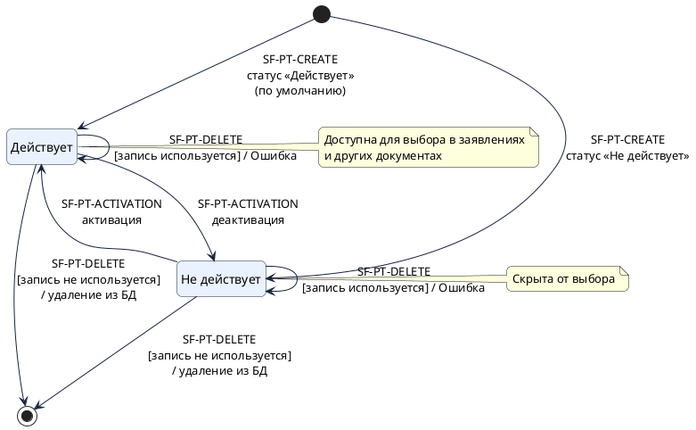

# ОСНОВНАЯ ФУНКЦИОНАЛЬНОСТЬ {#f}

## Журнал изменений {#change-history .collapsed}

- Записей пока нет.

## F-PT. Справочник видов изделий {#f-pt .collapsed}

- **Относится**: [BG-002][]
- **Использует**: [SF-G-DICT][] и подключаемые им глобальные функциональности: [SF-G-CATALOG][], [SF-G-TABLE][],
[SF-G-PAG][], [SF-G-SORT][], [SF-G-SEARCH][], [SF-G-FILTER][], [SF-G-COLUMNS][], [SF-G-SELECT][], [SF-G-CONFIRM][],
[SF-G-FORM][], [SF-G-LOCK][], [SF-G-TOAST][], [SF-G-SESSION][]
- **Используется в**: [SF-PT-LIST][], [SF-PT-READ][], [SF-PT-CREATE][], 
[SF-PT-UPDATE][], [SF-PT-ACTIVATION][], [SF-PT-DELETE][], [UI-PT-001][]
- **Описание**: Справочник видов изделий является единым, достоверным и управляемым источником данных для документов
всех подсистем, что исключает расхождение и дублирование информации. Справочник обеспечивает единый перечень видов
изделий из драгоценных металлов (ювелирные и весовые изделия, часовые корпуса) для сквозного учёта на всех этапах
жизненного цикла работ: от формирования заявления до оформления выдачи. Для поддержания его актуальности пользователь
может управлять записями вручную: просматривать, искать, создавать, редактировать, изменять статус и удалять.
- **Границы**:
    - **Входит**: Просмотр, поиск, создание, изменение, деактивация и удаление записей, права доступа и аудит изменений.
    - **Не входит**: Загрузка из файла, загрузка из внешних классификаторов, импорт из НСИ АСФР.

### Права доступа {#f-pt-access .collapsed}

Роли описаны в [глоссарии][roles]. «Да» — операция доступна роли, «Нет» — недоступна: элементы интерфейса для неё
не выводятся, а API отвечает `403`.

| Операция | `ais` | `pgipn` | `sgipn` | `igipn` | `pko` | `psh` |
| :--- | :--- | :--- | :--- | :--- | :--- | :--- |
| Просмотр списка и записи ([SF-PT-LIST][], [SF-PT-READ][]) | Да | Да | Да | Да | Да | Да |
| Создание ([SF-PT-CREATE][]) | Да | Нет | Нет | Нет | Нет | Нет |
| Изменение и смена статуса ([SF-PT-UPDATE][], [SF-PT-ACTIVATION][]) | Да | Нет | Нет | Нет | Нет | Нет |
| Удаление ([SF-PT-DELETE][]) | Да | Нет | Нет | Нет | Нет | Нет |

Пользователь без аутентификации не получает доступа ни к одной операции. Аутентифицированный пользователь, у
которого нет ни одной из перечисленных ролей (например, пользователь другой подсистемы), получает отказ `403` на
любую операцию справочника.

### Диаграмма последовательности {#sequence-diagram .collapsed}

Ниже представлена UML-диаграмма последовательности (Sequence Diagram), описывающая жизненный цикл сущности через 
взаимодействие пользователя, системы и базы данных.

### Диаграмма состояний {#f-pt-state-diagram .collapsed}

Схема показывает, в каком статусе находится запись справочника и какая детальная функциональность переводит её из 
статуса в статус. Просмотр и поиск ([SF-PT-LIST][], [SF-PT-READ][]) и редактирование ([SF-PT-UPDATE][]) статус
записи не меняют.

Удаление физическое: запись, которая не используется в других сущностях, удаляется из базы данных из любого статуса
и не может быть восстановлена; статуса «Удалена» нет. Запись, которая используется, удалить нельзя — её можно
деактивировать. Условия удаления задаются в [SF-PT-DELETE][].

[BG-002]: <../../business-context/business-requirements.md#bg-002>
[SF-G-TOAST]: <../../global/sf-g-toast/index.md#sf-g-toast>
[SF-PT-LIST]: <sf-list/index.md#sf-pt-list>
[SF-PT-READ]: <sf-read/index.md#sf-pt-read>
[SF-PT-CREATE]: <sf-create/index.md#sf-pt-create>
[SF-PT-UPDATE]: <sf-update/index.md#sf-pt-update>
[SF-PT-ACTIVATION]: <sf-activation/index.md#sf-pt-activation>
[SF-PT-DELETE]: <sf-delete/index.md#sf-pt-delete>
[UI-PT-001]: <ui.md#ui-pt-001>
[roles]: <../../business-context/glossary.md#roles>
[SF-G-PAG]: <../../global/sf-g-pag/index.md#sf-g-pag>
[SF-G-SORT]: <../../global/sf-g-sort/index.md#sf-g-sort>
[SF-G-SEARCH]: <../../global/sf-g-search/index.md#sf-g-search>
[SF-G-FILTER]: <../../global/sf-g-filter/index.md#sf-g-filter>
[SF-G-DICT]: <../../global/sf-g-dict/index.md#sf-g-dict>
[SF-G-CATALOG]: <../../global/sf-g-catalog/index.md#sf-g-catalog>
[SF-G-TABLE]: <../../global/sf-g-table/index.md#sf-g-table>
[SF-G-COLUMNS]: <../../global/sf-g-columns/index.md#sf-g-columns>
[SF-G-SELECT]: <../../global/sf-g-select/index.md#sf-g-select>
[SF-G-CONFIRM]: <../../global/sf-g-confirm/index.md#sf-g-confirm>
[SF-G-FORM]: <../../global/sf-g-form/index.md#sf-g-form>
[SF-G-LOCK]: <../../global/sf-g-lock/index.md#sf-g-lock>
[SF-G-SESSION]: <../../global/sf-g-session/index.md#sf-g-session>
