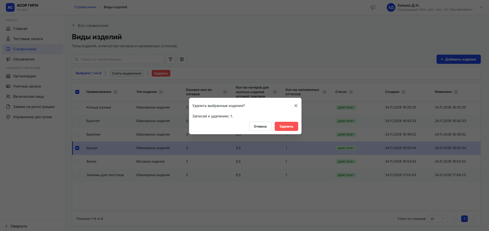

# ФУНКЦИОНАЛЬНЫЕ ТРЕБОВАНИЯ {#fr}

Критерии приёмки опираются на [тестовый набор][fixture] `PT.fixture.json` уровня основной функциональности. В примерах
удаляются записи «Брелоки» (`00000000-0000-4000-8000-000000000003`) и «Броши» (`00000000-0000-4000-8000-000000000004`).

## FR-PT-DELETE-001. Удаление записей вида изделий {#fr-pt-delete-001 .collapsed}

- **Использует**: [SF-PT-DELETE][]
- **Используется в**: [AR-PT-DELETE-001][], [FR-PT-DELETE-003][]
- **Описание**: Система физически удаляет из базы данных одну или несколько записей справочника видов изделий, если
ни одна из них не используется в других сущностях.
- **Условие**: Пользователь аутентифицирован и имеет право удаления (роль `ais`), список идентификаторов корректен,
ни одна из существующих записей списка не используется (отказы — в [FR-PT-DELETE-002][]).
- **Результат**:
    - Запись **используется**, если на неё ссылается хотя бы одна запись другой таблицы ([DR-PT-001][], `H02`).
      Статус записи на возможность удаления не влияет.
    - Система удаляет все существующие записи из списка в одной транзакции: либо удаляются все, либо ни одна (см.
      `H01`).
    - Идентификаторы, которых нет в справочнике (например, запись уже удалил другой пользователь), пропускаются без
      ошибки (см. `H03`).
    - Удаление физическое: записи исчезают из таблицы `dict_product_type`, восстановить их нельзя; статуса «Удалена»
      нет.
    - Система записывает в журнал аудита удаление каждой записи вместе с её данными на момент удаления
      ([FR-PT-002][]).
    - Система возвращает количество удалённых записей `deleted_count` и код ответа `200`.
- **Показатели (NFR)**: Время ответа на удаление 100 записей: 95-й процентиль — не более 1 с при 10 000 записях в
справочнике на тестовом стенде. Удаление и запись в журнал аудита выполняются в одной транзакции.

### Эталоны запроса и ответа {#fr-pt-delete-001-examples .collapsed}

Запрос `POST /api/v1/product-types/batch-delete`:

```json
--8<-- "requirements/features/dict-product-type/sf-delete/api/AR-PT-DELETE-001.request.json"
```

Ответ `200 OK`:

```json
--8<-- "requirements/features/dict-product-type/sf-delete/api/AR-PT-DELETE-001.response.200.json"
```

### Критерии приёмки (AC) {#fr-pt-delete-001-ac .collapsed}

```gherkin
# language: ru
@FR-PT-DELETE-001 @AR-PT-DELETE-001
Функционал: Удаление записей вида изделий

  Предыстория:
    Дано в справочнике записи из файла "PT.fixture.json"
    И аутентифицированный пользователь с ролью "ais"

  Сценарий: Удаление двух записей
    Когда он отправляет запрос "POST /api/v1/product-types/batch-delete"
      с телом из файла "AR-PT-DELETE-001.request.json"
    Тогда код ответа равен 200
    И тело ответа равно содержимому файла "AR-PT-DELETE-001.response.200.json"
    И запросы "GET /api/v1/product-types/00000000-0000-4000-8000-000000000003" и "…000004" возвращают 404
    И в справочнике 13 записей
    И в журнале аудита две записи об удалении с данными записей "Брелоки" и "Броши"

  Сценарий: Недействующую запись можно удалить
    Когда он отправляет запрос удаления с "pks" = ["00000000-0000-4000-8000-000000000003"]
    Тогда код ответа равен 200
    И в теле ответа "deleted_count" равно 1

  Сценарий: Несуществующие идентификаторы пропускаются
    Когда он отправляет запрос удаления с "pks" =
      ["00000000-0000-4000-8000-000000000003", "00000000-0000-4000-8000-000000000999"]
    Тогда код ответа равен 200
    И в теле ответа "deleted_count" равно 1

  @NFR @performance
  Сценарий: Время удаления 100 записей
    Дано в справочнике 10 000 записей, которые не используются
    Когда он 100 раз отправляет запрос удаления 100 разных записей
    Тогда 95-й процентиль времени ответа не больше 1 с

  @manual @NFR
  Сценарий: Сбой журнала аудита отменяет удаление
    Дано запись в журнал аудита завершается ошибкой
    Когда он отправляет запрос удаления с телом из файла "AR-PT-DELETE-001.request.json"
    Тогда код ответа равен 500
    И записи "Брелоки" и "Броши" остались в справочнике
```

### Допущения {#fr-pt-delete-001-assumptions .collapsed}

- **FR-PT-DELETE-001.H01**
    - **Статус**: требует подтверждения
    - **Подтверждает**: владелец справочника
    - **Допущение**: Удаление нескольких записей неделимо: если используется хотя бы одна, не удаляется ни одна, а
      ответ перечисляет используемые записи. На это правило опирается альтернативный поток А4 сценария `UC-PT-009`.
- **FR-PT-DELETE-001.H02**
    - **Статус**: требует подтверждения
    - **Подтверждает**: архитектор
    - **Допущение**: Использование определяется внешними ключами: каждая таблица, которая ссылается на
      `dict_product_type`, объявляет внешний ключ с запретом удаления (`ON DELETE RESTRICT`). Сейчас таких таблиц
      нет, поэтому сценарии с используемой записью проверяются на тестовой таблице-потребителе.
- **FR-PT-DELETE-001.H03**
    - **Статус**: требует подтверждения
    - **Подтверждает**: владелец справочника
    - **Допущение**: Идентификатор отсутствующей записи не считается ошибкой: цель пользователя — чтобы записи не
      было, и она уже достигнута.

## FR-PT-DELETE-002. Отказ в удалении записей вида изделий {#fr-pt-delete-002 .collapsed}

- **Использует**: [SF-PT-DELETE][]
- **Используется в**: [AR-PT-DELETE-001][], [FR-PT-DELETE-003][]
- **Описание**: Система отклоняет удаление, если пользователь не аутентифицирован или не имеет права удаления, список
идентификаторов некорректен, хотя бы одна запись используется либо произошла внутренняя ошибка. При любом отказе ни
одна запись не удаляется и в журнал аудита ничего не записывается.
- **Порядок проверок**:
    1. Аутентификация: при отказе код ответа `401`.
    2. Право удаления: при отказе код ответа `403`.
    3. Данные запроса: при отказе код ответа `400`, в ответе перечислены все найденные ошибки.
    4. Использование записей: при отказе код ответа `409`, в `details` — каждая используемая запись.
- **Показатели (NFR)**: Текст `message` не содержит технических подробностей (стека, SQL, имён таблиц).

### Проверки данных {#fr-pt-delete-002-checks .collapsed}

| Поле | Проверка | Код ошибки в `details` |
| :--- | :--- | :--- |
| `pks` | Поле передано | `REQUIRED` |
| `pks` | Значение — массив | `INVALID_TYPE` |
| `pks` | В массиве не меньше 1 элемента | `EMPTY` |
| `pks` | В массиве не больше 100 элементов | `TOO_MANY` |
| `pks[i]` | Элемент — UUID | `INVALID_FORMAT` |
| `pks[i]` | Элемент не повторяет предыдущий | `DUPLICATE` |
| Поле вне состава запроса | Поле не передаётся | `UNKNOWN_FIELD` |

### Коды ответов при отказе {#fr-pt-delete-002-responses .collapsed}

| Код ответа | Код ошибки `code` | Когда |
| :--- | :--- | :--- |
| `400` | `VALIDATION_ERROR` | Одна или несколько проверок данных не пройдены |
| `401` | `UNAUTHORIZED` | Пользователь не аутентифицирован |
| `403` | `FORBIDDEN` | У пользователя нет права удаления |
| `409` | `PRODUCT_TYPE_IN_USE` | Хотя бы одна запись используется |
| `500` | `INTERNAL_ERROR` | Внутренняя ошибка: ничего не удаляется |

В ответе `409` каждая используемая запись указана элементом `details`: поле `pks[i]` с её позицией в запросе, код
`IN_USE` и сообщение с наименованием записи.

### Эталоны отказов {#fr-pt-delete-002-examples .collapsed}

Запрос с ошибками: элемент не UUID, повтор идентификатора и лишнее поле.

```json
--8<-- "requirements/features/dict-product-type/sf-delete/api/AR-PT-DELETE-001.request.invalid.json"
```

Ответ `400 Bad Request`:

```json
--8<-- "requirements/features/dict-product-type/sf-delete/api/AR-PT-DELETE-001.response.400.json"
```

Запрос из файла `AR-PT-DELETE-001.request.json`, когда запись «Броши» используется. Ответ `409 Conflict`:

```json
--8<-- "requirements/features/dict-product-type/sf-delete/api/AR-PT-DELETE-001.response.409.json"
```

### Критерии приёмки (AC) {#fr-pt-delete-002-ac .collapsed}

Отказы `401` и `500` проверяются общими сценариями [AR-001][] для всех операций.

```gherkin
# language: ru
@FR-PT-DELETE-002 @AR-PT-DELETE-001
Функционал: Отказ в удалении записей вида изделий

  Предыстория:
    Дано в справочнике записи из файла "PT.fixture.json"

  Сценарий: Ошибки в данных запроса
    Дано аутентифицированный пользователь с ролью "ais"
    Когда он отправляет запрос удаления с телом из файла "AR-PT-DELETE-001.request.invalid.json"
    Тогда код ответа равен 400
    И тело ответа равно содержимому файла "AR-PT-DELETE-001.response.400.json"
    И в справочнике 15 записей

  Структура сценария: Ошибки в размере списка
    Дано аутентифицированный пользователь с ролью "ais"
    Когда он отправляет запрос удаления с телом <тело>
    Тогда код ответа равен 400
    И "details" содержит ошибку с полем "pks" и кодом "<код>"

    Примеры:
      | тело                | код          |
      | {}                  | REQUIRED     |
      | {"pks": "…000003"}  | INVALID_TYPE |
      | {"pks": []}         | EMPTY        |
      | {"pks": [101 UUID]} | TOO_MANY     |

  @manual
  Сценарий: Одна из записей используется — не удаляется ни одна
    Дано на запись "Броши" ссылается запись тестовой таблицы-потребителя
    И аутентифицированный пользователь с ролью "ais"
    Когда он отправляет запрос удаления с телом из файла "AR-PT-DELETE-001.request.json"
    Тогда код ответа равен 409
    И тело ответа равно содержимому файла "AR-PT-DELETE-001.response.409.json"
    И записи "Брелоки" и "Броши" остались в справочнике
    И в журнале аудита не появилось новых записей

  Сценарий: Нет права удаления
    Дано аутентифицированный пользователь с ролью "pko"
    Когда он отправляет запрос удаления с телом из файла "AR-PT-DELETE-001.request.json"
    Тогда код ответа равен 403
    И тело ответа равно содержимому файла "error.403.json"
    И в справочнике 15 записей
```

## FR-PT-DELETE-003. Подтверждение удаления на экране списка {#fr-pt-delete-003 .collapsed}

- **Использует**: [SF-PT-DELETE][], [FR-PT-DELETE-001][], [FR-PT-DELETE-002][], [AR-PT-DELETE-001][],
[FR-PT-LIST-008][], [FR-PT-LIST-005][], [UI-G-CONFIRM-001][], [UI-G-TOAST-001][]
- **Используется в**: [UC-PT-009][]
- **Описание**: Система запрашивает подтверждение удаления выделенных записей, удаляет их и сообщает результат.
- **Условие**: На экране списка выделена хотя бы одна запись ([FR-PT-LIST-008][]), у пользователя роль `ais`.
- **Результат**: После подтверждения и успешного удаления пользователь видит уведомление «Готово · Удалено изделий:
N.», удалённые строки исчезают из списка, выделение снято.
- **Показатели (NFR)**: По [UI-G-CONFIRM-001][].



### Окно подтверждения {#fr-pt-delete-003-modal .collapsed}

Окно подтверждения — по [UI-G-CONFIRM-001][] с действием `delete` (`pt-delete-modal`, `pt-delete-title`,
`pt-delete-text`, `pt-delete-close`, `pt-delete-cancel`, `pt-delete-confirm`). Его открывает кнопка «Удалить» панели
выделения (`pt-selection-delete`, [FR-PT-LIST-008][]).

- **Заголовок**: «Удалить выбранные изделия?».
- **Текст**: «Записей к удалению: N.», где N — количество выделенных записей.
- **Кнопка подтверждения**: «Удалить». Отправляет `POST /api/v1/product-types/batch-delete` ([AR-PT-DELETE-001][]) с
  идентификаторами выделенных записей.

### Ответы {#fr-pt-delete-003-ux .collapsed}

| Ответ | Уведомление |
| :--- | :--- |
| `200` | «Готово»: «Удалено изделий: N.» (N = `deleted_count`) |
| `409` | «Ошибка»: «Удаление невозможно: изделие используется в других записях — <наименования>.» (см. `H02`) |
| `403` | «Ошибка»: текст из `message` |
| `500`, нет связи | «Ошибка»: «Не удалось удалить изделия. Повторите попытку.» |

- Наименования в тексте ошибки `409` берутся из `details` ответа и перечисляются через запятую.
- После успешного удаления список перезагружается с текущими поиском, фильтрами, сортировкой и страницей; если
  страница опустела, открывается последняя существующая страница ([UI-G-PAG-001][]).
- Закрытие окна, состояние отправки и ответ `401` — по [UI-G-CONFIRM-001][].

### Критерии приёмки (AC) {#fr-pt-delete-003-ac .collapsed}

Закрытие окна без удаления, защита от повторной отправки и доступность проверяются сценариями [UI-G-CONFIRM-001][].

```gherkin
# language: ru
@FR-PT-DELETE-003 @UC-PT-009 @ui
Функционал: Подтверждение удаления на экране списка

  Предыстория:
    Дано в справочнике записи из файла "PT.fixture.json"
    И пользователь с ролью "ais" открыл экран "Виды изделий"

  Сценарий: Окно подтверждения
    Дано выделены строки "Брелоки" и "Броши"
    Когда пользователь нажимает "pt-selection-delete"
    Тогда виден "pt-delete-modal"
    И "pt-delete-title" содержит текст "Удалить выбранные изделия?"
    И "pt-delete-text" содержит текст "Записей к удалению: 2."

  Сценарий: Успешное удаление двух записей
    Дано выделены строки "Брелоки" и "Броши" и открыто окно подтверждения удаления
    Когда пользователь нажимает "pt-delete-confirm"
    Тогда отправлен один запрос "POST /api/v1/product-types/batch-delete" с телом из файла
      "AR-PT-DELETE-001.request.json"
    И "pt-delete-modal" закрыт
    И виден "toast" с заголовком "Готово" и текстом "Удалено изделий: 2."
    И в таблице нет строк "Брелоки" и "Броши"
    И нет "pt-selection-bar"
    И "pt-pagination-summary" содержит текст "Показано 1–10 из 13"

  Сценарий: Удаление всех строк последней страницы
    Дано открыта страница 2 и выделены все её 5 строк
    Когда пользователь нажимает "pt-selection-delete" и "pt-delete-confirm"
    Тогда виден "toast" с текстом "Удалено изделий: 5."
    И открыта страница 1
    И "pt-pagination-summary" содержит текст "Показано 1–10 из 10"

  @manual
  Сценарий: Запись используется
    Дано на запись "Броши" ссылается запись тестовой таблицы-потребителя
    И выделены строки "Брелоки" и "Броши" и открыто окно подтверждения удаления
    Когда пользователь нажимает "pt-delete-confirm"
    Тогда "pt-delete-modal" закрыт
    И виден "toast" с заголовком "Ошибка" и текстом
      "Удаление невозможно: изделие используется в других записях — Броши."
    И в таблице есть строки "Брелоки" и "Броши"
    И "pt-selection-count" содержит текст "Выбрано: 2 из 15"

  Сценарий: Внутренняя ошибка
    Дано API удаления отвечает кодом 500
    И выделена строка "Брелоки" и открыто окно подтверждения удаления
    Когда пользователь нажимает "pt-delete-confirm"
    Тогда виден "toast" с заголовком "Ошибка" и текстом "Не удалось удалить изделия. Повторите попытку."
    И в таблице есть строка "Брелоки" и она выделена
```

### Допущения {#fr-pt-delete-003-assumptions .collapsed}

Допущение о фокусе на «Отмена» перенесено в [UI-G-CONFIRM-001][] (`UI-G-CONFIRM-001.H01`).

- **FR-PT-DELETE-003.H02**
    - **Статус**: требует подтверждения
    - **Подтверждает**: владелец справочника
    - **Допущение**: Текст ошибки на скриншоте «Запись ссылается на другую запись» заменён на «Удаление невозможно:
      изделие используется в других записях — <наименования>.»: он объясняет причину и называет записи.

## AR-PT-DELETE-001. Удаление видов изделий (API) {#ar-pt-delete-001 .collapsed}

- **Использует**: [AR-PT-001][], [FR-PT-DELETE-001][], [FR-PT-DELETE-002][]
- **Метод и путь**: `POST /api/v1/product-types/batch-delete`
- **Права доступа**: роль `ais` (см. [SF-PT-DELETE][])
- **Заголовок запроса**: `Content-Type: application/json`
- **Параметры**: тело — объект с массивом `pks` из 1–100 идентификаторов записей (UUID) без повторов.
- **Форматы**: Тело запроса и ответа — JSON в кодировке UTF-8.
- **Почему не `DELETE /{pk}`**: экран удаляет несколько выделенных записей одним неделимым действием
  ([FR-PT-DELETE-001][]), поэтому операция принимает список; одна запись удаляется тем же запросом со списком из
  одного элемента.

### Ответы {#ar-pt-delete-001-responses .collapsed}

| Код ответа | Когда | Тело |
| :--- | :--- | :--- |
| `200` | Записи удалены или их уже не было | Количество удалённых записей |
| `400` | Ошибки в данных запроса | Ошибка с перечнем по полям |
| `401` | Пользователь не аутентифицирован | Ошибка |
| `403` | Нет права удаления | Ошибка |
| `409` | Хотя бы одна запись используется | Ошибка с перечнем используемых записей |
| `500` | Внутренняя ошибка | Ошибка |

Тела ответов с ошибками соответствуют общей схеме
[error.response.schema.json](../../../global/api/error.response.schema.json).

### Файлы эталонов и схем {#ar-pt-delete-001-files .collapsed}

Файлы лежат в каталоге [api/](api/) рядом со страницей.

| Файл | Назначение |
| :--- | :--- |
| `AR-PT-DELETE-001.request.schema.json` | Схема тела запроса |
| `AR-PT-DELETE-001.request.json` | Корректный запрос: удаление «Брелоки» и «Броши» |
| `AR-PT-DELETE-001.request.invalid.json` | Запрос с ошибками (ответ `400`) |
| `AR-PT-DELETE-001.response.200.schema.json` | Схема тела ответа `200` |
| `AR-PT-DELETE-001.response.200.json` | Эталон ответа `200` |
| `AR-PT-DELETE-001.response.400.json` | Эталон ответа `400` |
| `AR-PT-DELETE-001.response.409.json` | Эталон ответа `409`, когда используется «Броши» |

Эталоны ответов `401`, `403` и `500` общие для всех операций и лежат в глобальном каталоге:
[error.401.json](../../../global/api/error.401.json), [error.403.json](../../../global/api/error.403.json),
[error.500.json](../../../global/api/error.500.json) ([AR-001][]).

#### Схема запроса (JSON Schema) {#ar-pt-delete-001-request-schema .collapsed}

```json
--8<-- "requirements/features/dict-product-type/sf-delete/api/AR-PT-DELETE-001.request.schema.json"
```

#### Схема ответа 200 (JSON Schema) {#ar-pt-delete-001-response-200-schema .collapsed}

```json
--8<-- "requirements/features/dict-product-type/sf-delete/api/AR-PT-DELETE-001.response.200.schema.json"
```


[fixture]: <../fr.md#fr-pt-fixture>
[SF-PT-DELETE]: <index.md#sf-pt-delete>
[FR-PT-LIST-005]: <../sf-list/fr.md#fr-pt-list-005>
[FR-PT-LIST-008]: <../sf-list/fr.md#fr-pt-list-008>
[UC-PT-009]: <../uc.md#uc-pt-009>
[FR-PT-DELETE-001]: <#fr-pt-delete-001>
[FR-PT-DELETE-002]: <#fr-pt-delete-002>
[FR-PT-DELETE-003]: <#fr-pt-delete-003>
[AR-PT-DELETE-001]: <#ar-pt-delete-001>
[AR-001]: <../../../global/ar.md#ar-001>
[FR-PT-002]: <../fr.md#fr-pt-002>
[AR-PT-001]: <../ar.md#ar-pt-001>
[DR-PT-001]: <../dr.md#dr-pt-001>
[UI-G-CONFIRM-001]: <../../../global/sf-g-confirm/ui.md#ui-g-confirm-001>
[UI-G-TOAST-001]: <../../../global/sf-g-toast/ui.md#ui-g-toast-001>
[UI-G-PAG-001]: <../../../global/sf-g-pag/ui.md#ui-g-pag-001>
