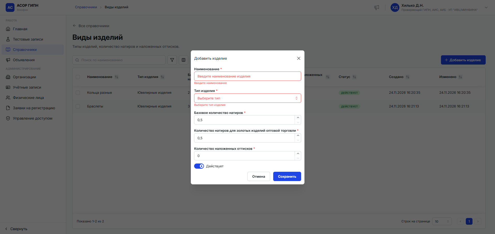

# ИНТЕРФЕЙСНЫЕ ТРЕБОВАНИЯ {#ui}

## UI-PT-001. Форма вида изделий {#ui-pt-001 .collapsed}

- **Использует**: [F-PT][], [DR-PT-CREATE-001][], [DR-PT-UPDATE-001][], [UI-G-FORM-001][], [UI-G-TOAST-001][]
- **Используется в**: [FR-PT-CREATE-003][], [FR-PT-UPDATE-003][], [FR-PT-ACTIVATION-002][], [UC-PT-006][],
[UC-PT-007][], [UC-PT-008][]
- **Описание**: Модальная форма записи [UI-G-FORM-001][] для справочника видов изделий. Одно окно работает в двух
режимах: создание ([SF-PT-CREATE][]) и изменение ([SF-PT-UPDATE][]). Здесь — поля, проверки и тексты справочника;
вид окна, ошибки, кнопки, отправка и закрытие — по [UI-G-FORM-001][]; особенности режима — в [FR-PT-CREATE-003][] и
[FR-PT-UPDATE-003][].
- **Показатели (NFR)**: По [UI-G-FORM-001][].

Атрибуты `data-testid` строятся по общим правилам [NFR-005][] с приставкой `pt`.



### Режимы {#ui-pt-001-modes .collapsed}

| Свойство | Создание | Изменение |
| :--- | :--- | :--- |
| `data-mode` окна | `create` | `update` |
| Заголовок | Добавить изделие | Изменить изделие |
| Как открывается | Кнопка «Добавить изделие» | Клик по строке списка |
| Значения при открытии | Значения по умолчанию | Данные записи из [AR-PT-READ-001][] |
| Запрос при сохранении | [AR-PT-CREATE-001][] | [AR-PT-UPDATE-001][] |
| Уведомление об успехе | Готово · Изделие добавлено. | Готово · Изделие сохранено. |
| Описано в | [FR-PT-CREATE-003][] | [FR-PT-UPDATE-003][] |

### Окно {#ui-pt-001-modal .collapsed}

Окно `pt-form-modal`, заголовок `pt-form-title`, крестик `pt-form-close`, скелетон `pt-form-loading` — по
[UI-G-FORM-001][].

### Поля {#ui-pt-001-fields .collapsed}

Поля в порядке таблицы. Обязательны все поля, кроме переключателя статуса: у него всегда есть значение. Общие
правила полей — по [UI-G-FORM-001][].

| Подпись | `data-testid` | Компонент |
| :--- | :--- | :--- |
| Наименование | `pt-form-name` | TextInput |
| Тип изделия | `pt-form-product-group` | Select |
| Базовое количество натиров | `pt-form-default-streak-count` | NumberInput |
| Количество натиров для золотых изделий оптовой торговли | `pt-form-wholesale-gold-streak-count` | NumberInput |
| Количество наложенных оттисков | `pt-form-stamp-impressions-count` | NumberInput |
| Статус (подпись «Действует») | `pt-form-is-active` | Switch |

Каждое поле получает атрибут `data-field` с именем поля API (`name_nominative`, `product_group`,
`default_streak_count`, `wholesale_gold_streak_count`, `stamp_impressions_count`, `is_active`); тот же `data-field`
получают стрелки поля и текст его ошибки.

- **Наименование**: плейсхолдер «Введите наименование изделия»; ввод не длиннее 150 символов (лишние символы не
  вводятся); при открытии окна поле в фокусе.
- **Тип изделия**: плейсхолдер «Выберите тип»; пункты — `pt-form-option` с `data-value` в порядке «Ювелирные
  изделия» (`JEWELRY`), «Весовые изделия» (`WEIGHT_PRODUCTS`), «Часовые корпуса» (`WATCH_CASES`).
- **Числовые поля**: стрелки `pt-form-step-up` и `pt-form-step-down` с `data-field`; шаг и границы — в таблице.

| Поле | Шаг стрелок | Стрелка «вниз» недоступна | Стрелка «вверх» недоступна |
| :--- | :--- | :--- | :--- |
| Базовое количество натиров | 0,5 | Значение ≤ 0,5 | Значение + 0,5 > 999,99 |
| Количество натиров для золотых изделий оптовой торговли | 0,5 | Значение ≤ 0,5 | Значение + 0,5 > 999,99 |
| Количество наложенных оттисков | 1 | Значение ≤ 1 | — |

- **Статус**: переключатель под числовыми полями с подписью «Действует»; правила статуса — в [SF-PT-ACTIVATION][].

### Ошибки полей {#ui-pt-001-errors .collapsed}

Перед отправкой форма проверяет поля по перечню [FR-PT-001][] и показывает в `pt-form-error` текст из его столбца
«Текст под полем формы». Поэтому ответ `400` при работе через форму не ожидается; если он пришёл — по
[UI-G-FORM-001][].

### Кнопки и ответы {#ui-pt-001-buttons .collapsed}

Кнопки `pt-form-cancel` и `pt-form-submit`, состояние отправки, закрытие окна и общие ответы — по [UI-G-FORM-001][].
Запрос: наименование без пробелов по краям, количества — JSON-числами с точкой, статус — в `is_active`.

| Ответ | Что делает система |
| :--- | :--- |
| `409` `DUPLICATE_PRODUCT_TYPE` | Показывает под наименованием «Изделие с таким наименованием и типом уже существует» |
| `500`, нет связи | Уведомление «Ошибка»: «Не удалось сохранить изделие. Повторите попытку.»; данные в форме |

После успешного сохранения окно закрывается, показывается уведомление режима, список перезагружается с текущими
поиском, фильтрами, сортировкой и страницей ([FR-PT-LIST-005][]).

### Критерии приёмки (AC) {#ui-pt-001-ac .collapsed}

Общее поведение формы проверяется сценариями [UI-G-FORM-001][]; ниже — поля и тексты справочника в режиме
создания. Режим изменения подтверждает [FR-PT-UPDATE-003][].

```gherkin
# language: ru
@UI-PT-001 @ui
Функционал: Форма вида изделий

  Предыстория:
    Дано в справочнике записи из файла "PT.fixture.json"
    И пользователь с ролью "ais" открыл экран "Виды изделий"
    И открыта форма создания

  Сценарий: Сохранение с незаполненными обязательными полями
    Когда пользователь нажимает "pt-form-submit"
    Тогда виден "pt-form-error" с data-field "name_nominative" и текстом "Введите наименование"
    И виден "pt-form-error" с data-field "product_group" и текстом "Выберите тип изделия"
    И у "pt-form-name" aria-invalid "true" и фокус на "pt-form-name"
    И запрос сохранения не отправлялся
    И "pt-form-modal" открыт

  Структура сценария: Проверка числового поля на клиенте
    Дано наименование "Подвески" и тип "Ювелирные изделия" заполнены
    Когда пользователь вводит "<значение>" в "<поле>" и нажимает "pt-form-submit"
    Тогда виден "pt-form-error" с data-field "<data-field>" и текстом "<текст>"
    И запрос сохранения не отправлялся

    Примеры:
      | поле                            | data-field              | значение | текст                                 |
      | pt-form-default-streak-count    | default_streak_count    | 0,555    | Не более 2 знаков после запятой       |
      | pt-form-default-streak-count    | default_streak_count    | 1000     | Значение должно быть не больше 999,99 |
      | pt-form-stamp-impressions-count | stamp_impressions_count | 0        | Значение должно быть больше 0         |
      | pt-form-stamp-impressions-count | stamp_impressions_count | 1,5      | Введите целое число                   |

  Сценарий: Стрелки меняют значение на шаг
    Когда пользователь нажимает "pt-form-step-up" с data-field "default_streak_count" два раза
    Тогда "pt-form-default-streak-count" содержит "1,5"
    И "pt-form-step-down" с data-field "default_streak_count" доступна

  Сценарий: Переключатель статуса
    Когда пользователь нажимает на подпись "Действует"
    Тогда "pt-form-is-active" имеет aria-checked "false"

  Сценарий: Запись с таким наименованием и типом уже существует
    Когда пользователь вводит "кольца разные" в "pt-form-name"
    И выбирает "Ювелирные изделия" в "pt-form-product-group"
    И нажимает "pt-form-submit"
    Тогда API отвечает кодом 409
    И виден "pt-form-error" с data-field "name_nominative" и текстом
      "Изделие с таким наименованием и типом уже существует"
    И "pt-form-modal" открыт, введённые данные сохранены

  Сценарий: Внутренняя ошибка при сохранении
    Дано API сохранения отвечает кодом 500
    И поля формы заполнены корректно
    Когда пользователь нажимает "pt-form-submit"
    Тогда виден "toast" с заголовком "Ошибка" и текстом "Не удалось сохранить изделие. Повторите попытку."
    И "pt-form-modal" открыт, введённые данные сохранены
```

Вопрос о подтверждении закрытия формы с изменёнными данными перенесён в [UI-G-FORM-001][] (`UI-G-FORM-001.Q01`).


[F-PT]: <index.md#f-pt>
[DR-PT-CREATE-001]: <sf-create/dr.md#dr-pt-create-001>
[DR-PT-UPDATE-001]: <sf-update/dr.md#dr-pt-update-001>
[NFR-005]: <../../global/nfr.md#nfr-005>
[FR-PT-LIST-005]: <sf-list/fr.md#fr-pt-list-005>
[SF-PT-CREATE]: <sf-create/index.md#sf-pt-create>
[SF-PT-UPDATE]: <sf-update/index.md#sf-pt-update>
[SF-PT-ACTIVATION]: <sf-activation/index.md#sf-pt-activation>
[FR-PT-CREATE-003]: <sf-create/fr.md#fr-pt-create-003>
[FR-PT-UPDATE-003]: <sf-update/fr.md#fr-pt-update-003>
[FR-PT-ACTIVATION-002]: <sf-activation/fr.md#fr-pt-activation-002>
[AR-PT-CREATE-001]: <sf-create/fr.md#ar-pt-create-001>
[AR-PT-READ-001]: <sf-read/fr.md#ar-pt-read-001>
[AR-PT-UPDATE-001]: <sf-update/fr.md#ar-pt-update-001>
[UC-PT-006]: <uc.md#uc-pt-006>
[UC-PT-007]: <uc.md#uc-pt-007>
[UC-PT-008]: <uc.md#uc-pt-008>
[FR-PT-001]: <fr.md#fr-pt-001>
[UI-G-FORM-001]: <../../global/sf-g-form/ui.md#ui-g-form-001>
[UI-G-TOAST-001]: <../../global/sf-g-toast/ui.md#ui-g-toast-001>
