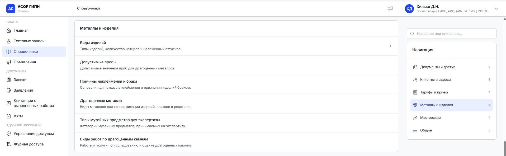
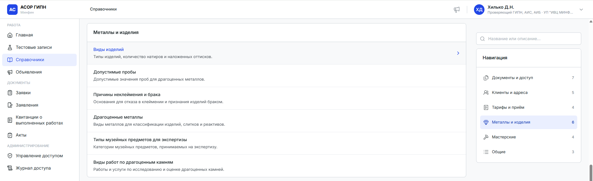

# ИНТЕРФЕЙСНЫЕ ТРЕБОВАНИЯ {#ui}

## UI-G-CATALOG-001. Экран каталога справочников {#ui-g-catalog-001 .collapsed}

- **Использует**: [SF-G-CATALOG][], [NFR-002][], [NFR-005][], [дизайн-система][design-system] (ListCard, NavCard,
TextInput, EmptyState)
- **Используется в**: [FR-PT-LIST-005][], [UI-G-DICT-001][]
- **Описание**: Экран «Справочники» показывает справочники карточками групп, ищет справочник по названию или
описанию и переводит в выбранный справочник.
- **Условие**: Пользователь аутентифицирован и выбрал пункт «Справочники» в меню.
- **Результат**: Пользователь находит справочник и открывает его экран.
- **Показатели (NFR)**: Экран и результат поиска показываются без запроса к API не позже 100 мс; соответствие
[NFR-002][].

### Макеты {#ui-g-catalog-001-mockups .collapsed}

Источник — скриншоты справочника видов изделий «01-Переход к справочнику-01…02».





### Элементы {#ui-g-catalog-001-elements .collapsed}

- **Экран** — `dict-catalog`
    - Адрес `/dictionaries`, хлебные крошки `app-breadcrumbs` — «Справочники» (текущая страница). Слева — карточки
      групп, справа — колонка шириной 248px с поиском и навигацией, закреплённая при прокрутке.
- **Карточка группы** — `dict-catalog-group` с `data-group`
    - ListCard: шапка с названием группы (`card-title`) и разделителем, ниже — пункты справочников группы в порядке
      перечня каталога.
- **Пункт справочника** — `dict-catalog-item-<справочник>` (например, `dict-catalog-item-product-type`)
    - Строка ListCard: название (14px, 500) и описание (`text-secondary`) в одно предложение. Вся строка — ссылка на
      экран справочника.
    - Наведение и фокус: фон `gray-0`, название цвета `accent`, справа шеврон `chevron-right`.
- **Поиск** — `dict-catalog-search`
    - TextInput с иконкой `search`, плейсхолдер и `aria-label` «Название или описание…».
- **Навигация** — `dict-catalog-nav`
    - NavCard с заголовком «Навигация»; пункт — `dict-catalog-nav-item` с `data-group`: иконка группы, название
      и справа количество справочников группы (`dict-catalog-nav-count`, `text-muted`). Активный пункт — фон
      `bg-nav-active`, текст и количество `accent`.
- **Ничего не найдено** — `dict-catalog-not-found`
    - EmptyState вместо карточек: иконка `search`, заголовок «Ничего не найдено», пояснение «Измените запрос.».

### Поведение (UX) {#ui-g-catalog-001-ux .collapsed}

1. Нажатие на пункт справочника или Enter на нём открывает экран справочника.
2. Поиск фильтрует пункты по мере ввода: остаются пункты, у которых название или описание содержит строку без учёта
   регистра (правила сравнения — [SF-G-SEARCH][]); группы без найденных пунктов скрываются, счётчики навигации
   показывают найденное количество. Крестик и Esc очищают поиск.
3. Нажатие на пункт навигации прокручивает экран к карточке группы и делает пункт активным (см. `H03`); при ручной
   прокрутке активным становится пункт группы, карточка которой вверху экрана.
4. Возврат из справочника ссылкой «Все справочники» открывает каталог с прокруткой к группе этого справочника.

### Критерии приёмки (AC) {#ui-g-catalog-001-ac .collapsed}

```gherkin
# language: ru
@UI-G-CATALOG-001 @SF-G-CATALOG @ui
Функционал: Экран каталога справочников

  Предыстория:
    Дано пользователь с ролью "ais" открыл экран "Справочники"

  Сценарий: Пункт справочника
    Тогда "dict-catalog-group" с data-group "metals" содержит "dict-catalog-item-product-type"
    И "dict-catalog-item-product-type" содержит "Виды изделий" и
      "Типы изделий, количество натиров и наложенных оттисков."

  Сценарий: Переход в справочник
    Когда пользователь нажимает "dict-catalog-item-product-type"
    Тогда открыт адрес "/dictionaries/product-types"
    И "app-breadcrumbs" содержит "Справочники" и "Виды изделий"

  Сценарий: Поиск по описанию
    Когда пользователь вводит "натиров" в "dict-catalog-search"
    Тогда виден "dict-catalog-item-product-type"
    И "dict-catalog-nav-count" в пункте "Металлы и изделия" содержит "1"

  Сценарий: Ничего не найдено
    Когда пользователь вводит "Диадема" в "dict-catalog-search"
    Тогда виден "dict-catalog-not-found"
    Когда пользователь нажимает Esc в "dict-catalog-search"
    Тогда нет "dict-catalog-not-found"

  Сценарий: Навигация по группам
    Когда пользователь нажимает "dict-catalog-nav-item" с data-group "metals"
    Тогда карточка "Металлы и изделия" вверху экрана и пункт навигации активен

  @NFR @a11y
  Сценарий: Переход с клавиатуры
    Когда пользователь переводит фокус на "dict-catalog-item-product-type" и нажимает Enter
    Тогда открыт адрес "/dictionaries/product-types"
```

### Допущения {#ui-g-catalog-001-assumptions .collapsed}

- **UI-G-CATALOG-001.H01**
    - **Статус**: требует подтверждения
    - **Подтверждает**: архитектор
    - **Допущение**: Перечень групп и справочников задаётся конфигурацией интерфейса, а не загружается из API;
      идентификаторы групп (`metals` и другие) задаёт тот же перечень.
- **UI-G-CATALOG-001.H02**
    - **Статус**: требует подтверждения
    - **Подтверждает**: владелец продукта
    - **Допущение**: Справочник, на просмотр которого у пользователя нет прав, в каталоге не показывается и не входит
      в счётчик группы.
- **UI-G-CATALOG-001.H03**
    - **Статус**: требует подтверждения
    - **Подтверждает**: владелец продукта
    - **Допущение**: Навигация прокручивает экран к группе, а не показывает только её карточку; на скриншоте видна
      одна группа, и это может быть фильтр.


[SF-G-CATALOG]: <index.md#sf-g-catalog>
[SF-G-SEARCH]: <../sf-g-search/index.md#sf-g-search>
[UI-G-DICT-001]: <../sf-g-dict/ui.md#ui-g-dict-001>
[NFR-002]: <../nfr.md#nfr-002>
[NFR-005]: <../nfr.md#nfr-005>
[design-system]: <../design-system/index.md>
[FR-PT-LIST-005]: <../../dict-product-type/sf-list/fr.md#fr-pt-list-005>
