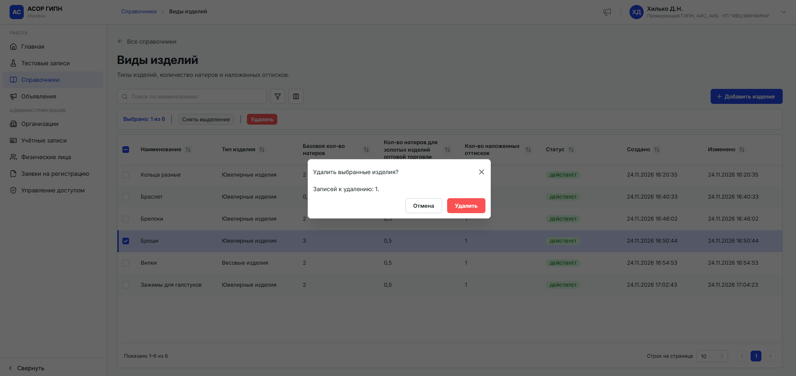
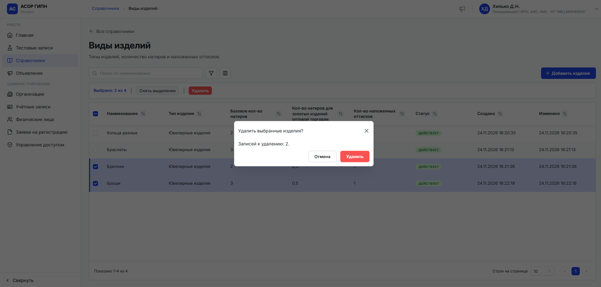
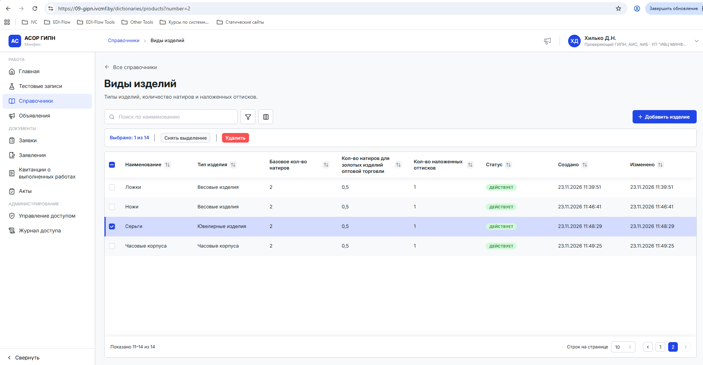
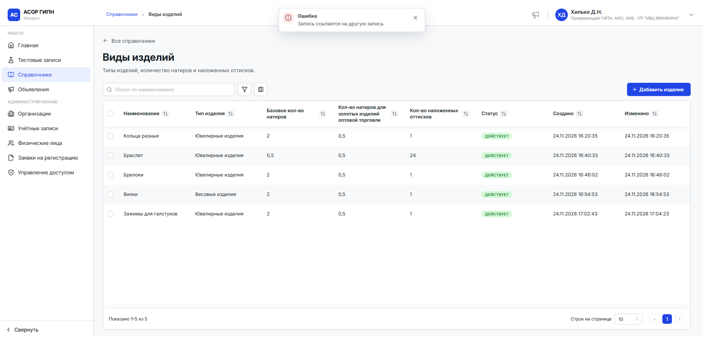
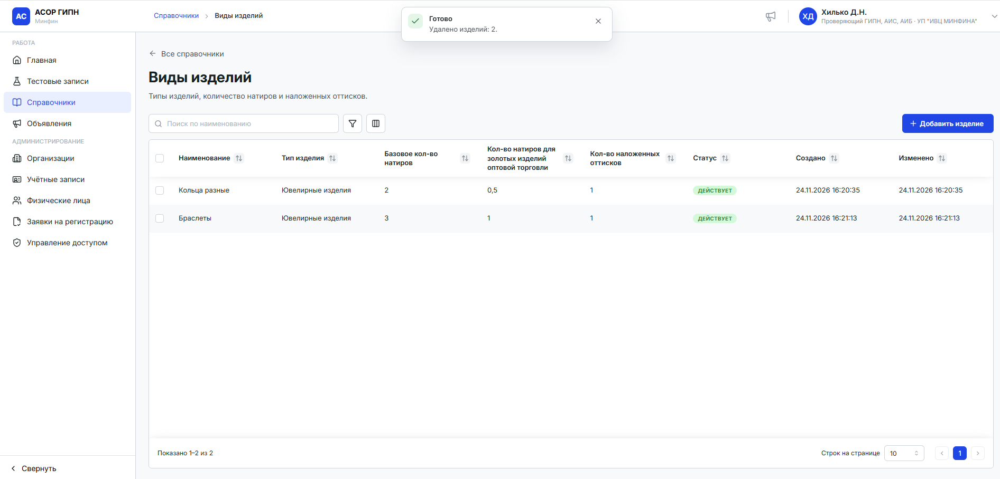

# ИНТЕРФЕЙСНЫЕ ТРЕБОВАНИЯ {#ui}

Критерии приёмки проверяются на каждом действии, которое подключает функциональность. Эталонная реализация —
удаление видов изделий (приставка `data-testid` `pt`, действие `delete`) с [тестовым набором][fixture].

## UI-G-CONFIRM-001. Окно подтверждения {#ui-g-confirm-001 .collapsed}

- **Использует**: [SF-G-CONFIRM][], [UI-G-TOAST-001][], [UI-G-SESSION-001][], [NFR-002][], [NFR-005][],
[дизайн-система][design-system] (Modal, Button)
- **Используется в**: [FR-PT-DELETE-003][]
- **Описание**: Модальное окно спрашивает подтверждение необратимого действия, отправляет запрос после согласия и
закрывается по результату.
- **Условие**: Пользователь нажал элемент, который по FR функциональности запускает подтверждаемое действие.
- **Результат**: Действие выполняется только после нажатия кнопки подтверждения; при отмене данные не меняются.
- **Показатели (NFR)**:
    - Окно открывается не позже 100 мс после нажатия, без запроса к API.
    - Повторные нажатия кнопки подтверждения во время отправки не отправляют повторных запросов.
    - Соответствие [NFR-002][]: фокус удерживается в окне, Esc закрывает окно.

### Макеты {#ui-g-confirm-001-mockups .collapsed}

Источник — скриншоты справочника видов изделий «02-Список видов изделий-08-Удаление записи из списка-02…04» и
«-09-Массовое удаление записи из списка (2 записи)-01…02».











### Элементы {#ui-g-confirm-001-elements .collapsed}

- **Окно** — `<p>-<действие>-modal`
    - Modal шириной `modal-width` (440px): фон `bg-surface`, скругление `radius-md`, тень `shadow-lg`, подложка
      `overlay`; `role="alertdialog"`, `aria-modal="true"`, `aria-labelledby` и `aria-describedby` ссылаются на
      заголовок и текст.
- **Заголовок** — `<p>-<действие>-title`
    - Вопрос из FR функциональности («Удалить выбранные изделия?»), стиль `modal-title`.
- **Текст** — `<p>-<действие>-text`
    - Последствие с числом записей («Записей к удалению: N.»), стиль `body`.
- **Закрыть** — `<p>-<действие>-close`
    - IconButton с иконкой `x` в правом верхнем углу, `aria-label` «Закрыть».
- **Отмена** — `<p>-<действие>-cancel`
    - Button Default «Отмена»; при открытии окна в фокусе (см. `H01`).
- **Подтвердить** — `<p>-<действие>-confirm`
    - Button Danger (заливка `danger-fill`) с подписью действия («Удалить»), справа от «Отмена».

### Поведение (UX) {#ui-g-confirm-001-ux .collapsed}

1. Крестик, «Отмена», Esc и клик по подложке закрывают окно без действия; выделение и данные экрана сохраняются,
   фокус возвращается на элемент, которым окно открыли.
2. Кнопка подтверждения отправляет запрос функциональности. Во время отправки она недоступна и показывает индикатор
   загрузки, «Отмена» и «Закрыть» недоступны, Esc не действует.
3. По ответу окно закрывается всегда, кроме `401`:
    - успех — уведомление «Готово» с текстом функциональности ([UI-G-TOAST-001][]), список перезагружается;
    - отказ (`403`, `409`) — уведомление «Ошибка» с текстом функциональности, данные экрана и выделение сохраняются;
    - `500` или нет связи — уведомление «Ошибка» «Не удалось <выполнить действие>. Повторите попытку.»;
    - `401` — по правилам истёкшей сессии ([UI-G-SESSION-001][]).

### Критерии приёмки (AC) {#ui-g-confirm-001-ac .collapsed}

```gherkin
# language: ru
@UI-G-CONFIRM-001 @SF-G-CONFIRM @ui
Функционал: Окно подтверждения

  Предыстория:
    Дано в справочнике видов изделий записи из файла "PT.fixture.json"
    И пользователь с ролью "ais" открыл экран "Виды изделий"
    И выделены строки "Брелоки" и "Броши"

  Сценарий: Открытие окна
    Когда пользователь нажимает "pt-selection-delete"
    Тогда виден "pt-delete-modal" с role "alertdialog" и aria-modal "true"
    И фокус на "pt-delete-cancel"
    И запрос к API не отправлялся

  Структура сценария: Закрытие без действия
    Дано открыто окно подтверждения удаления
    Когда пользователь <действие>
    Тогда "pt-delete-modal" закрыт и фокус на "pt-selection-delete"
    И запрос удаления не отправлялся
    И "pt-selection-count" содержит текст "Выбрано: 2 из 15"

    Примеры:
      | действие                    |
      | нажимает "pt-delete-cancel" |
      | нажимает "pt-delete-close"  |
      | нажимает Esc                |
      | кликает по подложке окна    |

  Сценарий: Отказ закрывает окно и сохраняет выделение
    Дано API удаления отвечает кодом 500
    И открыто окно подтверждения удаления
    Когда пользователь нажимает "pt-delete-confirm"
    Тогда "pt-delete-modal" закрыт
    И виден "toast" с data-type "error"
    И "pt-selection-count" содержит текст "Выбрано: 2 из 15"

  @NFR
  Сценарий: Двойное нажатие не отправляет повторный запрос
    Дано ответ API удаления задерживается на 1 с
    И открыто окно подтверждения удаления
    Когда пользователь дважды быстро нажимает "pt-delete-confirm"
    Тогда отправлен ровно один запрос удаления
    И во время отправки "pt-delete-confirm", "pt-delete-cancel" и "pt-delete-close" недоступны

  @NFR @a11y
  Сценарий: Доступность окна
    Дано открыто окно подтверждения удаления
    Тогда проверка axe-core внутри "pt-delete-modal" не находит нарушений уровней A и AA
    И нажатия Tab не выводят фокус за пределы "pt-delete-modal"
```

### Допущения {#ui-g-confirm-001-assumptions .collapsed}

- **UI-G-CONFIRM-001.H01**
    - **Статус**: требует подтверждения
    - **Подтверждает**: владелец продукта
    - **Допущение**: При открытии окна фокус стоит на «Отмена», чтобы случайное нажатие Enter не выполнило
      необратимое действие.


[fixture]: <../../dict-product-type/fr.md#fr-pt-fixture>
[SF-G-CONFIRM]: <index.md#sf-g-confirm>
[UI-G-TOAST-001]: <../sf-g-toast/ui.md#ui-g-toast-001>
[UI-G-SESSION-001]: <../sf-g-session/ui.md#ui-g-session-001>
[NFR-002]: <../nfr.md#nfr-002>
[NFR-005]: <../nfr.md#nfr-005>
[design-system]: <../design-system/index.md>
[FR-PT-DELETE-003]: <../../dict-product-type/sf-delete/fr.md#fr-pt-delete-003>
