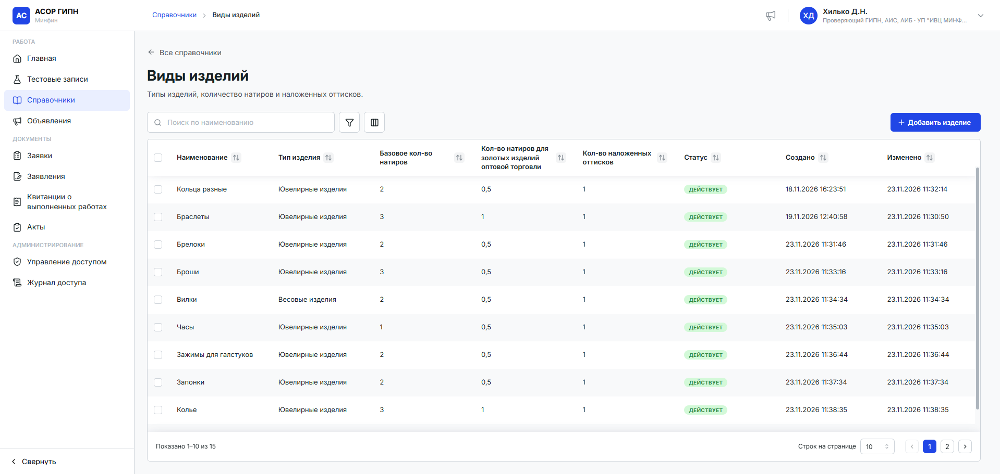
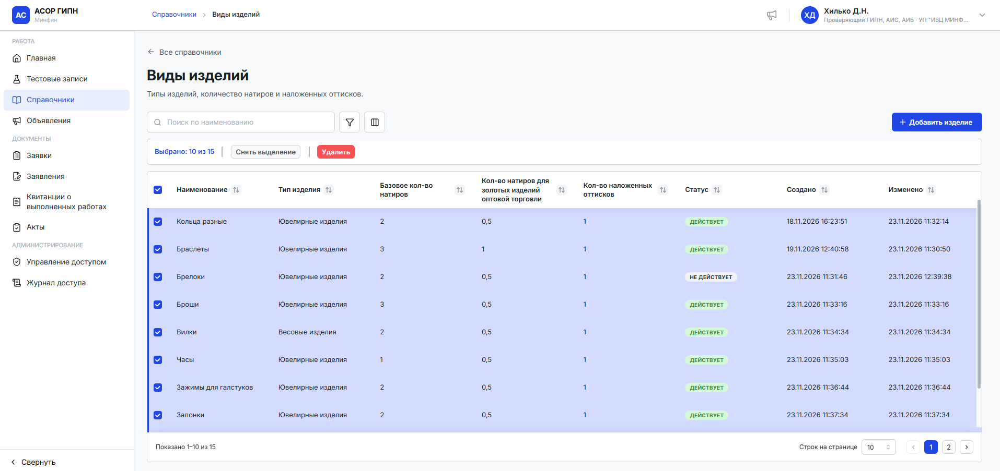

# ИНТЕРФЕЙСНЫЕ ТРЕБОВАНИЯ {#ui}

Критерии приёмки проверяются на каждом справочнике, который использует шаблон. Эталонная реализация — справочник
видов изделий (приставка `data-testid` `pt`) с [тестовым набором][fixture].

## UI-G-DICT-001. Экран справочника {#ui-g-dict-001 .collapsed}

- **Использует**: [SF-G-DICT][], [UI-G-CATALOG-001][], [UI-G-TABLE-001][], [UI-G-TABLE-002][], [UI-G-PAG-001][],
[UI-G-SORT-001][], [UI-G-SEARCH-001][], [UI-G-FILTER-001][], [UI-G-FILTER-002][], [UI-G-COLUMNS-001][],
[UI-G-SELECT-001][], [UI-G-FORM-001][], [NFR-002][], [NFR-005][], [дизайн-система][design-system] (PageHeader,
Toolbar, Button)
- **Используется в**: [FR-PT-LIST-005][]
- **Описание**: Экран справочника показывает заголовок, панель инструментов и таблицу записей с пагинацией;
элементы управления собраны из глобальных функциональностей в постоянном порядке.
- **Условие**: Пользователь аутентифицирован, его роль разрешена для просмотра справочника; экран открыт из
каталога ([UI-G-CATALOG-001][]) или по адресу.
- **Результат**: Пользователь видит первую страницу записей в порядке по умолчанию и элементы управления списком;
действия над записями видны только ролям, которым они разрешены.
- **Показатели (NFR)**:
    - Скелетон таблицы появляется не позже 100 мс после перехода на экран.
    - Таблица заполнена данными не позже 2 с после перехода при ответе API в пределах показателя справочника.
    - Минимальная ширина окна — 1280px, мобильная версия не предусмотрена; соответствие [NFR-002][].

### Макеты {#ui-g-dict-001-mockups .collapsed}

Источник — скриншоты справочника видов изделий «02-Список видов изделий-01-Есть записи» и «-05-Выделение
записей-04».





### Раскладка {#ui-g-dict-001-layout .collapsed}

Блоки сверху вниз:

| № | Блок | Требование |
| :--- | :--- | :--- |
| 1 | Хлебные крошки шапки: «Справочники» › название справочника | Этот раздел |
| 2 | Заголовок страницы: ссылка «Все справочники», заголовок, описание | Этот раздел |
| 3 | Панель инструментов: поиск, фильтры, столбцы, кнопка создания | См. «Элементы» и подключаемые UI-G |
| 4 | Строка чипов фильтров (при применённых фильтрах) | [UI-G-FILTER-002][] |
| 5 | Панель выделения (при выделенных строках) | [UI-G-SELECT-001][] |
| 6 | Таблица и её состояния | [UI-G-TABLE-001][], [UI-G-TABLE-002][], [UI-G-SORT-001][] |
| 7 | Футер таблицы с пагинацией | [UI-G-PAG-001][] |

Окна поверх экрана: форма записи ([UI-G-FORM-001][]) и подтверждение удаления ([UI-G-CONFIRM-001][]).

### Элементы {#ui-g-dict-001-elements .collapsed}

- **Адрес экрана**: `/dictionaries/<справочник>`; условия списка — в параметрах адреса с именами параметров API
  (см. `H01`).
- **Хлебные крошки** — `app-breadcrumbs`: «Справочники» — ссылка на каталог, название справочника — текущая
  страница, не ссылка.
- **Ссылка «Все справочники»** — `<p>-list-back-link`: иконка `arrow-left` 16px и текст, стиль `body`, цвет
  `text-secondary`; переход в каталог, условия списка не сохраняются.
- **Заголовок** — `<p>-list-title`: название справочника, стиль `page-title`, единственный `<h1>` экрана.
- **Описание** — `<p>-list-description`: то же описание, что в каталоге; стиль `body`, цвет `text-secondary`.
- **Панель инструментов** — `<p>-list-toolbar`: слева поле поиска, кнопки фильтров и столбцов; справа — кнопка
  создания.
- **Кнопка создания** — `<p>-list-create-button`: Button Primary `control-md`, иконка `plus` слева, текст
  «Добавить <объект>». Видна только ролям с правом создания, для остальных не выводится в DOM. Открывает форму
  создания; после успешного создания список перезагружается с текущими условиями.

### Что задаёт справочник {#ui-g-dict-001-checklist .collapsed}

- Название, описание, идентификатор для адреса и `data-testid` каталога, приставка `data-testid` экрана.
- Матрица прав: роли просмотра, создания, изменения, удаления.
- Сущность и поля (DR), проверки и тексты ошибок полей, правило уникальности, правило использования записи.
- Столбцы таблицы и их форматы; порядок по умолчанию; сортируемые поля и особые правила сравнения.
- Поле поиска; поля фильтра с видами условий; столбцы, которые можно скрыть.
- Поля формы, значения по умолчанию, шаги стрелок; тексты кнопки создания, заголовков формы и уведомлений.
- Объект в текстах «Нет доступа», подтверждения удаления и ошибок («изделия», «пробы»).
- Отклонения от шаблона, если они есть, с обоснованием.

### Критерии приёмки (AC) {#ui-g-dict-001-ac .collapsed}

```gherkin
# language: ru
@UI-G-DICT-001 @SF-G-DICT @ui
Функционал: Экран справочника

  Предыстория:
    Дано в справочнике видов изделий записи из файла "PT.fixture.json"
    И пользователь с ролью "ais" открыл экран "Виды изделий"

  Сценарий: Раскладка экрана
    Тогда сверху вниз видны "app-breadcrumbs", "pt-list-back-link", "pt-list-title", "pt-list-description",
      "pt-list-toolbar", "pt-list-table", "pt-pagination"
    И на экране один заголовок h1

  Сценарий: Возврат в каталог
    Когда пользователь нажимает "pt-list-back-link"
    Тогда открыт экран "Справочники"

  Сценарий: Кнопка создания только для роли с правом создания
    Тогда виден "pt-list-create-button"
    Когда пользователь с ролью "pko" открывает экран "Виды изделий"
    Тогда на экране нет "pt-list-create-button"

  @NFR @performance
  Сценарий: Время отображения
    Дано в справочнике видов изделий 10 000 записей
    Когда пользователь открывает экран "Виды изделий"
    Тогда "pt-list-skeleton" появляется не позже 100 мс после перехода
    И строки "pt-list-row" появляются не позже 2 с после перехода

  @NFR @a11y
  Сценарий: Доступность экрана
    Тогда проверка axe-core не находит нарушений уровней A и AA
```

### Допущения {#ui-g-dict-001-assumptions .collapsed}

- **UI-G-DICT-001.H01**
    - **Статус**: требует подтверждения
    - **Подтверждает**: архитектор
    - **Допущение**: Адрес экрана справочника — `/dictionaries/<справочник>`, условия списка хранятся в параметрах
      адреса с теми же именами, что в API. На скриншоте адрес `/dictionaries/products?number=2` — рабочий макет.


[fixture]: <../../dict-product-type/fr.md#fr-pt-fixture>
[SF-G-DICT]: <index.md#sf-g-dict>
[UI-G-CATALOG-001]: <../sf-g-catalog/ui.md#ui-g-catalog-001>
[UI-G-TABLE-001]: <../sf-g-table/ui.md#ui-g-table-001>
[UI-G-TABLE-002]: <../sf-g-table/ui.md#ui-g-table-002>
[UI-G-PAG-001]: <../sf-g-pag/ui.md#ui-g-pag-001>
[UI-G-SORT-001]: <../sf-g-sort/ui.md#ui-g-sort-001>
[UI-G-SEARCH-001]: <../sf-g-search/ui.md#ui-g-search-001>
[UI-G-FILTER-001]: <../sf-g-filter/ui.md#ui-g-filter-001>
[UI-G-FILTER-002]: <../sf-g-filter/ui.md#ui-g-filter-002>
[UI-G-COLUMNS-001]: <../sf-g-columns/ui.md#ui-g-columns-001>
[UI-G-SELECT-001]: <../sf-g-select/ui.md#ui-g-select-001>
[UI-G-FORM-001]: <../sf-g-form/ui.md#ui-g-form-001>
[UI-G-CONFIRM-001]: <../sf-g-confirm/ui.md#ui-g-confirm-001>
[NFR-002]: <../nfr.md#nfr-002>
[NFR-005]: <../nfr.md#nfr-005>
[design-system]: <../design-system/index.md>
[FR-PT-LIST-005]: <../../dict-product-type/sf-list/fr.md#fr-pt-list-005>
