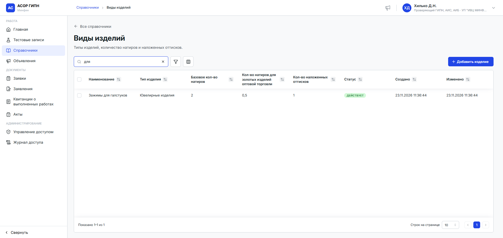

# ИНТЕРФЕЙСНЫЕ ТРЕБОВАНИЯ {#ui}

Критерии приёмки проверяются на каждом списке, который подключает функциональность. Эталонная реализация —
справочник видов изделий (`GET /api/v1/product-types`, поиск по наименованию, экран «Виды изделий», приставка
`data-testid` `pt`) с [тестовым набором][fixture].

## UI-G-SEARCH-001. Поле поиска {#ui-g-search-001 .collapsed}

- **Использует**: [SF-G-SEARCH][], [FR-G-SEARCH-001][], [NFR-005][], [дизайн-система][design-system] (TextInput,
EmptyState)
- **Используется в**: [FR-PT-LIST-006][]
- **Описание**: Поле на панели инструментов списка ищет записи по мере ввода; если ничего не найдено, таблица
сообщает об этом и предлагает сбросить условия.
- **Условие**: Открыт экран со списком, который подключает [SF-G-SEARCH][].
- **Результат**: Таблица показывает только записи, найденные по строке поиска, с учётом фильтров и сортировки.
- **Показатели (NFR)**:
    - Запрос отправляется через 300 мс после последнего изменения строки; при непрерывном вводе — не больше одного
      запроса на паузу 300 мс.
    - Результат показывается не позже 1 с после паузы ввода при ответе API в пределах показателя функциональности.

### Макет {#ui-g-search-001-mockups .collapsed}

Источник — скриншот справочника видов изделий «02-Список видов изделий-06-Поиск по вхождению».



### Элементы {#ui-g-search-001-elements .collapsed}

- **Поле поиска** — `<p>-list-search`
    - Компонент TextInput (вариант поиска): высота `control-lg`, ширина 360px, иконка `search` слева, рамка
      `border`, при фокусе — `accent`.
    - Плейсхолдер и `aria-label` — «Поиск по <полю>», поле задаёт функциональность (у видов изделий — «Поиск по
      наименованию»).
    - Ввод не длиннее 150 символов (или предела функциональности): лишние символы не вводятся.
- **Очистить поиск** — `<p>-list-search-clear`
    - Иконка `x` справа в поле, видна только при непустом поле, `aria-label` «Очистить поиск».
- **Ничего не найдено** — `<p>-list-not-found`
    - EmptyState в теле таблицы: иконка `search` 28px, заголовок «Ничего не найдено», пояснение «Измените условия
      поиска или сбросьте фильтры.»; сводка пагинации «Показано 0–0 из 0».
- **Сбросить все** — `<p>-list-not-found-reset`
    - Button Outline в заглушке: очищает поиск и снимает все фильтры одним запросом.

### Поведение (UX) {#ui-g-search-001-ux .collapsed}

1. Поиск запускается без кнопки «Найти», через 300 мс после последнего изменения строки. Строка обрезается по
   краям; пустая после обрезки строка снимает поиск.
2. Крестик очищает поле, сразу снимает поиск и оставляет фокус в поле; клавиша Esc в поле действует так же.
3. Изменение поиска загружает первую страницу ([SF-G-PAG][]), сохраняет фильтры и сортировку и снимает выделение.
4. Строка поиска отражается в адресе экрана параметром `search`.
5. Заглушка «Ничего не найдено» показывается, когда `total` = 0 и задан поиск или фильтр; если условий нет, а
   записей нет, экран показывает состояние «Записей пока нет» функциональности.

### Критерии приёмки (AC) {#ui-g-search-001-ac .collapsed}

```gherkin
# language: ru
@UI-G-SEARCH-001 @SF-G-SEARCH @ui
Функционал: Поле поиска

  Предыстория:
    Дано в справочнике видов изделий записи из файла "PT.fixture.json"
    И пользователь с ролью "ais" открыл экран "Виды изделий"

  Сценарий: Поиск по мере ввода
    Когда пользователь вводит "для" в "pt-list-search"
    Тогда в таблице одна строка — "Зажимы для галстуков"
    И "pt-pagination-summary" содержит текст "Показано 1–1 из 1"
    И виден "pt-list-search-clear"
    И адрес экрана содержит "search=для"

  Сценарий: Очистка поиска
    Дано пользователь ввёл "для" в "pt-list-search"
    Когда пользователь нажимает "pt-list-search-clear"
    Тогда "pt-list-search" пустое и в фокусе
    И "pt-pagination-summary" содержит текст "Показано 1–10 из 15"

  Сценарий: Esc очищает поиск
    Дано пользователь ввёл "для" в "pt-list-search"
    Когда пользователь нажимает Esc в "pt-list-search"
    Тогда "pt-list-search" пустое

  Сценарий: Поиск загружает первую страницу
    Дано открыта страница 2
    Когда пользователь вводит "коль" в "pt-list-search"
    Тогда "pt-pagination-summary" содержит текст "Показано 1–3 из 3"

  Сценарий: Ничего не найдено и сброс условий
    Дано применён фильтр "Статус: Действует"
    Когда пользователь вводит "Диадема" в "pt-list-search"
    Тогда виден "pt-list-not-found" с текстом "Ничего не найдено" и "Измените условия поиска или сбросьте фильтры."
    Когда пользователь нажимает "pt-list-not-found-reset"
    Тогда "pt-list-search" пустое и нет "pt-filter-chips"
    И "pt-pagination-summary" содержит текст "Показано 1–10 из 15"

  @NFR @performance
  Сценарий: Задержка запроса поиска
    Когда пользователь вводит "кольца" в "pt-list-search" с паузой 50 мс между символами
    Тогда отправлен один запрос списка с параметром "search" = "кольца"
    И запрос отправлен через 300 мс после ввода последнего символа
```


[fixture]: <../../dict-product-type/fr.md#fr-pt-fixture>
[SF-G-SEARCH]: <index.md#sf-g-search>
[SF-G-PAG]: <../sf-g-pag/index.md#sf-g-pag>
[NFR-005]: <../nfr.md#nfr-005>
[design-system]: <../design-system/index.md>
[FR-G-SEARCH-001]: <fr.md#fr-g-search-001>
[FR-PT-LIST-006]: <../../dict-product-type/sf-list/fr.md#fr-pt-list-006>
