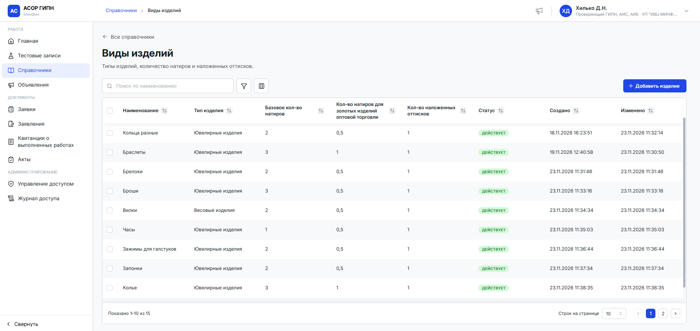
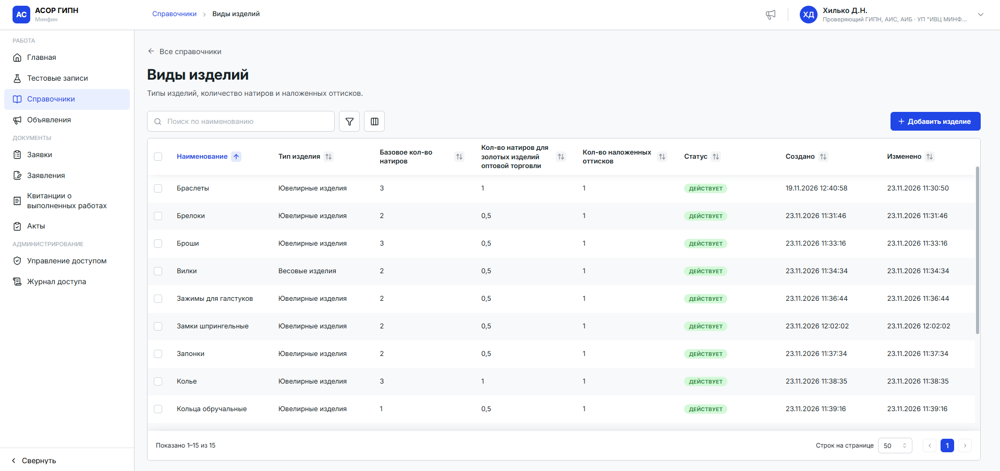

# ИНТЕРФЕЙСНЫЕ ТРЕБОВАНИЯ {#ui}

Критерии приёмки проверяются на каждом списке, который подключает функциональность. Эталонная реализация —
справочник видов изделий (`GET /api/v1/product-types`, экран «Виды изделий», приставка `data-testid` `pt`) с
[тестовым набором][fixture].

## UI-G-SORT-001. Сортировка по заголовку столбца {#ui-g-sort-001 .collapsed}

- **Использует**: [SF-G-SORT][], [FR-G-SORT-001][], [NFR-005][], [дизайн-система][design-system] (DataTable)
- **Используется в**: [FR-PT-LIST-007][]
- **Описание**: Пользователь упорядочивает таблицу нажатием на заголовок столбца и видит, по какому столбцу и в каком
направлении она упорядочена.
- **Условие**: Открыт экран с таблицей, который подключает [SF-G-SORT][].
- **Результат**: Таблица упорядочена по одному столбцу в выбранном направлении либо в порядке по умолчанию.
- **Показатели (NFR)**: Результат показывается не позже 1 с после нажатия при ответе API в пределах показателя
функциональности; соответствие [NFR-002][].

### Макеты {#ui-g-sort-001-mockups .collapsed}

Источник — скриншоты справочника видов изделий «02-Список видов изделий-04-Сортировка-01…09».






### Элементы {#ui-g-sort-001-elements .collapsed}

- **Заголовок столбца** — `<p>-list-header` с `data-field` (имя поля API), атрибут `aria-sort`.
- **Кнопка сортировки** — `<p>-list-sort` с `data-field` внутри заголовка
    - Есть у каждого столбца из перечня сортируемых полей; у столбца флажков выделения её нет.
    - Текст заголовка и иконка справа от него.
    - Без сортировки: иконка `sort` цвета `text-muted`, `aria-sort="none"`.
    - По возрастанию: текст и иконка `sort-up` цвета `accent`, иконка на фоне `primary-0`, `aria-sort="ascending"`.
    - По убыванию: то же с иконкой `sort-down`, `aria-sort="descending"`.

### Поведение (UX) {#ui-g-sort-001-ux .collapsed}

1. При открытии экрана сортировка не выбрана: записи идут в порядке по умолчанию функциональности.
2. Нажатия по одному столбцу переключают состояния по кругу: по возрастанию → по убыванию → без сортировки (`H01`).
3. Нажатие по другому столбцу снимает сортировку с прежнего и сортирует по новому по возрастанию.
4. Сортировка загружает первую страницу ([SF-G-PAG][]), сохраняет поиск и фильтры и снимает выделение строк.
5. Сортировка отражается в адресе экрана параметрами `sort_by` и `sort_order`.
6. Скрытый столбец, по которому идёт сортировка, сортировку не снимает.
7. Кнопка работает с клавиатуры: Enter и пробел действуют как нажатие.

### Критерии приёмки (AC) {#ui-g-sort-001-ac .collapsed}

```gherkin
# language: ru
@UI-G-SORT-001 @SF-G-SORT @ui
Функционал: Сортировка по заголовку столбца

  Предыстория:
    Дано в справочнике видов изделий записи из файла "PT.fixture.json"
    И пользователь с ролью "ais" открыл экран "Виды изделий"

  Сценарий: Сортировки по умолчанию нет
    Тогда у всех "pt-list-header" aria-sort "none"
    И первая строка — "Кольца разные"

  Сценарий: Цикл сортировки
    Когда пользователь нажимает "pt-list-sort" с data-field "name_nominative"
    Тогда у заголовка "name_nominative" aria-sort "ascending" и первая строка — "Браслеты"
    Когда пользователь снова нажимает "pt-list-sort" с data-field "name_nominative"
    Тогда у заголовка "name_nominative" aria-sort "descending" и первая строка — "Часы"
    Когда пользователь снова нажимает "pt-list-sort" с data-field "name_nominative"
    Тогда у заголовка "name_nominative" aria-sort "none" и первая строка — "Кольца разные"
    И адрес экрана не содержит "sort_by"

  Сценарий: Сортировка по другому столбцу снимает прежнюю
    Дано список отсортирован по "name_nominative" по возрастанию
    Когда пользователь нажимает "pt-list-sort" с data-field "is_active"
    Тогда у заголовка "name_nominative" aria-sort "none"
    И у заголовка "is_active" aria-sort "ascending" и первая строка — "Брелоки"

  Сценарий: Сортировка сохраняет поиск и загружает первую страницу
    Дано открыта страница 2
    И пользователь ввёл "коль" в "pt-list-search"
    Когда пользователь нажимает "pt-list-sort" с data-field "name_nominative"
    Тогда в таблице строки "Колье", "Кольца обручальные", "Кольца разные" в этом порядке
    И адрес экрана содержит "sort_by=name_nominative" и "search=коль"

  Сценарий: Сортировка снимает выделение
    Дано выделена строка "Броши"
    Когда пользователь нажимает "pt-list-sort" с data-field "created_at"
    Тогда нет "pt-selection-bar"

  @NFR @a11y
  Сценарий: Сортировка с клавиатуры
    Когда пользователь переводит фокус на "pt-list-sort" с data-field "created_at" и нажимает Enter
    Тогда у заголовка "created_at" aria-sort "ascending"
```

### Допущения {#ui-g-sort-001-assumptions .collapsed}

- **UI-G-SORT-001.H01**
    - **Статус**: принято
    - **Подтверждает**: аналитик (правило дизайн-системы)
    - **Допущение**: Третье нажатие по тому же столбцу возвращает порядок по умолчанию (цикл из дизайн-системы); на
      нём основан альтернативный поток А3 сценария `UC-PT-004`.


[fixture]: <../../dict-product-type/fr.md#fr-pt-fixture>
[SF-G-SORT]: <index.md#sf-g-sort>
[SF-G-PAG]: <../sf-g-pag/index.md#sf-g-pag>
[NFR-002]: <../nfr.md#nfr-002>
[NFR-005]: <../nfr.md#nfr-005>
[design-system]: <../design-system/index.md>
[FR-G-SORT-001]: <fr.md#fr-g-sort-001>
[FR-PT-LIST-007]: <../../dict-product-type/sf-list/fr.md#fr-pt-list-007>
