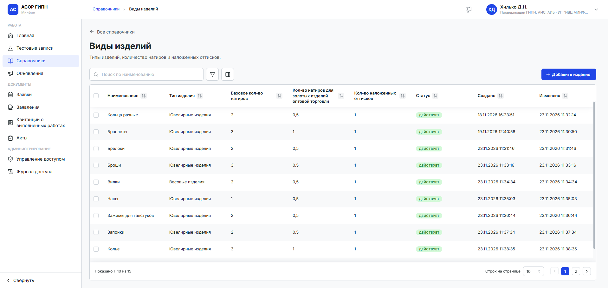

# Дизайн-система {#design-system}

Дизайн-система — единый набор визуальных стандартов, дизайн-токенов, компонентов интерфейса и правил их
использования. Она обеспечивает единообразие продукта и ускоряет работу дизайнеров, разработчиков и ИИ-агентов.
Страница объединяет бренд-бук (для людей) и UI-kit (Слой 3 контекста для фронтенда и ИИ-агентов).

Дизайн-система АСОР ГИПН собрана по 50 скриншотам справочника «Виды изделий» (`dict-product-type`) от 24.11.2026.
Всё, что видно на скриншотах, описано как факт; достроенное помечено **[Допущение]**. Превью ниже — живая вёрстка
на токенах `code/tokens.css` и классах `code/ui-kit.css`, а не картинки.

<iframe src="previews/cover.html" title="АСОР ГИПН — обложка" loading="lazy" height="288"
  style="width:100%;border:1px solid #ced4da;border-radius:8px;background:#f8f9fa"
  onload="this.style.height='0';this.style.height=this.contentDocument.documentElement.scrollHeight+2+'px'"></iframe>

<small>[Открыть превью отдельно](previews/cover.html){target="_blank" rel="noopener"}</small>

## Бренд {#brand}

### Характер интерфейса {#identity}

АСОР ГИПН — служебная система для проверяющих и операторов. Человек проводит в ней рабочий день,
работает с таблицами и формами и отвечает за точность данных. Отсюда принципы:

1. **Данные важнее украшений.** Белые поверхности на светло-сером фоне, один фирменный синий, без градиентов
   и иллюстраций. Цвет появляется там, где есть действие или статус.
2. **Предсказуемость.** Каждый справочник устроен одинаково: заголовок, панель инструментов, таблица,
   пагинация, модальная форма. Пользователь, освоивший один, освоил все.
3. **Плотность без тесноты.** Строки таблицы 53px, текст 13–14px, шаг сетки 4px.
4. **Безопасные необратимые действия.** Удаление — только красной кнопкой и только после подтверждения;
   результат всегда сообщается уведомлением.
5. **Явное состояние.** Активные фильтры видны чипами и счётчиком, выделение — панелью «Выбрано: N из M»,
   сортировка — синим заголовком столбца.

### Имя {#name}

- Полное название в интерфейсе — **АСОР ГИПН**, прописными, пробел между частями.
- Под названием — ведомство: **Минфин**.
- [Допущение] Расшифровка аббревиатуры на скриншотах отсутствует; в документах при первом упоминании
  давать её полностью после согласования с заказчиком.

### Логотип {#logo}

На скриншотах логотип — типографический знак: синий квадрат со скруглением 4px и белыми буквами «АС».

<iframe src="previews/logos.html" title="Логотип" loading="lazy" height="150"
  style="width:100%;border:1px solid #ced4da;border-radius:8px;background:#f8f9fa"
  onload="this.style.height='0';this.style.height=this.contentDocument.documentElement.scrollHeight+2+'px'"></iframe>

<small>[Открыть превью отдельно](previews/logos.html){target="_blank" rel="noopener"}</small>


| Версия | Файл | Когда |
| --- | --- | --- |
| Знак | `assets/logos/asor-mark.svg` | Шапка, фавикон, свёрнутое меню |
| Знак + название | `assets/logos/asor-lockup.svg` | Шапка приложения, экран входа, документы |
| Монохромный знак | `assets/logos/asor-mark-mono.svg` | [Допущение] Печать, факс, одноцветные носители |

- Цвет знака — `primary-6` `#2146e6`, буквы — белые, Inter Bold.
- Охранное поле — не меньше половины стороны знака со всех сторон.
- Минимальный размер знака — 24px на экране.
- Нельзя: менять цвет на нефирменный, растягивать, добавлять тень и обводку, ставить знак на фото.
- [Допущение] SVG-файлы перерисованы по скриншоту (исходников нет); буквы набраны шрифтом, поэтому для печати
  нужен вариант с текстом в кривых — запросить у владельца бренда.

### Голос и тон {#tone-of-voice}

Система говорит как аккуратный коллега-специалист: коротко, точно, вежливо, без эмоций.

- **Коротко.** «Готово», «Ошибка», «Записей пока нет». Никаких «Ура!» и «Упс».
- **По делу.** Сообщение называет результат и количество: «Удалено изделий: 1.»
- **Без вины пользователя.** Ошибка объясняет причину: «Запись ссылается на другую запись», а не
  «Вы не можете удалить».
- **Термины предметной области** — как в нормативных документах: «натиры», «наложенные оттиски», «проба».
- Без восклицательных знаков, эмодзи и сленга. Обращение — безличное; если нужно — на «вы» со строчной буквы.

### Правила текстов интерфейса {#ui-texts}

| Элемент | Правило | Пример |
| --- | --- | --- |
| Заголовок страницы | Существительное во множественном числе, с прописной | Виды изделий |
| Описание страницы | Одно предложение с точкой | Типы изделий, количество натиров и наложенных оттисков. |
| Кнопка | Глагол в инфинитиве, без точки | Добавить изделие, Сохранить, Сбросить все |
| Заголовок окна формы | Действие + объект | Добавить изделие, Изменить изделие |
| Заголовок подтверждения | Вопрос | Удалить выбранные изделия? |
| Подпись поля | Существительное, полностью в форме, можно сокращать в шапке таблицы | Количество наложенных оттисков / Кол-во наложенных оттисков |
| Плейсхолдер | Что сделать | Введите наименование изделия, Выберите тип |
| Пустое значение фильтра | Нейтрально | Любое значение |
| Ошибка поля | Что сделать, без точки | Введите наименование |
| Уведомление | Заголовок-итог + пояснение | Готово · Удалено изделий: 1. |
| Статус | Прописными в бейдже | ДЕЙСТВУЕТ, НЕ ДЕЙСТВУЕТ |
| Заголовок группы меню | Прописными | РАБОТА, ДОКУМЕНТЫ, АДМИНИСТРИРОВАНИЕ |

Форматы данных:

- Дата и время — `ДД.ММ.ГГГГ ЧЧ:ММ:СС` (23.11.2026 11:35:03).
- Диапазон — через длинное тире с пробелами: `18.11.2026 00:00:00 — 19.11.2026 23:59:59`.
- Дробные числа — с запятой: 0,5. Диапазон строк — с коротким тире: «Показано 1–10 из 15».
- Счётчик выбора — «Выбрано: 3 из 15».

Замечено на скриншотах и рекомендуется унифицировать:

- «Выделить все» на кнопке и «Выделить всё» в описании сценария — выбрать одно написание
  (рекомендуем «Выделить все» без «ё», как «Сбросить все»).
- Сокращения «Кол-во» допустимы только в шапке таблицы и фильтрах; в формах — полные подписи.
- Подпись фильтра выровнена с заголовком столбца: «Кол-во натиров для золотых изделий оптовой торговли»
  ([FR-PT-LIST-006](../../features/dict-product-type/sf-list/fr.md#fr-pt-list-006)).

## Основы {#foundations}

### Цвет {#colors}

Палитра нейтральная: белые поверхности, светло-серый фон, тёмный текст и один фирменный синий.
Все значения сняты пикселями со скриншотов; недостающие ступени шкал — [Допущение].

| Роль | Токен | Значение | Применение |
| --- | --- | --- | --- |
| Акцент | `accent` → `primary-6` | `#2146e6` | Кнопка Primary, ссылки, активные состояния, фокус |
| Наведение акцента | `accent-hover` → `primary-7` | `#1a3bcc` | [Допущение] |
| Активный пункт | `bg-nav-active` → `primary-0` | `#eaefff` | Меню, навигационная карточка |
| Выделение | `bg-selected` → `primary-1` | `#d3dbff` | Выделенная строка, активная иконочная кнопка |
| Фон страницы | `bg-page` → `gray-0` | `#f8f9fa` | Рабочая область, зебра таблицы |
| Поверхность | `bg-surface` → `white` | `#ffffff` | Шапка, сайдбар, карточки, окна |
| Рамка | `border` → `gray-4` | `#ced4da` | Поля, кнопки Default, карточки, разделители |
| Текст | `text` → `gray-9` | `#212529` | Основной текст |
| Вторичный текст | `text-secondary` → `gray-7` | `#495057` | Описания |
| Приглушённый | `text-muted` → `gray-6` | `#868e96` | Метаданные, иконки сортировки |
| Ошибка | `danger` → `red-6` | `#fa5252` | Ошибки полей, обязательность |
| Удаление | `danger-fill` → `red-8` | `#e03131` | Кнопка Danger (рекомендация) |
| Успех | `success` / `success-soft` | `#2b8a3e` / `#d3f9d8` | Бейдж «Действует», уведомление |

Правила:

- Синий — только для интерактивного и активного. Не красить им заголовки и декоративные элементы.
- Красный — только для ошибок и удаления. Зелёный — только для статуса «Действует» и успеха.
- Статус никогда не передаётся одним цветом: всегда текст бейджа или иконка.
- Подложка модального окна — `overlay`, 60% чёрного.

<iframe src="previews/colors.html" title="Цвета" loading="lazy" height="900"
  style="width:100%;border:1px solid #ced4da;border-radius:8px;background:#f8f9fa"
  onload="this.style.height='0';this.style.height=this.contentDocument.documentElement.scrollHeight+2+'px'"></iframe>

<small>[Открыть превью отдельно](previews/colors.html){target="_blank" rel="noopener"}</small>

### Типографика {#typography}

Шрифт — **Inter** (Google Fonts, начертания 400/500/600/700). Запасные: системные sans-serif.
[Допущение] Шрифт определён визуально по форме глифов.

| Стиль | Размер / интерлиньяж | Начертание | Где |
| --- | --- | --- | --- |
| `page-title` | 28 / 34 | 700 | Заголовок страницы |
| `card-title`, `modal-title` | 15 / 22 | 600 / 500 | Заголовки карточек и окон |
| `popover-title` | 14 / 20 | 600 | Заголовок поповера |
| `body`, `body-strong` | 14 / 20 | 400 / 600 | Текст, меню, имя пользователя |
| `table-cell`, `table-head` | 13 / 18 | 400 / 600 | Таблицы |
| `label`, `button` | 13 / 18 | 600 | Подписи полей, кнопки |
| `caption` | 12 / 16 | 400 | Подписи, должность |
| `error`, `overline` | 11 / 14 | 400 / 500 | Ошибки, заголовки групп меню |
| `badge` | 10 / 14 | 700, прописные | Бейджи статуса |

Размеры замерены по скриншотам с точностью ±1px. Цифры в таблицах — пропорциональные, как на скриншотах;
[Допущение] для столбцов с числами можно включить `font-variant-numeric: tabular-nums`.

<iframe src="previews/typography.html" title="Типографика" loading="lazy" height="760"
  style="width:100%;border:1px solid #ced4da;border-radius:8px;background:#f8f9fa"
  onload="this.style.height='0';this.style.height=this.contentDocument.documentElement.scrollHeight+2+'px'"></iframe>

<small>[Открыть превью отдельно](previews/typography.html){target="_blank" rel="noopener"}</small>

### Сетка и отступы {#layout}

- Шаг — 4px: `space-1` 4 · `space-2` 8 · `space-3` 12 · `space-4` 16 · `space-5` 20 · `space-6` 24 ·
  `space-8` 32 · `space-10` 40.
- Каркас: шапка `header-height` 60px, сайдбар `sidebar-width` 256px, рабочая область с полями `space-6`.
- Высоты контролов: `control-sm` 28 (пагинация, панель выделения), `control-md` 36 (кнопки, поля форм),
  `control-lg` 40 (поиск и иконочные кнопки панели инструментов).
- Таблица растягивается на всю ширину рабочей области; футер с пагинацией прижат к низу окна.
- [Допущение] Минимальная ширина экрана — 1280px; мобильная версия не предусмотрена.

### Скругления и тени {#radius-shadow}

- `radius-sm` 4px — контролы; `radius-md` 8px — контейнеры (карточки, таблица, окна, поповеры);
  `radius-full` — бейджи, аватар, переключатель.
- Тени только у всплывающих слоёв: `shadow-md` — поповеры, списки, уведомления; `shadow-lg` — модальные окна.
  Карточки и таблица отделяются рамкой, не тенью. [Допущение] Значения теней взяты из Mantine.

<iframe src="previews/spacing.html" title="Отступы, скругления, тени" loading="lazy" height="760"
  style="width:100%;border:1px solid #ced4da;border-radius:8px;background:#f8f9fa"
  onload="this.style.height='0';this.style.height=this.contentDocument.documentElement.scrollHeight+2+'px'"></iframe>

<small>[Открыть превью отдельно](previews/spacing.html){target="_blank" rel="noopener"}</small>

### Иконки {#icons}

- Линейные иконки 24×24 с толщиной линии 1.75, скруглёнными концами, без заливки. В интерфейсе выводятся
  16px (20px в шапке), цветом текста рядом.
- На скриншотах использован набор в стиле Tabler Icons. Файлы в папке
  `assets/icons/` нарисованы заново в том же стиле.
  [Допущение] Для разработки рекомендуется подключить Tabler Icons (MIT) целиком.
- Иконка без подписи всегда получает `aria-label` и тултип.

<iframe src="previews/icons.html" title="Иконки" loading="lazy" height="420"
  style="width:100%;border:1px solid #ced4da;border-radius:8px;background:#f8f9fa"
  onload="this.style.height='0';this.style.height=this.contentDocument.documentElement.scrollHeight+2+'px'"></iframe>

<small>[Открыть превью отдельно](previews/icons.html){target="_blank" rel="noopener"}</small>

### Доступность {#accessibility}

Проверено по WCAG 2.1 AA (4.5:1 для текста, 3:1 для крупного текста и границ контролов).

| Пара | Контраст | Статус |
| --- | --- | --- |
| Белый на `accent` | 6.8:1 | Норма |
| `text` на `bg-surface` | 15.4:1 | Норма |
| `text-secondary` на `bg-page` | 7.8:1 | Норма |
| `accent` на `bg-nav-active` | 5.9:1 | Норма |
| `green-9` на `green-1` (бейдж «Действует») | 3.8:1 | Ниже нормы → `green-10` 5.3:1 |
| Белый на `red-6` (кнопка «Удалить») | 3.3:1 | Ниже нормы → `red-8` 4.5:1 |
| `gray-6` на белом (должность, вторичный текст) | 3.3:1 | Только некритичный текст |
| `gray-5` на белом (плейсхолдер, группы меню) | 2.1:1 | Ниже нормы → группы меню `gray-7` |
| `gray-4` рамка на белом | 1.5:1 | Ниже 3:1 для границ полей → рассмотреть `gray-6` |

Пары со скриншотов сохранены в токенах; рекомендованные замены (`green-10`, `red-8`) уже применены в UI-kit.
Остальное:

- Фокус клавиатуры виден всегда: кольцо 2px `focus-ring` с отступом 2px.
- Модальное окно удерживает фокус и закрывается по Esc.
- Таблица — семантическая `<table>`; заголовки сортировки — кнопки с `aria-sort`.

## Дизайн-токены (CSS Variables) {#tokens .collapsed}

Источник истины — `code/tokens.json` (у каждого токена поле `usage`: откуда значение и где применять). Ниже — те же
токены как CSS-переменные (`code/tokens.css`). В интерфейсе используйте семантические токены (`--accent`, `--text`,
`--border`, `--bg-selected`), а не шкалу (`--primary-6`, `--gray-4`).

```css
/* АСОР ГИПН — дизайн-токены. Источник: tokens.json. Тема: светлая. */
:root {
  /* Цвета: шкалы */
  --primary-0: #eaefff;
  --primary-1: #d3dbff;
  --primary-2: #a6b5f5;
  --primary-3: #7f94f0;
  --primary-4: #5a75ec;
  --primary-5: #3d5ce9;
  --primary-6: #2146e6;
  --primary-7: #1a3bcc;
  --primary-8: #0831b8;
  --primary-9: #062690;
  --gray-0: #f8f9fa;
  --gray-1: #f1f3f5;
  --gray-2: #e9ecef;
  --gray-3: #dee2e6;
  --gray-4: #ced4da;
  --gray-5: #adb5bd;
  --gray-6: #868e96;
  --gray-7: #495057;
  --gray-8: #343a40;
  --gray-9: #212529;
  --white: #ffffff;
  --green-1: #d3f9d8;
  --green-9: #2b8a3e;
  --green-10: #237032;
  --red-0: #fff5f5;
  --red-6: #fa5252;
  --red-8: #e03131;
  --yellow-1: #fff3bf;
  --yellow-9: #8f4c00;
  --overlay: rgba(0, 0, 0, 0.6);

  /* Цвета: семантические роли — используйте в интерфейсе их */
  --bg-page: var(--gray-0);
  --bg-surface: var(--white);
  --bg-row-alt: var(--gray-0);
  --bg-hover: var(--gray-2);
  --bg-selected: var(--primary-1);
  --bg-nav-active: var(--primary-0);
  --border: var(--gray-4);
  --border-subtle: var(--gray-3);
  --text: var(--gray-9);
  --text-secondary: var(--gray-7);
  --text-muted: var(--gray-6);
  --text-placeholder: var(--gray-5);
  --accent: var(--primary-6);
  --accent-hover: var(--primary-7);
  --on-accent: var(--white);
  --danger: var(--red-6);
  --danger-fill: var(--red-8);
  --success: var(--green-9);
  --success-soft: var(--green-1);
  --focus-ring: var(--primary-6);

  /* Отступы (шаг 4px) */
  --space-1: 4px;
  --space-2: 8px;
  --space-3: 12px;
  --space-4: 16px;
  --space-5: 20px;
  --space-6: 24px;
  --space-8: 32px;
  --space-10: 40px;

  /* Скругления */
  --radius-sm: 4px;
  --radius-md: 8px;
  --radius-full: 9999px;

  /* Размеры элементов */
  --control-sm: 28px;
  --control-md: 36px;
  --control-lg: 40px;
  --header-height: 60px;
  --sidebar-width: 256px;
  --row-height: 53px;
  --modal-width: 440px;

  /* Тени */
  --shadow-sm: 0 1px 3px rgba(0, 0, 0, 0.05), 0 1px 2px rgba(0, 0, 0, 0.1);
  --shadow-md: 0 1px 3px rgba(0, 0, 0, 0.05), 0 10px 15px -5px rgba(0, 0, 0, 0.08), 0 7px 7px -5px rgba(0, 0, 0, 0.04);
  --shadow-lg: 0 1px 3px rgba(0, 0, 0, 0.05), 0 20px 25px -5px rgba(0, 0, 0, 0.1), 0 10px 10px -5px rgba(0, 0, 0, 0.04);

  /* Слои */
  --z-sticky: 10;
  --z-popover: 300;
  --z-modal: 400;
  --z-toast: 500;
  --z-tooltip: 600;

  /* Шрифты */
  --font-sans: Inter, -apple-system, "Segoe UI", Roboto, Arial, sans-serif;
  --font-mono: "JetBrains Mono", ui-monospace, Consolas, monospace;
}
```

### Стили текста {#type-styles}

Шрифт — Inter (Google Fonts, 400/500/600/700), токен `--font-sans`.

| Стиль | Размер / интерлиньяж | Начертание | Назначение |
| --- | --- | --- | --- |
| `page-title` | 28px / 34px | 700, трекинг -0.01em | Заголовок страницы (H1). Один на страницу. |
| `card-title` | 15px / 22px | 600 | Заголовок карточки, группы списка, панели «Навигация». |
| `modal-title` | 15px / 22px | 500 | Заголовок модального окна. [Допущение] 500 вместо 400 на скриншотах — для иерархии. |
| `popover-title` | 14px / 20px | 600 | Заголовок поповера (фильтры, столбцы). |
| `body` | 14px / 20px | 400 | Основной текст, описания, пункты меню. |
| `body-strong` | 14px / 20px | 600 | Имя пользователя, акценты в тексте. |
| `table-cell` | 13px / 18px | 400 | Ячейки таблицы, значения в чипах фильтров. |
| `table-head` | 13px / 17px | 600 | Заголовки столбцов; переносятся до 3 строк. |
| `label` | 13px / 18px | 600 | Подписи полей формы и фильтров. |
| `button` | 13px / 18px | 600 | Текст кнопок. |
| `caption` | 12px / 16px | 400 | Подписи, должность, описание поповера. |
| `error` | 11px / 14px | 400 | Текст ошибки под полем, цвет danger. |
| `overline` | 11px / 14px | 500, трекинг 0.02em | Заголовки групп меню, всегда прописными. |
| `badge` | 10px / 14px | 700, трекинг 0.04em | Текст бейджа статуса, прописными. |
| `brand` | 14px / 18px | 700 | Название системы в шапке рядом со знаком. |
| `code` | 12px / 18px | 400 | [Допущение] Идентификаторы и коды в документации. |

### Каркас страницы {#app-shell}

- **AppShell:** шапка `--header-height` (60px) + сайдбар `--sidebar-width` (256px) + рабочая область с полями
  `--space-6` на фоне `--bg-page`.
- **Контейнеры** (таблица, карточка, окно, поповер): фон `--bg-surface`, рамка `1px solid var(--border)`, скругление
  `--radius-md`. Тень только у всплывающих слоёв.
- **Высоты контролов:** `--control-sm` 28px, `--control-md` 36px, `--control-lg` 40px.
- **Адаптивность:** минимальная ширина 1280px (desktop-first) — [Допущение].

## Компоненты {#components}

У каждого компонента — живое превью и правила применения. Вёрстка превью — эталон: классы `ui-*` из
`code/ui-kit.css`, значения только из `code/tokens.css`.

### Каркас и навигация {#c-layout}

#### AppHeader {#c-appheader}

<iframe src="previews/appheader.html" title="AppHeader — превью" loading="lazy" height="90"
  style="width:100%;border:1px solid #ced4da;border-radius:8px;background:#f8f9fa"
  onload="this.style.height='0';this.style.height=this.contentDocument.documentElement.scrollHeight+2+'px'"></iframe>

<small>[Открыть превью отдельно](previews/appheader.html){target="_blank" rel="noopener"}</small>

Шапка приложения: логотип, хлебные крошки, объявления, профиль пользователя.

- Высота `header-height` (60px), фон `bg-surface`, снизу разделитель `border`.
- Логотип занимает ширину сайдбара, чтобы крошки начинались по линии контента.
- Профиль: аватар, ФИО (`body-strong`), должность и организация (`caption`, `text-muted`, обрезка «…»).
- Иконка объявлений отделена от профиля вертикальным разделителем.

#### Logo {#c-logo}

<iframe src="previews/logo.html" title="Logo — превью" loading="lazy" height="80"
  style="width:100%;border:1px solid #ced4da;border-radius:8px;background:#f8f9fa"
  onload="this.style.height='0';this.style.height=this.contentDocument.documentElement.scrollHeight+2+'px'"></iframe>

<small>[Открыть превью отдельно](previews/logo.html){target="_blank" rel="noopener"}</small>

Знак и название системы в левом верхнем углу шапки.

- Знак: квадрат 34px `accent`, скругление `radius-sm`, белые буквы «АС» жирным.
- Справа название «АСОР ГИПН» (стиль `brand`) и ведомство «Минфин» (`caption`, `text-muted`).
- Файлы — в `assets/logos/`. Правила — раздел «Логотип».

#### Breadcrumbs {#c-breadcrumbs}

<iframe src="previews/breadcrumbs.html" title="Breadcrumbs — превью" loading="lazy" height="60"
  style="width:100%;border:1px solid #ced4da;border-radius:8px;background:#f8f9fa"
  onload="this.style.height='0';this.style.height=this.contentDocument.documentElement.scrollHeight+2+'px'"></iframe>

<small>[Открыть превью отдельно](previews/breadcrumbs.html){target="_blank" rel="noopener"}</small>

Путь от раздела к текущей странице в шапке.

- Ссылки — `accent`, разделитель — `chevron-right` цвета `text-muted`, текущая страница — `text`, не ссылка.
- Не дублирует заголовок страницы целиком при глубине больше трёх уровней — сокращать середину «…».

#### Sidebar {#c-sidebar}

<iframe src="previews/sidebar.html" title="Sidebar — превью" loading="lazy" height="520"
  style="width:100%;border:1px solid #ced4da;border-radius:8px;background:#f8f9fa"
  onload="this.style.height='0';this.style.height=this.contentDocument.documentElement.scrollHeight+2+'px'"></iframe>

<small>[Открыть превью отдельно](previews/sidebar.html){target="_blank" rel="noopener"}</small>

Боковое меню разделов, сгруппированное по смыслу.

- Ширина `sidebar-width` (256px), фон `bg-surface`, справа разделитель `border`.
- Заголовки групп: стиль `overline`, прописными, цвет `text-muted`
  (на скриншотах `gray-5` — 2.1:1, рекомендуем `gray-6` или `gray-7`).
- Пункт: иконка 16px и подпись `body`; активный — фон `bg-nav-active`, текст и иконка `accent`;
  скругление `radius-md`.
- Внизу — «Свернуть». [Допущение] Свёрнутое меню — 64px, только иконки с тултипами.
- Пункты зависят от роли пользователя: набор групп на скриншотах различается.

#### PageHeader {#c-pageheader}

<iframe src="previews/pageheader.html" title="PageHeader — превью" loading="lazy" height="200"
  style="width:100%;border:1px solid #ced4da;border-radius:8px;background:#f8f9fa"
  onload="this.style.height='0';this.style.height=this.contentDocument.documentElement.scrollHeight+2+'px'"></iframe>

<small>[Открыть превью отдельно](previews/pageheader.html){target="_blank" rel="noopener"}</small>

Заголовок страницы: ссылка назад, название, описание.

- «← Все справочники» — `text-secondary`, ведёт на родительский список.
- Название — `page-title`, единственный H1 страницы. Описание — `body`, `text-secondary`, одно предложение с точкой.
- Отступы: слева и справа `space-6`.

Требования: [UI-G-DICT-001](../sf-g-dict/ui.md#ui-g-dict-001).

#### ListCard {#c-listcard}

<iframe src="previews/listcard.html" title="ListCard — превью" loading="lazy" height="330"
  style="width:100%;border:1px solid #ced4da;border-radius:8px;background:#f8f9fa"
  onload="this.style.height='0';this.style.height=this.contentDocument.documentElement.scrollHeight+2+'px'"></iframe>

<small>[Открыть превью отдельно](previews/listcard.html){target="_blank" rel="noopener"}</small>

Карточка-группа со списком ссылок на справочники.

- Шапка — `card-title` с разделителем; строки — название (14px, 500) и описание (`text-secondary`).
- Наведение: фон `gray-0`, название `accent`, справа шеврон `chevron-right`.
- Вся строка кликабельна.

Требования: [UI-G-CATALOG-001](../sf-g-catalog/ui.md#ui-g-catalog-001).

#### NavCard {#c-navcard}

<iframe src="previews/navcard.html" title="NavCard — превью" loading="lazy" height="370"
  style="width:100%;border:1px solid #ced4da;border-radius:8px;background:#f8f9fa"
  onload="this.style.height='0';this.style.height=this.contentDocument.documentElement.scrollHeight+2+'px'"></iframe>

<small>[Открыть превью отдельно](previews/navcard.html){target="_blank" rel="noopener"}</small>

Панель навигации по группам справочников со счётчиками и поиском над ней.

- Поиск «Название или описание…» фильтрует список справочников.
- Пункт: иконка, название, справа количество (`text-muted`); активный — `bg-nav-active`, текст `accent`.

Требования: [UI-G-CATALOG-001](../sf-g-catalog/ui.md#ui-g-catalog-001).

### Действия {#c-actions}

#### Button {#c-button}

<iframe src="previews/button.html" title="Button — превью" loading="lazy" height="130"
  style="width:100%;border:1px solid #ced4da;border-radius:8px;background:#f8f9fa"
  onload="this.style.height='0';this.style.height=this.contentDocument.documentElement.scrollHeight+2+'px'"></iframe>

<small>[Открыть превью отдельно](previews/button.html){target="_blank" rel="noopener"}</small>

Кнопка запускает действие. На экране — не больше одной кнопки **Primary**: то, ради чего открыта страница
или окно («Добавить изделие», «Сохранить», «Применить»).

| Вариант | Где применять | Токены |
| --- | --- | --- |
| Primary | Главное действие страницы, окна, поповера | `accent`, `on-accent`, наведение `accent-hover` |
| Outline | Второе действие рядом с Primary в поповере: «Выделить все», «Сбросить все» | рамка и текст `accent` |
| Default | Отмена и закрытие в модальных окнах | `bg-surface`, `border`, `text` |
| Danger | Необратимое удаление | `danger-fill` (рекомендовано), на скриншотах `red-6` |
| Subtle, размер sm | Служебные действия в панели выделения: «Снять выделение» | `gray-0`, `border`, `text-secondary` |

- Высота `control-md` (36px), в панели выделения — `control-sm` (28px); скругление `radius-sm`; текст — стиль `button`.
- Текст — глагол в инфинитиве, с прописной буквы, без точки: «Сохранить», «Удалить».
- Иконка слева только у главного действия создания (`plus`).
- Порядок в футере окна: «Отмена» слева, подтверждающее действие справа.
- Фокус клавиатуры: кольцо 2px `focus-ring` с отступом 2px.
- [Допущение] Недоступная кнопка — прозрачность 45%; на скриншотах не встречается.

Потребитель передаёт: текст, вариант, размер, обработчик, признак `disabled`.

#### IconButton {#c-iconbutton}

<iframe src="previews/iconbutton.html" title="IconButton — превью" loading="lazy" height="96"
  style="width:100%;border:1px solid #ced4da;border-radius:8px;background:#f8f9fa"
  onload="this.style.height='0';this.style.height=this.contentDocument.documentElement.scrollHeight+2+'px'"></iframe>

<small>[Открыть превью отдельно](previews/iconbutton.html){target="_blank" rel="noopener"}</small>

Квадратная кнопка с одной иконкой для панели инструментов таблицы: фильтры и настройка столбцов.

- Размер `control-lg` (40px) — совпадает с высотой поля поиска; рамка `border`, скругление `radius-sm`.
- Активное состояние (поповер открыт или фильтры применены): фон `bg-selected`, иконка `accent`.
- Счётчик применённых фильтров — кружок `primary-8` с белой цифрой в правом верхнем углу.
- Обязательно `aria-label` и тултип с действием: «Скрыть фильтры», «Скрыть столбцы»
  (тултип называет действие, которое произойдёт по нажатию).

#### Tooltip {#c-tooltip}

<iframe src="previews/tooltip.html" title="Tooltip — превью" loading="lazy" height="80"
  style="width:100%;border:1px solid #ced4da;border-radius:8px;background:#f8f9fa"
  onload="this.style.height='0';this.style.height=this.contentDocument.documentElement.scrollHeight+2+'px'"></iframe>

<small>[Открыть превью отдельно](previews/tooltip.html){target="_blank" rel="noopener"}</small>

Короткая подсказка над элементом при наведении и фокусе.

- Фон `gray-9`, текст белый 12px, скругление `radius-sm`, показывается над элементом.
- Одна фраза без точки; описывает действие: «Сбросить все фильтры».
- Обязателен для иконочных кнопок без подписи.

### Формы {#c-forms}

Требования: [UI-G-FORM-001](../sf-g-form/ui.md#ui-g-form-001).

#### TextInput {#c-textinput}

<iframe src="previews/textinput.html" title="TextInput — превью" loading="lazy" height="300"
  style="width:100%;border:1px solid #ced4da;border-radius:8px;background:#f8f9fa"
  onload="this.style.height='0';this.style.height=this.contentDocument.documentElement.scrollHeight+2+'px'"></iframe>

<small>[Открыть превью отдельно](previews/textinput.html){target="_blank" rel="noopener"}</small>

Однострочное поле ввода; включает вариант поиска с иконкой.

- Высота `control-md`, в панели инструментов — `control-lg`; рамка `border`, скругление `radius-sm`.
- Фокус: рамка `accent`. Ошибка: рамка и плейсхолдер `danger`, под полем текст стилем `error`.
- Подпись над полем — стиль `label`; обязательность — красная звёздочка `danger` после подписи.
- Плейсхолдер — что ввести: «Введите наименование изделия»; поиск — по чему ищем: «Поиск по наименованию».
- Текст ошибки — что сделать: «Введите наименование», без «Ошибка:» и без точки.
- Поиск фильтрует по вхождению подстроки без кнопки «Найти».

#### NumberInput {#c-numberinput}

<iframe src="previews/numberinput.html" title="NumberInput — превью" loading="lazy" height="200"
  style="width:100%;border:1px solid #ced4da;border-radius:8px;background:#f8f9fa"
  onload="this.style.height='0';this.style.height=this.contentDocument.documentElement.scrollHeight+2+'px'"></iframe>

<small>[Открыть превью отдельно](previews/numberinput.html){target="_blank" rel="noopener"}</small>

Числовое поле со стрелками увеличения и уменьшения.

- Строение как у TextInput; справа колонка из двух стрелок шириной 24px, разделённых `border`.
- Стрелка недоступна (цвет `gray-4`), если значение достигло границы: на скриншотах «вниз» неактивна при 0,5.
- Десятичный разделитель — запятая: «0,5».
- Шаг и минимум задаются требованиями к полю: натиры — шаг 0,5, оттиски — шаг 1
  ([UI-PT-001](../../features/dict-product-type/ui.md#ui-pt-001)).

#### Select {#c-select}

<iframe src="previews/select.html" title="Select — превью" loading="lazy" height="250"
  style="width:100%;border:1px solid #ced4da;border-radius:8px;background:#f8f9fa"
  onload="this.style.height='0';this.style.height=this.contentDocument.documentElement.scrollHeight+2+'px'"></iframe>

<small>[Открыть превью отдельно](previews/select.html){target="_blank" rel="noopener"}</small>

Выбор одного значения из списка.

- Строение как у TextInput, справа иконка `selector`.
- В фильтрах пустое значение — плейсхолдер «Любое значение»; в формах — «Выберите тип».
- Выпадающий список: фон `bg-surface`, рамка `border`, тень `shadow-md`, наведение на пункт `bg-hover`.
- [Допущение] Выбранный пункт в открытом списке подсвечивается `accent` с белым текстом.

#### DateRangeInput {#c-daterangeinput}

<iframe src="previews/daterangeinput.html" title="DateRangeInput — превью" loading="lazy" height="110"
  style="width:100%;border:1px solid #ced4da;border-radius:8px;background:#f8f9fa"
  onload="this.style.height='0';this.style.height=this.contentDocument.documentElement.scrollHeight+2+'px'"></iframe>

<small>[Открыть превью отдельно](previews/daterangeinput.html){target="_blank" rel="noopener"}</small>

Поле выбора диапазона дат и времени для фильтров «Создано» и «Изменено».

- Плейсхолдер «Выберите диапазон»; в чипе фильтра значение пишется
  `ДД.ММ.ГГГГ ЧЧ:ММ:СС — ДД.ММ.ГГГГ ЧЧ:ММ:СС`.
- По умолчанию время начала 00:00:00, конца — 23:59:59, чтобы в отбор попадала последняя минута дня
  (на скриншотах 23:59:00; допущение `UI-G-FILTER-001.H02`).
- Календарь — по скриншоту фильтрации: неделя с понедельника, выходные `danger`, дни соседних месяцев
  `text-muted`, выбранные дни `accent`, диапазон `primary-1`, поля времени и кнопка `check` под календарём.
- Требования: [UI-G-FILTER-001](../sf-g-filter/ui.md#ui-g-filter-001).

#### Checkbox {#c-checkbox}

<iframe src="previews/checkbox.html" title="Checkbox — превью" loading="lazy" height="84"
  style="width:100%;border:1px solid #ced4da;border-radius:8px;background:#f8f9fa"
  onload="this.style.height='0';this.style.height=this.contentDocument.documentElement.scrollHeight+2+'px'"></iframe>

<small>[Открыть превью отдельно](previews/checkbox.html){target="_blank" rel="noopener"}</small>

Флажок для выбора строк таблицы и пунктов списка столбцов.

- Квадрат 16px, рамка `border`, скругление `radius-sm`; отмечен — заливка `accent`, белая галочка.
- Частичное состояние (минус) — в шапке таблицы, когда выделена часть строк страницы.
- Подпись справа, стиль `table-cell`; клик по подписи переключает флажок.

#### Switch {#c-switch}

<iframe src="previews/switch.html" title="Switch — превью" loading="lazy" height="56"
  style="width:100%;border:1px solid #ced4da;border-radius:8px;background:#f8f9fa"
  onload="this.style.height='0';this.style.height=this.contentDocument.documentElement.scrollHeight+2+'px'"></iframe>

<small>[Открыть превью отдельно](previews/switch.html){target="_blank" rel="noopener"}</small>

Переключатель двух состояний, которое применяется к записи сразу при сохранении формы.

- Включён: дорожка `accent`, бегунок белый; выключен: дорожка `gray-3`.
- Подпись справа описывает включённое состояние: «Действует».
- Используется для поля «Статус» в форме записи справочника.

### Отображение данных {#c-data}

#### Toolbar {#c-toolbar}

<iframe src="previews/toolbar.html" title="Toolbar — превью" loading="lazy" height="76"
  style="width:100%;border:1px solid #ced4da;border-radius:8px;background:#f8f9fa"
  onload="this.style.height='0';this.style.height=this.contentDocument.documentElement.scrollHeight+2+'px'"></iframe>

<small>[Открыть превью отдельно](previews/toolbar.html){target="_blank" rel="noopener"}</small>

Панель над таблицей: поиск, фильтры, столбцы и главное действие.

- Слева: поле поиска (360px, `control-lg`), иконочные кнопки фильтров и столбцов с зазором `space-2`.
- Справа: кнопка Primary «Добавить <сущность>» с иконкой `plus`.
- Под панелью появляются чипы фильтров или панель выделения.

#### DataTable {#c-datatable}

<iframe src="previews/datatable.html" title="DataTable — превью" loading="lazy" height="470"
  style="width:100%;border:1px solid #ced4da;border-radius:8px;background:#f8f9fa"
  onload="this.style.height='0';this.style.height=this.contentDocument.documentElement.scrollHeight+2+'px'"></iframe>

<small>[Открыть превью отдельно](previews/datatable.html){target="_blank" rel="noopener"}</small>

Таблица записей справочника с сортировкой, выделением и пагинацией.

- Обёртка: `bg-surface`, рамка `border`, скругление `radius-md`.
- Шапка: стиль `table-head`, перенос до 3 строк; у сортируемого столбца иконка `sort` (`text-muted`).
  Активная сортировка — заголовок и иконка `accent`, иконка-стрелка на фоне `primary-0`.
- Сортировка по клику циклична: по возрастанию → по убыванию → без сортировки. По умолчанию сортировки нет.
- Строки: высота `row-height` (53px), стиль `table-cell`, зебра `bg-row-alt`, наведение `bg-hover`.
- Выделенная строка: фон `bg-selected` и полоса 3px `accent` слева.
- Первый столбец — флажок; флажок шапки выделяет все строки текущей страницы.
- Даты: `ДД.ММ.ГГГГ ЧЧ:ММ:СС`; дробные — через запятую.
- Видимость столбцов настраивается поповером «Столбцы таблицы».
- Пустая таблица показывает EmptyState; футер с пагинацией остаётся.

Требования: [UI-G-TABLE-001](../sf-g-table/ui.md#ui-g-table-001).

#### Pagination {#c-pagination}

<iframe src="previews/pagination.html" title="Pagination — превью" loading="lazy" height="70"
  style="width:100%;border:1px solid #ced4da;border-radius:8px;background:#f8f9fa"
  onload="this.style.height='0';this.style.height=this.contentDocument.documentElement.scrollHeight+2+'px'"></iframe>

<small>[Открыть превью отдельно](previews/pagination.html){target="_blank" rel="noopener"}</small>

Офсетная пагинация в футере таблицы.

- Слева: «Показано 1–10 из 15». Справа: «Строк на странице» с селектом (10, 25, 50, 100), стрелки и номера
  страниц.
- Кнопки `control-sm`, рамка `border`; текущая — заливка `accent`.
- Требования: [UI-G-PAG-001](../sf-g-pag/ui.md#ui-g-pag-001).
  Если страница одна — текущая `primary-2`, стрелки неактивны (`gray-4`).
- При смене размера страницы — переход на первую страницу.

#### SelectionBar {#c-selectionbar}

<iframe src="previews/selectionbar.html" title="SelectionBar — превью" loading="lazy" height="76"
  style="width:100%;border:1px solid #ced4da;border-radius:8px;background:#f8f9fa"
  onload="this.style.height='0';this.style.height=this.contentDocument.documentElement.scrollHeight+2+'px'"></iframe>

<small>[Открыть превью отдельно](previews/selectionbar.html){target="_blank" rel="noopener"}</small>

Панель массовых действий; появляется над таблицей при выделении хотя бы одной строки.

- Слева «Выбрано: N из M» (`accent`, 600), затем «Снять выделение» (Subtle sm) и «Удалить» (Danger sm),
  разделённые вертикальными линиями `border`.
- Удаление всегда подтверждается модальным окном.

Требования: [UI-G-SELECT-001](../sf-g-select/ui.md#ui-g-select-001).

#### FilterChips {#c-filterchips}

<iframe src="previews/filterchips.html" title="FilterChips — превью" loading="lazy" height="60"
  style="width:100%;border:1px solid #ced4da;border-radius:8px;background:#f8f9fa"
  onload="this.style.height='0';this.style.height=this.contentDocument.documentElement.scrollHeight+2+'px'"></iframe>

<small>[Открыть превью отдельно](previews/filterchips.html){target="_blank" rel="noopener"}</small>

Чипы применённых фильтров под панелью инструментов.

- Чип: «<Поле>: <значение>» и крестик для отключения одного фильтра; рамка `gray-5`, скругление `radius-sm`.
- После чипов — разделитель и кнопка Outline sm «Сбросить все».
- Число чипов равно счётчику на кнопке фильтров.

#### Badge {#c-badge}

<iframe src="previews/badge.html" title="Badge — превью" loading="lazy" height="80"
  style="width:100%;border:1px solid #ced4da;border-radius:8px;background:#f8f9fa"
  onload="this.style.height='0';this.style.height=this.contentDocument.documentElement.scrollHeight+2+'px'"></iframe>

<small>[Открыть превью отдельно](previews/badge.html){target="_blank" rel="noopener"}</small>

Статус записи в таблице: одно-два слова прописными в капсуле.

| Вариант | Текст | Токены |
| --- | --- | --- |
| Действует | ДЕЙСТВУЕТ | фон `success-soft`, текст `green-10` (на скриншотах `green-9`, контраст 3.8:1) |
| Не действует | НЕ ДЕЙСТВУЕТ | фон `gray-1`, текст `text` |
| [Допущение] Предупреждение | НА ПРОВЕРКЕ | фон `yellow-1`, текст `yellow-9` |
| [Допущение] Инфо | ЧЕРНОВИК | фон `primary-0`, текст `accent` |

- Высота 18px, скругление `radius-full`, стиль `badge`.
- Цвет несёт смысл и всегда дублируется текстом.

#### Avatar {#c-avatar}

<iframe src="previews/avatar.html" title="Avatar — превью" loading="lazy" height="70"
  style="width:100%;border:1px solid #ced4da;border-radius:8px;background:#f8f9fa"
  onload="this.style.height='0';this.style.height=this.contentDocument.documentElement.scrollHeight+2+'px'"></iframe>

<small>[Открыть превью отдельно](previews/avatar.html){target="_blank" rel="noopener"}</small>

Инициалы пользователя в круге.

- 36px в шапке, 28px в списках; фон `accent`, текст белый, две буквы: фамилия и имя («ХД»).
- [Допущение] Фото пользователя не используется.

### Оверлеи и обратная связь {#c-feedback}

#### Popover {#c-popover}

<iframe src="previews/popover.html" title="Popover — превью" loading="lazy" height="460"
  style="width:100%;border:1px solid #ced4da;border-radius:8px;background:#f8f9fa"
  onload="this.style.height='0';this.style.height=this.contentDocument.documentElement.scrollHeight+2+'px'"></iframe>

<small>[Открыть превью отдельно](previews/popover.html){target="_blank" rel="noopener"}</small>

Панель, раскрывающаяся под иконочной кнопкой: фильтры и столбцы таблицы.

- Ширина 380px, `bg-surface`, рамка `border`, скругление `radius-md`, тень `shadow-md`.
- Шапка: заголовок `popover-title` и подзаголовок `caption` («Задайте условия отбора записей»).
- Футер справа: Outline (сброс или «Выделить все») и Primary «Применить».
  Изменения применяются только по «Применить».
- Длинное содержимое прокручивается внутри, футер закреплён.

#### Modal {#c-modal}

<iframe src="previews/modal.html" title="Modal — превью" loading="lazy" height="560"
  style="width:100%;border:1px solid #ced4da;border-radius:8px;background:#f8f9fa"
  onload="this.style.height='0';this.style.height=this.contentDocument.documentElement.scrollHeight+2+'px'"></iframe>

<small>[Открыть превью отдельно](previews/modal.html){target="_blank" rel="noopener"}</small>

Модальное окно для формы записи и подтверждения удаления.

- Ширина `modal-width` (440px), `bg-surface`, скругление `radius-md`, тень `shadow-lg`, подложка `overlay`.
- Шапка: заголовок `modal-title` и крестик закрытия. Заголовок формы — «Добавить изделие» / «Изменить изделие»;
  подтверждения — вопрос: «Удалить выбранные изделия?».
- Поля в один столбец с зазором `space-3`; подписи полностью, без сокращений («Количество», не «Кол-во»).
- Ошибки валидации показываются после попытки сохранения у каждого незаполненного обязательного поля.
- Футер справа: «Отмена» (Default) и подтверждение (Primary или Danger).
- Закрытие: крестик, «Отмена», Esc. Клик по подложке не закрывает окно формы (чтобы не потерять ввод) и закрывает
  окно подтверждения (как «Отмена»).
- Фокус: при открытии — на первом поле формы или на «Отмена» в окне подтверждения; Tab не выводит фокус за пределы
  окна; после закрытия фокус возвращается на элемент, которым окно открыли.
- Во время запроса кнопка подтверждения недоступна и показывает индикатор загрузки: повторное нажатие не отправляет
  второй запрос.

Требования: [UI-G-FORM-001](../sf-g-form/ui.md#ui-g-form-001),
[UI-G-CONFIRM-001](../sf-g-confirm/ui.md#ui-g-confirm-001).

#### Toast {#c-toast}

<iframe src="previews/toast.html" title="Toast — превью" loading="lazy" height="260"
  style="width:100%;border:1px solid #ced4da;border-radius:8px;background:#f8f9fa"
  onload="this.style.height='0';this.style.height=this.contentDocument.documentElement.scrollHeight+2+'px'"></iframe>

<small>[Открыть превью отдельно](previews/toast.html){target="_blank" rel="noopener"}</small>

Всплывающее уведомление о результате операции, по центру сверху.

- Ширина 360px, `bg-surface`, рамка `border`, тень `shadow-md`; иконка в квадрате 28px.
- Успех: иконка `check` на `success-soft`, заголовок «Готово», текст с количеством: «Удалено изделий: 1.»
- Ошибка: иконка `alert` на `red-0`, заголовок «Ошибка», причина: «Запись ссылается на другую запись».
- Предупреждение: `yellow-1` / `yellow-9` (пока не используется).
- Успех скрывается через 4 с, ошибка — только вручную.
- Требования, включая допущения о времени показа и нескольких уведомлениях:
  [UI-G-TOAST-001](../sf-g-toast/ui.md#ui-g-toast-001).

#### EmptyState {#c-emptystate}

<iframe src="previews/emptystate.html" title="EmptyState — превью" loading="lazy" height="240"
  style="width:100%;border:1px solid #ced4da;border-radius:8px;background:#f8f9fa"
  onload="this.style.height='0';this.style.height=this.contentDocument.documentElement.scrollHeight+2+'px'"></iframe>

<small>[Открыть превью отдельно](previews/emptystate.html){target="_blank" rel="noopener"}</small>

Заглушка, когда в таблице нет записей.

- Иконка `inbox` 28px, заголовок «Записей пока нет» (13px, 600), пояснение «Здесь появятся новые записи.»
  (`text-secondary`).
- Для пустого результата поиска или фильтра: иконка `search`, «Ничего не найдено» и
  «Измените условия поиска или сбросьте фильтры.» с кнопкой Outline «Сбросить все»
  ([FR-PT-LIST-006](../../features/dict-product-type/sf-list/fr.md#fr-pt-list-006)).

Требования: [UI-G-TABLE-002](../sf-g-table/ui.md#ui-g-table-002).

## Паттерны экранов {#patterns}

### Экран справочника {#dictionary-screen}

Каждый справочник собирается из одних и тех же блоков сверху вниз:

1. **AppHeader** — логотип, крошки «Справочники › Виды изделий», профиль.
2. **Sidebar** — разделы по группам; активен «Справочники».
3. **PageHeader** — «← Все справочники», название, описание.
4. **Toolbar** — поиск, фильтры, столбцы; справа «Добавить <сущность>».
5. Под панелью по ситуации: **FilterChips** (есть применённые фильтры) или **SelectionBar** (есть выделение).
6. **DataTable** — с первым столбцом флажков, статусом-бейджем, датами «Создано» и «Изменено».
7. **Pagination** — в футере таблицы.

Каталог справочников: слева карточки-группы (**ListCard**), справа поиск и **NavCard** с группами
и счётчиками.

Требования: [SF-G-DICT](../sf-g-dict/index.md#sf-g-dict).

### Поиск {#search}

- Поиск по вхождению в наименование, без учёта регистра, срабатывает при вводе.
- Задержка запроса 300 мс после последнего ввода, от 1 символа.
- Требования: [SF-G-SEARCH](../sf-g-search/index.md#sf-g-search).
- Поиск сочетается с фильтрами и сортировкой.

### Фильтры {#filters}

1. Кнопка фильтров открывает поповер «Фильтры» с полями по столбцам: текст, выбор, числа, диапазоны дат.
2. «Применить» закрывает поповер; кнопка становится активной со счётчиком, под панелью появляются чипы.
3. Крестик на чипе отключает один фильтр; «Сбросить все» — все.
4. Пустое значение фильтра — «Любое значение».

Требования: [SF-G-FILTER](../sf-g-filter/index.md#sf-g-filter).

### Сортировка и столбцы {#sort-columns}

- Клик по заголовку: по возрастанию → по убыванию → без сортировки; сортировка по одному столбцу.
  По умолчанию сортировки нет ([SF-G-SORT](../sf-g-sort/index.md#sf-g-sort)).
- Поповер «Столбцы таблицы»: флажки по столбцам, «Выделить все», «Применить».
  Хотя бы один столбец остаётся видимым; выбор запоминается в браузере пользователя
  ([SF-G-COLUMNS](../sf-g-columns/index.md#sf-g-columns)).

### Выделение и массовое удаление {#bulk-delete}

1. Флажок строки выделяет её (фон `bg-selected`, полоса `accent`); флажок в шапке — все строки страницы,
   при частичном выделении он в состоянии «минус».
2. Над таблицей появляется SelectionBar: «Выбрано: N из M», «Снять выделение», «Удалить».
3. «Удалить» открывает подтверждение «Удалить выбранные изделия?» с числом записей.
4. Успех — уведомление «Готово · Удалено изделий: N.», строки исчезают, выделение сбрасывается.
   Ошибка — «Ошибка» с причиной, записи остаются.

Требования: [SF-G-SELECT](../sf-g-select/index.md#sf-g-select), [SF-G-CONFIRM](../sf-g-confirm/index.md#sf-g-confirm).

### Создание и изменение записи {#create-update}

1. «Добавить изделие» открывает модальное окно с пустой формой и значениями по умолчанию: натиры 0,5 и 0,5,
   оттиски 1, «Действует» включён
   ([FR-PT-CREATE-003](../../features/dict-product-type/sf-create/fr.md#fr-pt-create-003)).
2. «Сохранить» с незаполненными обязательными полями подсвечивает каждое поле ошибкой, окно не закрывается.
3. Успешное сохранение закрывает окно, запись появляется в таблице, обновляются «Создано»/«Изменено».
4. Изменение — то же окно с заголовком «Изменить изделие» и заполненными полями.
   Окно изменения открывается кликом по строке таблицы
   ([FR-PT-UPDATE-003](../../features/dict-product-type/sf-update/fr.md#fr-pt-update-003)).

Общие правила формы: [SF-G-FORM](../sf-g-form/index.md#sf-g-form); одновременное изменение:
[SF-G-LOCK](../sf-g-lock/index.md#sf-g-lock).

### Состояния таблицы {#table-states}

| Состояние | Что показываем |
| --- | --- |
| Есть записи | Строки, пагинация «Показано 1–10 из 15» |
| Нет записей | EmptyState «Записей пока нет», «Показано 0–0 из 0», пагинация неактивна |
| Ничего не найдено | EmptyState «Ничего не найдено» и кнопка «Сбросить все» |
| Загрузка | Скелетон строк в цвет `gray-1`, шапка и панель инструментов доступны |
| Ошибка загрузки | Уведомление «Ошибка» и кнопка «Повторить» в теле таблицы |
| Нет доступа | Блок «Недостаточно прав для просмотра справочника» без кнопки |

Состояния и тексты закреплены в [UI-G-TABLE-002](../sf-g-table/ui.md#ui-g-table-002).

## Правила вёрстки для ИИ-агентов {#ai-rules}

1. **Только токены.** Не задавайте цвета, отступы, размеры и тени литералами: используйте переменные из
   `code/tokens.css`. Новый цвет или размер сначала добавляется в `code/tokens.json`.
2. **Только компоненты реестра.** Экран собирается из компонентов этой страницы; экран в требованиях описывает лишь
   отклонения от UI-kit.
3. **Одна кнопка Primary** на страницу, окно или поповер.
4. **Все состояния данных:** загрузка, пусто, ничего не найдено, ошибка — см. «Состояния таблицы».
5. **Удаление** — только кнопкой Danger и только после подтверждения в модальном окне; результат — уведомлением.
6. **Тексты** — по разделу «Правила текстов интерфейса», даты `ДД.ММ.ГГГГ ЧЧ:ММ:СС`, дробные числа с запятой.
7. **Доступность:** фокус `--focus-ring` виден всегда, у иконочных кнопок есть `aria-label` и тултип, контраст текста не
   ниже 4.5:1.

## Допущения и открытые вопросы {#assumptions .collapsed}

Скриншоты покрывают один справочник в светлой теме. Ниже — всё, что достроено, и что стоит уточнить.

### Достроено {#assumed}

| Область | Допущение | Как проверить |
| --- | --- | --- |
| Шрифт | Inter, определён визуально | Посмотреть `font-family` в стилях приложения |
| Шкала primary | Ступени 3, 4, 5, 7, 9 интерполированы; на скриншотах есть 0, 1, 2, 6, 8 | Выгрузить тему Mantine (`theme.colors`) |
| Шкала gray | `gray-2`, `gray-8` взяты из Mantine | То же |
| Предупреждение | Цвета `yellow-1`, `yellow-9`, бейдж «На проверке», уведомление «Внимание» | Нужны ли эти состояния |
| Доступные замены | `green-10`, `red-8` вместо цветов со скриншотов | Согласовать с владельцем продукта |
| Тени и z-index | Значения Mantine | Стили приложения |
| Логотип | Перерисован в SVG; монохромная версия придумана | Запросить исходники знака |
| Конец периода | 23:59:59, на скриншоте 23:59:00 | [UI-G-FILTER-001](../sf-g-filter/ui.md#ui-g-filter-001), `H02` |
| Наведение и нажатие | Цвета hover/active кнопок и строк | Скриншоты с наведением |
| Недоступная кнопка | Прозрачность 45% | Скриншот |
| Свёрнутый сайдбар | 64px, только иконки | Скриншот после «Свернуть» |
| Тайминги | Уведомление 4 с | `UI-G-TOAST-001.H01` в [SF-G-TOAST](../sf-g-toast/index.md#sf-g-toast) |
| Адаптивность | Минимум 1280px, без мобильной версии | Требования |
| Тёмная тема | Не создавалась | Нужна ли |

### Открытые вопросы {#open-questions}

1. Расшифровка «АСОР ГИПН» и правила использования знака — есть ли брендбук ведомства?
2. Принимаем ли рекомендованные замены цветов для доступности (бейдж «Действует», кнопка «Удалить»,
   заголовки групп меню, рамки полей)?
3. Написание «Выделить все» закреплено в
   [UI-G-COLUMNS-001](../sf-g-columns/ui.md#ui-g-columns-001);
   подпись фильтра натиров ждёт подтверждения допущения `FR-PT-LIST-006.H01`.
4. Нужна ли тёмная тема и мобильная версия?
5. Иконочный набор: подключаем Tabler Icons как зависимость или храним свои SVG?

## Файлы дизайн-системы {#files .collapsed}

| Путь | Что |
| --- | --- |
| `index.md` | Эта страница: бренд-бук, основы, токены, компоненты, паттерны |
| `code/tokens.json` | Токены — источник истины |
| `code/tokens.css` | Токены как CSS-переменные |
| `code/ui-kit.css` | Эталонная вёрстка компонентов (классы `ui-*`) и оформление превью |
| `previews/*.html` | Живые превью: по странице на компонент и на цвета, типографику, отступы, иконки, логотип |
| `assets/logos/` | Знак и логотип (SVG) |
| `assets/icons/` | 29 иконок 24×24 (SVG) |
| `assets/screens/` | Эталонные скриншоты, по которым собрана система |

Эталонные скриншоты:


