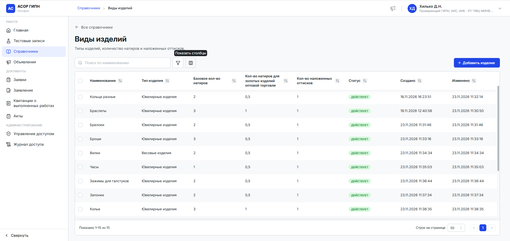
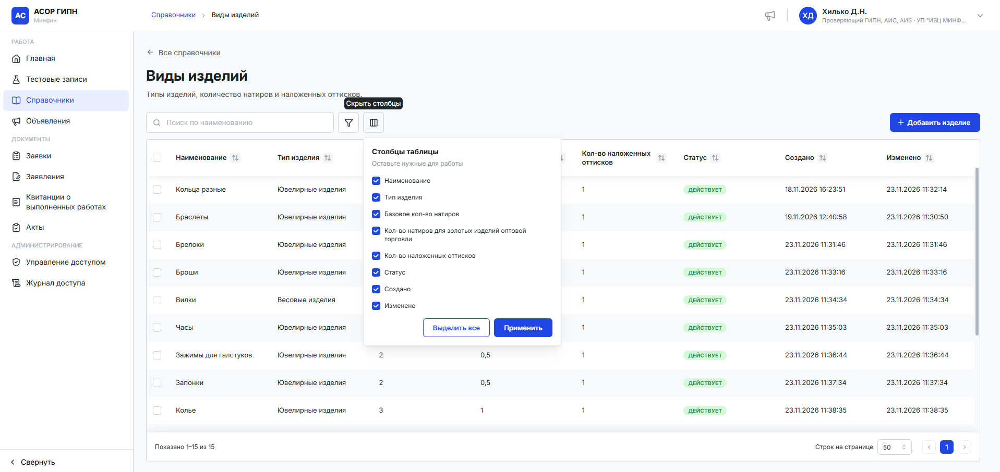
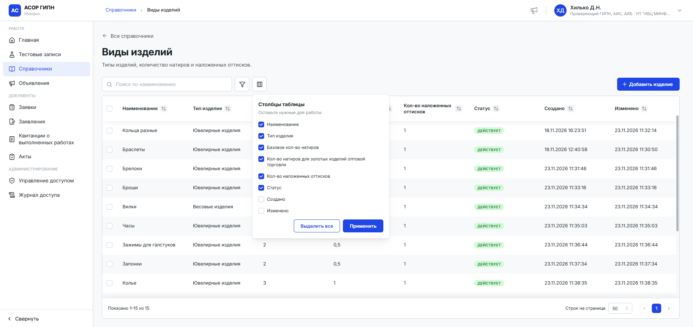
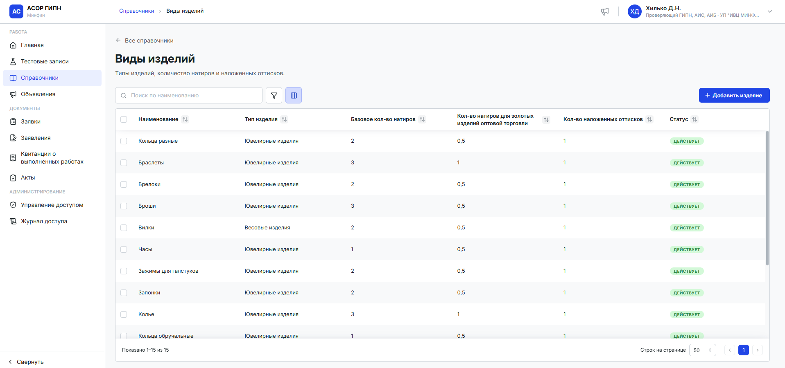
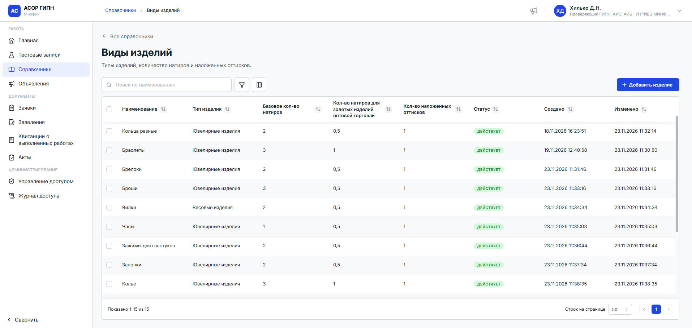

# ИНТЕРФЕЙСНЫЕ ТРЕБОВАНИЯ {#ui}

Критерии приёмки проверяются на каждом списке, который подключает функциональность. Эталонная реализация — экран
«Виды изделий» (приставка `data-testid` `pt`) с [тестовым набором][fixture].

## UI-G-COLUMNS-001. Кнопка и панель столбцов {#ui-g-columns-001 .collapsed}

- **Использует**: [SF-G-COLUMNS][], [NFR-002][], [NFR-005][], [дизайн-система][design-system] (IconButton, Tooltip,
Popover, Checkbox, Button)
- **Используется в**: [FR-PT-LIST-007][]
- **Описание**: Кнопка на панели инструментов открывает панель с флажками столбцов; таблица показывает только
отмеченные столбцы.
- **Условие**: Открыт экран со списком, который подключает [SF-G-COLUMNS][].
- **Результат**: Таблица показывает выбранные столбцы; при следующем открытии экрана выбор восстанавливается.
- **Показатели (NFR)**: Применение не отправляет запрос к API и занимает не больше 100 мс; соответствие [NFR-002][].

### Макеты {#ui-g-columns-001-mockups .collapsed}

Источник — скриншоты справочника видов изделий «02-Список видов изделий-03-Настройка видимости столбцов-01…06».











### Элементы {#ui-g-columns-001-elements .collapsed}

- **Кнопка столбцов** — `<p>-list-columns-button`
    - IconButton `control-lg` справа от кнопки фильтров, иконка `columns`, `aria-label` «Столбцы таблицы»,
      `aria-expanded` отражает открытие панели.
    - Тултип: «Показать столбцы», когда панель закрыта, и «Скрыть столбцы», когда открыта.
    - Активное состояние (фон `bg-selected`, иконка `accent`): панель открыта или скрыт хотя бы один столбец.
- **Панель столбцов** — `<p>-columns-popover`
    - Popover под кнопкой; заголовок «Столбцы таблицы», подзаголовок «Оставьте нужные для работы».
- **Флажок столбца** — `<p>-columns-option` с `data-field`
    - Checkbox с полным заголовком столбца, в порядке столбцов таблицы; отмечены видимые столбцы. Длинный заголовок
      переносится по словам.
- **Выделить все** — `<p>-columns-select-all`
    - Button Outline в футере панели.
- **Применить** — `<p>-columns-apply`
    - Button Primary в футере панели.

### Поведение (UX) {#ui-g-columns-001-ux .collapsed}

1. Кнопка столбцов открывает и закрывает панель; при открытии флажки отражают видимые столбцы.
2. «Выделить все» отмечает все флажки, но не применяет их: таблица меняется только после «Применить».
3. «Применить» показывает только отмеченные столбцы и закрывает панель; оставшиеся столбцы делят ширину таблицы.
   Если не отмечено ни одного столбца, «Применить» недоступна (см. `H01`).
4. Повторное нажатие кнопки, клик вне панели и Esc закрывают панель без применения; фокус возвращается на кнопку.
5. Выбор сохраняется в браузере пользователя и восстанавливается при следующем открытии экрана (см. `H02`).
6. Скрытие столбцов не отправляет запрос, не снимает сортировку по скрытому столбцу, выделение строк, поиск и
   фильтры.

### Критерии приёмки (AC) {#ui-g-columns-001-ac .collapsed}

```gherkin
# language: ru
@UI-G-COLUMNS-001 @SF-G-COLUMNS @ui
Функционал: Кнопка и панель столбцов

  Предыстория:
    Дано в справочнике видов изделий записи из файла "PT.fixture.json"
    И пользователь с ролью "ais" открыл экран "Виды изделий"

  Сценарий: Тултип и открытие панели
    Когда пользователь наводит курсор на "pt-list-columns-button"
    Тогда виден "tooltip" с текстом "Показать столбцы"
    Когда пользователь нажимает "pt-list-columns-button"
    Тогда виден "pt-columns-popover" с заголовком "Столбцы таблицы"
    И отмечены все "pt-columns-option"
    И при наведении виден "tooltip" с текстом "Скрыть столбцы"

  Сценарий: Скрытие столбцов
    Когда пользователь открывает "pt-columns-popover"
    И снимает "pt-columns-option" с data-field "created_at" и "updated_at"
    И нажимает "pt-columns-apply"
    Тогда "pt-columns-popover" закрыт
    И в таблице нет "pt-list-header" с data-field "created_at" и "updated_at"
    И "pt-list-columns-button" в активном состоянии
    И запрос списка не отправлялся

  Сценарий: Выделить все не применяет выбор
    Дано скрыты столбцы "created_at" и "updated_at"
    Когда пользователь открывает "pt-columns-popover" и нажимает "pt-columns-select-all"
    Тогда отмечены все "pt-columns-option"
    И в таблице по-прежнему нет столбцов "created_at" и "updated_at"
    Когда пользователь нажимает "pt-columns-apply"
    Тогда в таблице видны все столбцы данных

  Сценарий: Нельзя скрыть все столбцы
    Когда пользователь открывает "pt-columns-popover" и снимает все "pt-columns-option"
    Тогда "pt-columns-apply" недоступна

  Сценарий: Закрытие без применения
    Когда пользователь открывает "pt-columns-popover", снимает "pt-columns-option" с data-field "created_at"
    И нажимает Esc
    Тогда "pt-columns-popover" закрыт и фокус на "pt-list-columns-button"
    И в таблице есть столбец "created_at"

  Сценарий: Выбор сохраняется
    Дано скрыт столбец "updated_at"
    Когда пользователь обновляет страницу браузера
    Тогда в таблице нет столбца "updated_at"

  Сценарий: Хранилище браузера недоступно
    Дано хранилище браузера недоступно
    Когда пользователь открывает экран "Виды изделий"
    Тогда в таблице видны все столбцы данных
```

### Допущения {#ui-g-columns-001-assumptions .collapsed}

- **UI-G-COLUMNS-001.H01**
    - **Статус**: требует подтверждения
    - **Подтверждает**: владелец продукта
    - **Допущение**: Хотя бы один столбец данных остаётся видимым; на скриншотах снятие всех флажков не показано.
- **UI-G-COLUMNS-001.H02**
    - **Статус**: требует подтверждения
    - **Подтверждает**: архитектор
    - **Допущение**: Выбор хранится в `localStorage` браузера под ключом `<p>-list-columns`; если хранилище
      недоступно, показываются все столбцы. Хранение на сервере для всех устройств пользователя не требуется.


[fixture]: <../../features/dict-product-type/fr.md#fr-pt-fixture>
[SF-G-COLUMNS]: <index.md#sf-g-columns>
[NFR-002]: <../nfr.md#nfr-002>
[NFR-005]: <../nfr.md#nfr-005>
[design-system]: <../design-system/index.md>
[FR-PT-LIST-007]: <../../features/dict-product-type/sf-list/fr.md#fr-pt-list-007>
