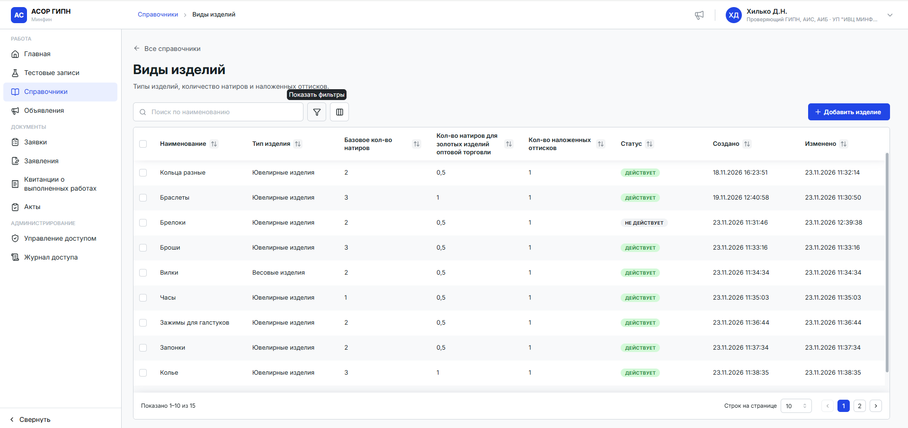
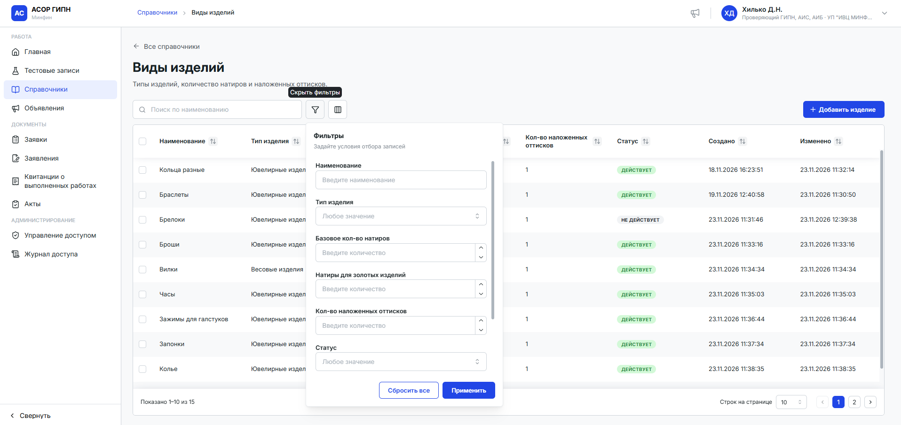
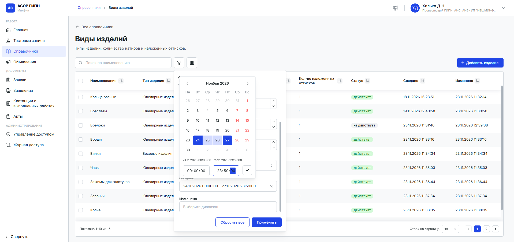
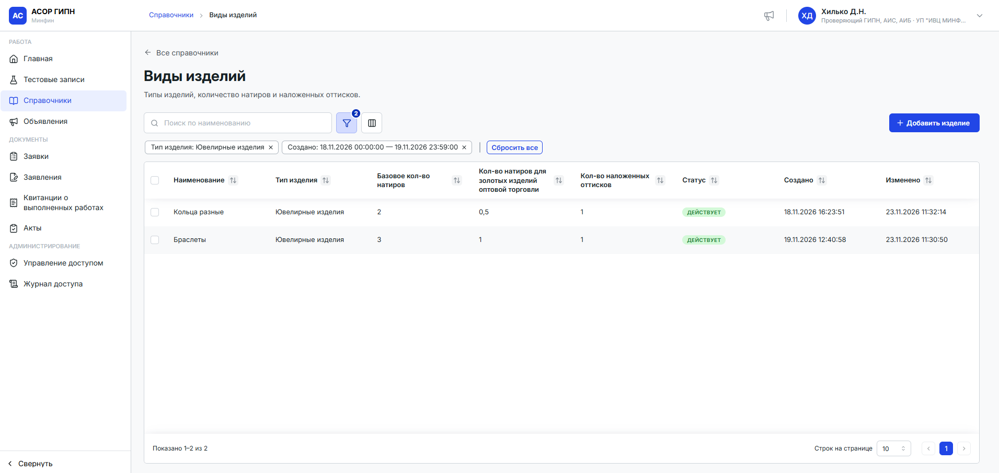
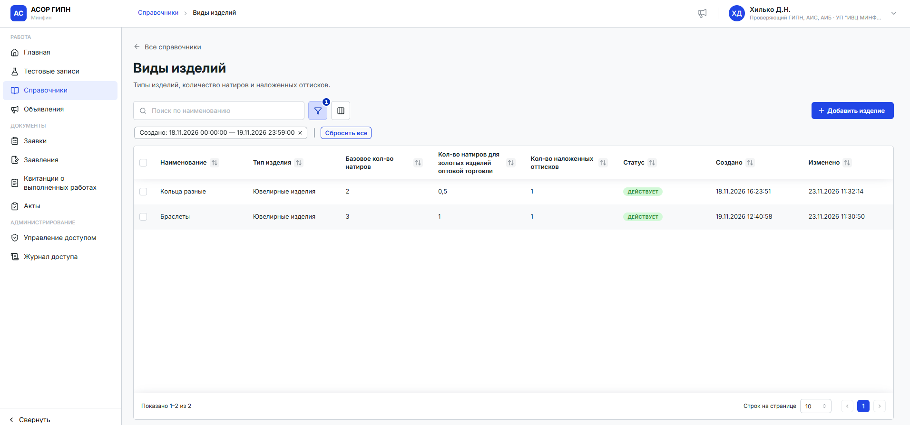
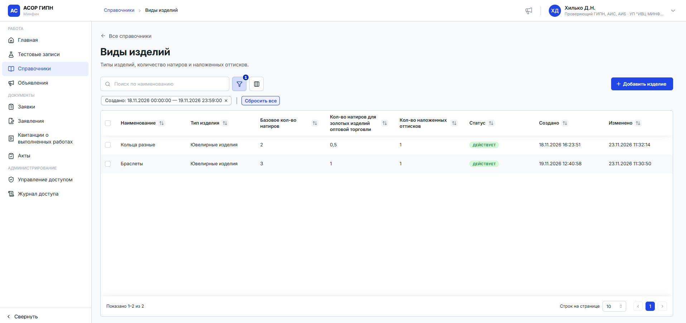
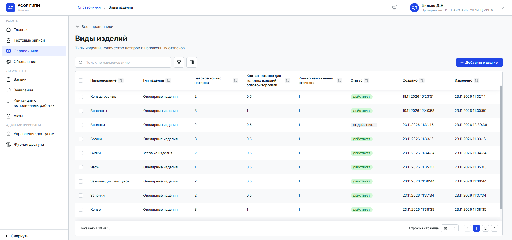

# ИНТЕРФЕЙСНЫЕ ТРЕБОВАНИЯ {#ui}

Критерии приёмки проверяются на каждом списке, который подключает функциональность. Эталонная реализация —
справочник видов изделий (`GET /api/v1/product-types`, экран «Виды изделий», приставка `data-testid` `pt`, поля
фильтра — в [FR-PT-LIST-006][]) с [тестовым набором][fixture].

## UI-G-FILTER-001. Кнопка и панель фильтров {#ui-g-filter-001 .collapsed}

- **Использует**: [SF-G-FILTER][], [FR-G-FILTER-001][], [NFR-005][], [дизайн-система][design-system] (IconButton,
Tooltip, Popover, TextInput, Select, NumberInput, DateRangeInput)
- **Используется в**: [FR-PT-LIST-006][]
- **Описание**: Кнопка на панели инструментов открывает панель с полями фильтра; применённые фильтры видны по
активной кнопке и счётчику.
- **Условие**: Открыт экран со списком, который подключает [SF-G-FILTER][].
- **Результат**: Таблица показывает только записи, которые удовлетворяют всем применённым фильтрам.
- **Показатели (NFR)**: Результат показывается не позже 1 с после нажатия «Применить» при ответе API в пределах
показателя функциональности; соответствие [NFR-002][].

### Макеты {#ui-g-filter-001-mockups .collapsed}

Источник — скриншоты справочника видов изделий «02-Список видов изделий-07-Фильтрация-01…07».







### Элементы {#ui-g-filter-001-elements .collapsed}

- **Кнопка фильтров** — `<p>-list-filter-button`
    - IconButton `control-lg`, иконка `filter`, `aria-label` «Фильтры», `aria-expanded` отражает открытие панели.
    - Тултип: «Показать фильтры», когда панель закрыта, и «Скрыть фильтры», когда открыта.
    - Активное состояние (фон `bg-selected`, иконка `accent`): панель открыта или применён хотя бы один фильтр.
- **Счётчик** — `<p>-list-filter-count`
    - Кружок `primary-8` с белой цифрой в правом верхнем углу кнопки: количество применённых фильтров (период — один
      фильтр). Без фильтров счётчик не выводится.
- **Панель** — `<p>-filter-popover`
    - Popover шириной 380px под кнопкой: заголовок «Фильтры», подзаголовок «Задайте условия отбора записей». Поля
      прокручиваются внутри, футер с кнопками закреплён. При открытии поля заполнены применёнными значениями.
- **Поле фильтра** — `<p>-filter-<поле>`, где `<поле>` — имя поля API через дефис (например, `pt-filter-is-active`)
    - Подпись над полем — подпись функциональности. Вид поля по виду условия:

| Вид условия | Компонент | Плейсхолдер | Особенности |
| :--- | :--- | :--- | :--- |
| Вхождение | TextInput | Введите <что> | Длина — по полю |
| Выбор, логическое | Select | Любое значение | Крестик в поле снимает выбор |
| Число, целое | NumberInput | Введите количество | Стрелки меняют значение на шаг поля |
| Период | DateRangeInput | Выберите диапазон | Календарь и время, см. ниже |

- **Пункт выбора** — `<p>-filter-option` с `data-value` (код значения или `true`, `false`).
- **Числовое поле**: разделитель — запятая, точка при вводе заменяется на запятую, буквы не вводятся; стрелки
  справа, стрелка «вниз» недоступна, если значение не больше шага.
- **Период**:
    - Календарь месяца со стрелками перехода, неделя начинается с понедельника, выходные — цветом `danger`, дни
      соседних месяцев — `text-muted`. Дни начала и конца — заливка `accent`, дни между ними — `primary-1`.
    - Под календарём — строка диапазона «ДД.ММ.ГГГГ ЧЧ:ММ:СС – ДД.ММ.ГГГГ ЧЧ:ММ:СС» (короткое тире с пробелами),
      поля времени начала (по умолчанию 00:00:00) и конца (по умолчанию 23:59:59, см. `H02`) с отдельным выбором
      часов, минут и секунд и кнопка с иконкой `check`, которая подтверждает выбор и закрывает календарь.
    - Поле показывает выбранный диапазон в том же формате; крестик в поле очищает период.
- **Ошибка поля** — `<p>-filter-error` с `data-field`: текст стилем `error` под полем, рамка поля `danger`. Тексты:
  «Введите число», «Введите целое число», «Значение должно быть больше 0», «Значение должно быть не больше
  <предел>», «Не более 2 знаков после запятой».
- **Сбросить все** — `<p>-filter-reset`: Button Outline в футере панели.
- **Применить** — `<p>-filter-apply`: Button Primary в футере панели.

### Поведение (UX) {#ui-g-filter-001-ux .collapsed}

1. Кнопка фильтров открывает и закрывает панель.
2. «Применить» проверяет поля: при ошибке панель остаётся открытой и запрос не отправляется; без ошибок —
   применяет заполненные поля, закрывает панель и загружает первую страницу ([SF-G-PAG][]); поиск и сортировка
   сохраняются, выделение снимается. Применённые фильтры показываются чипами ([UI-G-FILTER-002][]).
3. «Сбросить все» очищает поля, снимает все фильтры, загружает первую страницу и закрывает панель (см. `H01`).
4. Повторное нажатие кнопки фильтров, клик вне панели и Esc закрывают панель без применения: неприменённые
   изменения отбрасываются, фокус возвращается на кнопку фильтров.
5. Применённые фильтры отражаются в адресе экрана параметрами API.
6. Открытая панель доступна с клавиатуры: фокус переходит на первое поле, Tab — по полям, затем на «Сбросить все» и
   «Применить».

### Критерии приёмки (AC) {#ui-g-filter-001-ac .collapsed}

```gherkin
# language: ru
@UI-G-FILTER-001 @SF-G-FILTER @ui
Функционал: Кнопка и панель фильтров

  Предыстория:
    Дано в справочнике видов изделий записи из файла "PT.fixture.json"
    И пользователь с ролью "ais" открыл экран "Виды изделий"

  Сценарий: Тултип и открытие панели
    Когда пользователь наводит курсор на "pt-list-filter-button"
    Тогда виден "tooltip" с текстом "Показать фильтры"
    Когда пользователь нажимает "pt-list-filter-button"
    Тогда виден "pt-filter-popover" с заголовком "Фильтры"
    И "pt-list-filter-button" имеет aria-expanded "true"
    И при наведении виден "tooltip" с текстом "Скрыть фильтры"

  Сценарий: Применение двух фильтров
    Когда пользователь открывает "pt-filter-popover"
    И выбирает "pt-filter-option" с data-value "JEWELRY" в "pt-filter-product-group"
    И задаёт в "pt-filter-created-at" период с 18.11.2026 по 19.11.2026
    И нажимает "pt-filter-apply"
    Тогда "pt-filter-popover" закрыт
    И "pt-list-filter-button" в активном состоянии, "pt-list-filter-count" содержит "2"
    И "pt-pagination-summary" содержит текст "Показано 1–2 из 2"
    И адрес экрана содержит "product_group=JEWELRY"

  Сценарий: Значения по умолчанию в периоде
    Когда пользователь открывает "pt-filter-popover" и выбирает в "pt-filter-created-at" дни 24 и 27 ноября 2026
    Тогда строка диапазона содержит "24.11.2026 00:00:00 – 27.11.2026 23:59:59"

  Сценарий: Ошибка в числовом фильтре
    Когда пользователь открывает "pt-filter-popover"
    И вводит "0,555" в "pt-filter-default-streak-count"
    И нажимает "pt-filter-apply"
    Тогда "pt-filter-popover" открыт
    И виден "pt-filter-error" с data-field "default_streak_count" и текстом "Не более 2 знаков после запятой"
    И запрос списка не отправлялся

  Сценарий: Закрытие панели без применения
    Когда пользователь открывает "pt-filter-popover"
    И выбирает "pt-filter-option" с data-value "false" в "pt-filter-is-active"
    И нажимает Esc
    Тогда "pt-filter-popover" закрыт и фокус на "pt-list-filter-button"
    И нет "pt-filter-chips"
    И при повторном открытии "pt-filter-is-active" показывает "Любое значение"

  Сценарий: Сбросить все в панели
    Дано применён фильтр "Статус: Действует"
    Когда пользователь открывает "pt-filter-popover" и нажимает "pt-filter-reset"
    Тогда "pt-filter-popover" закрыт
    И нет "pt-list-filter-count"
    И "pt-pagination-summary" содержит текст "Показано 1–10 из 15"

  @NFR @a11y
  Сценарий: Управление панелью с клавиатуры
    Когда пользователь переводит фокус на "pt-list-filter-button" и нажимает Enter
    Тогда виден "pt-filter-popover" и фокус на первом поле панели
    И клавиша Tab переводит фокус по полям панели, затем на "pt-filter-reset" и "pt-filter-apply"
```

### Допущения {#ui-g-filter-001-assumptions .collapsed}

- **UI-G-FILTER-001.H01**
    - **Статус**: требует подтверждения
    - **Подтверждает**: владелец продукта
    - **Допущение**: «Сбросить все» в панели сразу снимает фильтры и закрывает панель, как одноимённая кнопка в строке
      чипов; на скриншотах её нажатие не показано.
- **UI-G-FILTER-001.H02**
    - **Статус**: требует подтверждения
    - **Подтверждает**: владелец продукта
    - **Допущение**: Время конца периода по умолчанию — 23:59:59, а не 23:59:00, как на скриншоте: иначе записи,
      созданные в последнюю минуту дня, не попадут в отбор.

## UI-G-FILTER-002. Чипы применённых фильтров {#ui-g-filter-002 .collapsed}

- **Использует**: [SF-G-FILTER][], [UI-G-FILTER-001][], [NFR-005][], [дизайн-система][design-system] (FilterChips,
Tooltip)
- **Используется в**: [FR-PT-LIST-006][]
- **Описание**: Строка под панелью инструментов показывает применённые фильтры чипами и позволяет отключить один
фильтр или все сразу.
- **Условие**: Применён хотя бы один фильтр ([UI-G-FILTER-001][]).
- **Результат**: Пользователь видит условия отбора и снимает их без открытия панели.

### Макеты {#ui-g-filter-002-mockups .collapsed}

Источник — скриншоты справочника видов изделий «02-Список видов изделий-07-Фильтрация-07…09».









### Элементы {#ui-g-filter-002-elements .collapsed}

- **Строка чипов** — `<p>-filter-chips`
    - Под панелью инструментов, видна при хотя бы одном применённом фильтре; если выделены строки, панель выделения
      идёт под строкой чипов.
- **Чип** — `<p>-filter-chip` с `data-field`
    - Текст «<Подпись поля>: <значение>», рамка `gray-5`, скругление `radius-sm`. Порядок чипов — порядок полей в
      панели; число чипов равно счётчику на кнопке.
    - Формат значения: название значения для выбора («Ювелирные изделия», «Действует»), число с запятой («0,5»),
      период — «ДД.ММ.ГГГГ ЧЧ:ММ:СС — ДД.ММ.ГГГГ ЧЧ:ММ:СС» (длинное тире с пробелами).
- **Отключить фильтр** — `<p>-filter-chip-remove` внутри чипа
    - Иконка `x`, `aria-label` «Отключить фильтр <подпись поля>».
- **Сбросить все** — `<p>-filter-chips-reset`
    - Button Outline sm после вертикального разделителя, тултип «Сбросить все фильтры».

### Поведение (UX) {#ui-g-filter-002-ux .collapsed}

1. Крестик на чипе снимает один фильтр, уменьшает счётчик и загружает первую страницу.
2. «Сбросить все» снимает все фильтры; поиск не сбрасывается. Строка чипов и счётчик исчезают, кнопка фильтров
   перестаёт быть активной.

### Критерии приёмки (AC) {#ui-g-filter-002-ac .collapsed}

```gherkin
# language: ru
@UI-G-FILTER-002 @SF-G-FILTER @ui
Функционал: Чипы применённых фильтров

  Предыстория:
    Дано в справочнике видов изделий записи из файла "PT.fixture.json"
    И пользователь с ролью "ais" открыл экран "Виды изделий"

  Сценарий: Чипы показывают применённые фильтры
    Дано применены фильтры «Тип изделия: Ювелирные изделия» и «Создано» с 18.11.2026 по 19.11.2026
    Тогда видны "pt-filter-chip" с текстами "Тип изделия: Ювелирные изделия" и
      "Создано: 18.11.2026 00:00:00 — 19.11.2026 23:59:59"
    И число "pt-filter-chip" равно значению "pt-list-filter-count"

  Сценарий: Отключение одного фильтра
    Дано применены фильтры «Тип изделия: Ювелирные изделия» и «Создано» с 18.11.2026 по 19.11.2026
    Когда пользователь нажимает "pt-filter-chip-remove" в чипе с data-field "product_group"
    Тогда виден один "pt-filter-chip" с data-field "created_at"
    И "pt-list-filter-count" содержит "1"
    И "pt-pagination-summary" содержит текст "Показано 1–2 из 2"

  Сценарий: Сброс всех фильтров не сбрасывает поиск
    Дано пользователь ввёл "кольца" в "pt-list-search"
    И применён фильтр «Базовое кол-во натиров: 1»
    Когда пользователь наводит курсор на "pt-filter-chips-reset"
    Тогда виден "tooltip" с текстом "Сбросить все фильтры"
    Когда пользователь нажимает "pt-filter-chips-reset"
    Тогда нет "pt-filter-chips" и "pt-list-filter-count"
    И "pt-list-search" содержит "кольца"
    И "pt-pagination-summary" содержит текст "Показано 1–2 из 2"
```


[fixture]: <../../features/dict-product-type/fr.md#fr-pt-fixture>
[SF-G-FILTER]: <index.md#sf-g-filter>
[SF-G-PAG]: <../sf-g-pag/index.md#sf-g-pag>
[NFR-002]: <../nfr.md#nfr-002>
[NFR-005]: <../nfr.md#nfr-005>
[design-system]: <../design-system/index.md>
[FR-G-FILTER-001]: <fr.md#fr-g-filter-001>
[UI-G-FILTER-001]: <#ui-g-filter-001>
[UI-G-FILTER-002]: <#ui-g-filter-002>
[FR-PT-LIST-006]: <../../features/dict-product-type/sf-list/fr.md#fr-pt-list-006>
