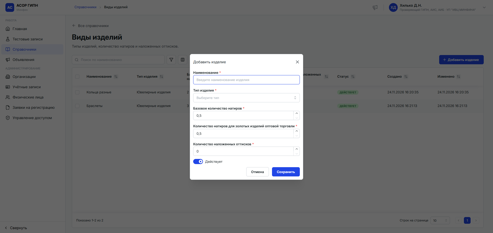
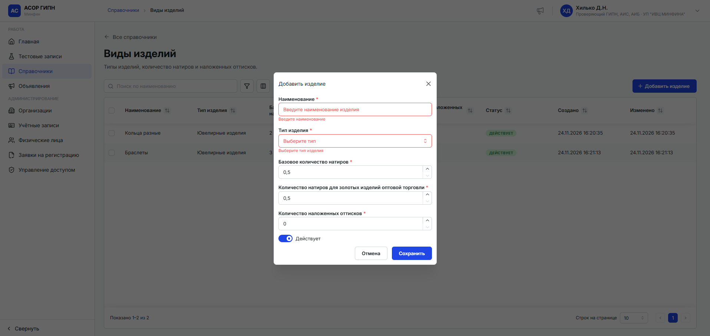
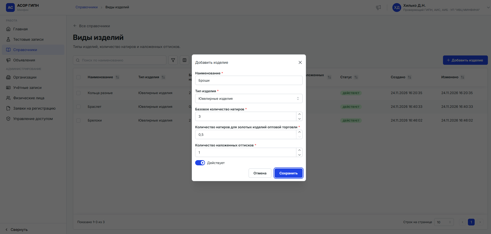
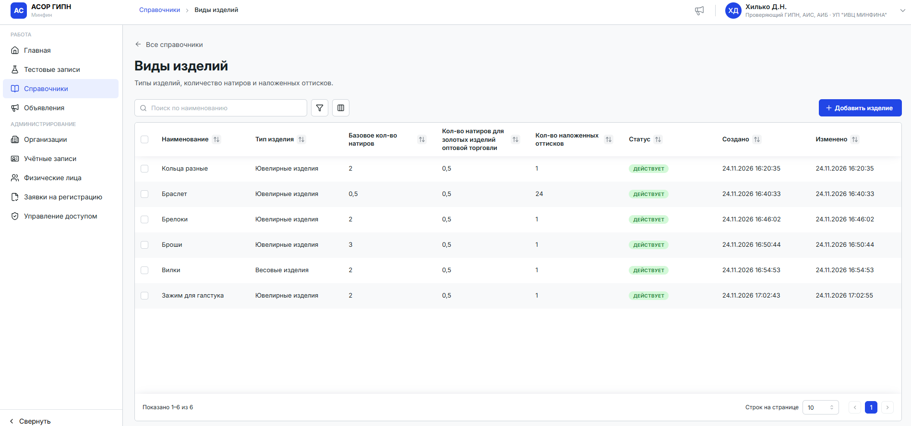

# ИНТЕРФЕЙСНЫЕ ТРЕБОВАНИЯ {#ui}

Критерии приёмки проверяются на каждой форме, которая подключает функциональность. Эталонная реализация — форма
вида изделий [UI-PT-001][] (приставка `data-testid` `pt`) в режиме создания с [тестовым набором][fixture].

## UI-G-FORM-001. Модальная форма записи {#ui-g-form-001 .collapsed}

- **Использует**: [SF-G-FORM][], [AR-001][], [UI-G-TOAST-001][], [UI-G-SESSION-001][], [NFR-002][], [NFR-005][],
[дизайн-система][design-system] (Modal, TextInput, Select, NumberInput, Switch, Button)
- **Используется в**: [UI-PT-001][], [UI-G-LOCK-001][]
- **Описание**: Модальное окно с полями записи работает в режимах создания и изменения, проверяет поля до отправки,
показывает ошибки под полями и сообщает результат.
- **Условие**: Пользователь открыл форму действием функциональности (кнопка создания, клик по строке) и имеет право
на операцию режима.
- **Результат**: Корректные данные отправляются одним запросом; при успехе окно закрывается и список обновляется,
при отказе введённые данные сохраняются.
- **Показатели (NFR)**:
    - Проверка полей и показ ошибок — не позже 100 мс после нажатия «Сохранить», без запроса к API.
    - Повторные нажатия «Сохранить» во время отправки не создают повторных запросов.
    - Соответствие [NFR-002][]: фокус удерживается в окне, ошибки связаны с полями, Esc закрывает окно.

### Макеты {#ui-g-form-001-mockups .collapsed}

Источник — скриншоты справочника видов изделий «04-Создание записи-01…03» и «05-Изменение записи-01».









### Окно {#ui-g-form-001-modal .collapsed}

- **Окно** — `<p>-form-modal` с `data-mode` (`create` или `update`), в режиме изменения также `data-pk`
    - Modal шириной `modal-width` (440px): фон `bg-surface`, скругление `radius-md`, тень `shadow-lg`, подложка
      `overlay`; `role="dialog"`, `aria-modal="true"`, `aria-labelledby` ссылается на заголовок.
- **Заголовок** — `<p>-form-title`: текст режима («Добавить …», «Изменить …»), стиль `modal-title`.
- **Закрыть** — `<p>-form-close`: IconButton `x` в правом верхнем углу, `aria-label` «Закрыть».
- **Загрузка** — `<p>-form-loading`: скелетон вместо полей, пока форма изменения читает запись; «Сохранить»
  недоступна.

### Поля {#ui-g-form-001-fields .collapsed}

- **Раскладка**: один столбец, зазор `space-3`, порядок — по требованию функциональности. Поле — `<p>-form-<поле>`
  с `data-field` (имя поля API).
- **Подпись**: стиль `label`, полностью, без сокращений; у обязательного поля — красная звёздочка `danger`.
- **Текстовое поле** (TextInput): плейсхолдер — что ввести; лишние символы сверх максимальной длины не вводятся;
  при отправке пробелы по краям обрезаются.
- **Выбор** (Select): плейсхолдер «Выберите …»; пункт — `<p>-form-option` с `data-value`.
- **Число** (NumberInput): разделитель — запятая, точка при вводе заменяется на запятую, буквы и другие символы не
  вводятся. Справа стрелки `<p>-form-step-up` и `<p>-form-step-down` с `data-field`, `aria-label` «Увеличить» и
  «Уменьшить»; клавиши ↑ и ↓ действуют так же. Стрелка недоступна, если шаг выводит значение за границы поля.
  В запросе — JSON-число с точкой.
- **Переключатель** (Switch): подпись справа описывает включённое состояние и не меняется; `role="switch"`,
  `aria-checked`; включён — дорожка `accent`, выключен — `gray-3`. Нажатие на переключатель или подпись и «пробел»
  меняют состояние.
- **Первое поле** при открытии окна в фокусе.

### Ошибки полей {#ui-g-form-001-errors .collapsed}

- **Текст ошибки** — `<p>-form-error` с `data-field`: под полем, стиль `error`; рамка поля и плейсхолдер — `danger`;
  у поля `aria-invalid="true"` и `aria-describedby`, ссылающийся на текст ошибки.
- Ошибки показываются после нажатия «Сохранить» у каждого поля с ошибкой, а не при вводе; исправление значения
  убирает ошибку этого поля.
- Ответ `400` показывается так же, под полями по `details[].field`; ошибка поля, которого нет в форме, —
  уведомлением «Ошибка».

### Кнопки {#ui-g-form-001-buttons .collapsed}

Футер окна, кнопки справа: «Отмена» и «Сохранить».

- **Отмена** — `<p>-form-cancel`: Button Default; закрывает окно без сохранения (см. `Q01`).
- **Сохранить** — `<p>-form-submit`: Button Primary; Enter в текстовом или числовом поле действует как нажатие.
    - При ошибках запрос не отправляется, окно остаётся открытым, фокус переходит на первое поле с ошибкой.
    - Без ошибок отправляет запрос режима; во время отправки кнопка недоступна и показывает индикатор загрузки,
      поля недоступны.

### Поведение (UX) {#ui-g-form-001-ux .collapsed}

1. Фокус удерживается в окне: Tab переходит по полям, затем на «Отмена», «Сохранить», «Закрыть» и снова на первое
   поле.
2. Крестик, «Отмена» и Esc закрывают окно без подтверждения, даже если данные изменены (до решения `Q01`); клик по
   подложке окно не закрывает. После закрытия фокус возвращается на элемент, которым окно открыли.
3. Общие ответы на сохранение (особые отказы и тексты успеха — в требованиях функциональности):

| Ответ | Что делает форма |
| :--- | :--- |
| `200`, `201` | Окно закрывается, уведомление «Готово» с текстом режима, список перезагружается с текущими условиями |
| `400` | Ошибки под полями, окно остаётся открытым |
| `403` | Уведомление «Ошибка» с текстом из `message`, окно остаётся открытым |
| `401` | По [UI-G-SESSION-001][] |
| `500`, нет связи | Уведомление «Ошибка»: «Не удалось сохранить <объект>. Повторите попытку.»; данные в форме |

4. Уведомления — по [UI-G-TOAST-001][].

### Критерии приёмки (AC) {#ui-g-form-001-ac .collapsed}

```gherkin
# language: ru
@UI-G-FORM-001 @SF-G-FORM @ui
Функционал: Модальная форма записи

  Предыстория:
    Дано в справочнике видов изделий записи из файла "PT.fixture.json"
    И пользователь с ролью "ais" открыл экран "Виды изделий"
    И открыта форма создания

  Сценарий: Окно формы
    Тогда виден "pt-form-modal" с data-mode "create", role "dialog" и aria-modal "true"
    И фокус на первом поле формы

  Сценарий: Ошибки показываются после нажатия «Сохранить»
    Когда пользователь нажимает "pt-form-submit"
    Тогда видны "pt-form-error" у незаполненных обязательных полей
    И у первого поля с ошибкой aria-invalid "true" и фокус на нём
    И запрос сохранения не отправлялся

  Сценарий: Исправление значения убирает ошибку поля
    Дано показаны ошибки незаполненных полей
    Когда пользователь вводит "Броши" в "pt-form-name"
    Тогда нет "pt-form-error" с data-field "name_nominative"

  Сценарий: Внутренняя ошибка при сохранении
    Дано API сохранения отвечает кодом 500
    И поля формы заполнены корректно
    Когда пользователь нажимает "pt-form-submit"
    Тогда виден "toast" с data-type "error"
    И "pt-form-modal" открыт, введённые данные сохранены

  # Поведение может измениться по решению вопроса UI-G-FORM-001.Q01
  Структура сценария: Закрытие без сохранения
    Дано в "pt-form-name" введено "Подвески"
    Когда пользователь <действие>
    Тогда "pt-form-modal" закрыт и фокус на "pt-list-create-button"
    И запрос сохранения не отправлялся

    Примеры:
      | действие                  |
      | нажимает "pt-form-cancel" |
      | нажимает "pt-form-close"  |
      | нажимает Esc              |

  Сценарий: Клик по подложке не закрывает окно
    Когда пользователь кликает по подложке окна
    Тогда "pt-form-modal" открыт

  @NFR
  Сценарий: Двойное нажатие не отправляет повторный запрос
    Дано ответ API сохранения задерживается на 1 с
    И поля формы заполнены корректно
    Когда пользователь дважды быстро нажимает "pt-form-submit"
    Тогда отправлен ровно один запрос сохранения
    И во время отправки "pt-form-submit" недоступна

  @NFR @performance
  Сценарий: Скорость проверки полей
    Когда пользователь нажимает "pt-form-submit" с пустыми полями
    Тогда ошибки полей появляются не позже 100 мс после нажатия

  @NFR @a11y
  Сценарий: Доступность окна
    Тогда проверка axe-core внутри "pt-form-modal" не находит нарушений уровней A и AA
    И нажатия Tab не выводят фокус за пределы "pt-form-modal"
```

### Открытые вопросы {#ui-g-form-001-questions .collapsed}

- **UI-G-FORM-001.Q01**
    - **Статус**: открыт
    - **Решает**: владелец продукта
    - **Вопрос**: Спрашивать ли подтверждение «Закрыть без сохранения?», если пользователь закрывает форму
      (крестик, «Отмена», Esc) после того, как изменил данные?
    - **Варианты**:
        1. Не спрашивать (так описано сейчас): данные теряются без предупреждения; от случайного закрытия защищает
           только то, что клик по подложке окно не закрывает.
        2. Спрашивать, только если значения отличаются от значений при открытии: окно «Закрыть без сохранения?» с
           текстом «Введённые данные будут потеряны.» и кнопками «Продолжить» (Default) и «Закрыть» (Danger) по
           правилам [UI-G-CONFIRM-001][]. Если данные не менялись, окно закрывается сразу.
    - **От решения зависит**: поведение «Отмены», крестика и Esc во всех формах продукта и сценарий «Закрытие без
      сохранения».


[fixture]: <../../features/dict-product-type/fr.md#fr-pt-fixture>
[SF-G-FORM]: <index.md#sf-g-form>
[AR-001]: <../ar.md#ar-001>
[UI-G-TOAST-001]: <../sf-g-toast/ui.md#ui-g-toast-001>
[UI-G-SESSION-001]: <../sf-g-session/ui.md#ui-g-session-001>
[UI-G-LOCK-001]: <../sf-g-lock/ui.md#ui-g-lock-001>
[UI-G-CONFIRM-001]: <../sf-g-confirm/ui.md#ui-g-confirm-001>
[NFR-002]: <../nfr.md#nfr-002>
[NFR-005]: <../nfr.md#nfr-005>
[design-system]: <../design-system/index.md>
[UI-PT-001]: <../../features/dict-product-type/ui.md#ui-pt-001>
