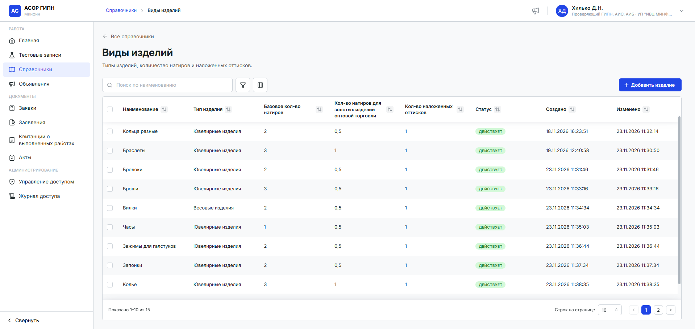
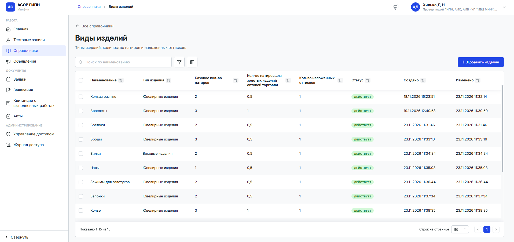
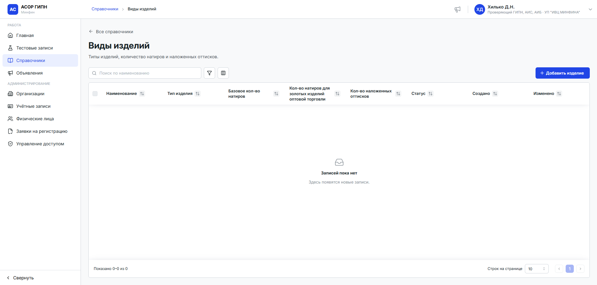

# ИНТЕРФЕЙСНЫЕ ТРЕБОВАНИЯ {#ui}

Критерии приёмки глобальной функциональности проверяются на каждом списке, который её подключает. Эталонная
реализация — справочник видов изделий (`GET /api/v1/product-types`, экран «Виды изделий», приставка `data-testid`
`pt`) с [тестовым набором][fixture] из 15 записей. Новый список добавляется строкой в примеры сценариев.

## UI-G-PAG-001. Панель пагинации {#ui-g-pag-001 .collapsed}

- **Использует**: [SF-G-PAG][], [FR-G-PAG-001][], [NFR-005][], [дизайн-система][design-system] (Pagination, Select,
IconButton)
- **Используется в**: [FR-PT-LIST-005][]
- **Описание**: Панель в футере таблицы показывает, какие записи видны, и переключает страницы и их размер.
- **Условие**: Открыт экран со списком, который подключает [SF-G-PAG][].
- **Результат**: Пользователь видит диапазон показанных записей и их общее количество, переходит между страницами и
меняет размер страницы; условия списка при этом сохраняются.
- **Показатели (NFR)**: Новая страница показывается не позже 1 с после нажатия при ответе API в пределах показателя
функциональности; соответствие [NFR-002][].

### Макеты {#ui-g-pag-001-mockups .collapsed}

Источник — скриншоты справочника видов изделий «02-Список видов изделий-01…02».








### Элементы {#ui-g-pag-001-elements .collapsed}

Атрибуты `data-testid` строятся по [NFR-005][]: `<p>` — приставка экрана (у справочника видов изделий — `pt`).

- **Панель** — `<p>-pagination`
    - Компонент Pagination в футере таблицы, футер прижат к низу рабочей области.
- **Сводка** — `<p>-pagination-summary`
    - Слева: «Показано X–Y из N», где X и Y — номера первой и последней записи страницы, N — `total`; тире короткое
      (–). Без записей — «Показано 0–0 из 0».
- **Размер страницы** — `<p>-pagination-page-size`
    - Справа: подпись «Строк на странице» и Select `control-sm` со значениями 10, 25, 50, 100; выбранное значение
      отмечено галочкой. Пункт списка — `<p>-pagination-page-size-option` с `data-value`.
- **Предыдущая и следующая страница** — `<p>-pagination-prev`, `<p>-pagination-next`
    - IconButton `control-sm` с иконками `chevron-left` и `chevron-right`, `aria-label` «Предыдущая страница» и
      «Следующая страница». На первой странице недоступна «Предыдущая», на последней — «Следующая» (цвет `gray-4`,
      атрибут `disabled`).
- **Номер страницы** — `<p>-pagination-page` с `data-page`
    - Кнопка `control-sm` с рамкой `border`; текущая — заливка `accent`, белый текст, `aria-current="page"`. Если
      страница одна или записей нет, текущая кнопка цвета `primary-2` и недоступна.
    - При числе страниц больше 7 показываются первая, последняя, текущая и соседние с ней страницы; пропуски
      обозначаются знаком «…» — `<p>-pagination-ellipsis`, не кнопка (см. `H01`).

### Поведение (UX) {#ui-g-pag-001-ux .collapsed}

1. Номер и размер страницы отражаются в адресе экрана параметрами `page` и `page_size`. Обновление страницы, кнопки
   «Назад» и «Вперёд» браузера восстанавливают тот же список.
2. Переход на другую страницу сохраняет поиск, фильтры, сортировку и размер страницы; таблица прокручивается к первой
   строке.
3. Смена размера страницы загружает первую страницу с текущими условиями.
4. Изменение поиска, фильтров или сортировки загружает первую страницу ([SF-G-SEARCH][], [SF-G-FILTER][],
   [SF-G-SORT][]).
5. Если на запрошенной странице нет записей, а `total` больше 0 (например, записи удалил другой пользователь), экран
   загружает последнюю существующую страницу.
6. Если ответ пришёл после более нового запроса, экран его не показывает: отображается результат последнего запроса.
7. Выделение строк снимается при переходе на другую страницу и при смене размера страницы.

### Критерии приёмки (AC) {#ui-g-pag-001-ac .collapsed}

```gherkin
# language: ru
@UI-G-PAG-001 @SF-G-PAG @ui
Функционал: Панель пагинации

  Предыстория:
    Дано в справочнике видов изделий записи из файла "PT.fixture.json"
    И пользователь с ролью "ais" открыл экран "Виды изделий"

  Сценарий: Первая страница
    Тогда "pt-pagination-summary" содержит текст "Показано 1–10 из 15"
    И видны "pt-pagination-page" с data-page 1 и 2, у страницы 1 aria-current "page"
    И "pt-pagination-prev" недоступна
    И "pt-pagination-page-size" показывает "10"

  Сценарий: Переход на следующую страницу
    Когда пользователь нажимает "pt-pagination-next"
    Тогда в таблице 5 строк, первая — "Ложки"
    И "pt-pagination-summary" содержит текст "Показано 11–15 из 15"
    И "pt-pagination-next" недоступна
    И адрес экрана содержит "page=2"

  Сценарий: Переход по номеру страницы
    Когда пользователь нажимает "pt-pagination-page" с data-page 2
    Тогда у "pt-pagination-page" с data-page 2 aria-current "page"

  Сценарий: Смена размера страницы
    Дано открыта страница 2
    Когда пользователь выбирает "pt-pagination-page-size-option" с data-value 50
    Тогда в таблице 15 строк
    И "pt-pagination-summary" содержит текст "Показано 1–15 из 15"
    И "pt-pagination-prev" и "pt-pagination-next" недоступны

  Сценарий: Условия восстанавливаются после обновления страницы
    Дано открыта страница 2 с размером страницы 10
    Когда пользователь обновляет страницу браузера
    Тогда в таблице 5 строк, первая — "Ложки"

  Сценарий: Пустой список
    Дано справочник видов изделий пуст
    Когда пользователь открывает экран "Виды изделий"
    Тогда "pt-pagination-summary" содержит текст "Показано 0–0 из 0"
    И "pt-pagination-page" с data-page 1 недоступна

  Сценарий: Переход на последнюю существующую страницу
    Дано открыта страница 2
    И другой пользователь удалил записи так, что их осталось 10
    Когда пользователь обновляет страницу браузера
    Тогда открыта страница 1 и "pt-pagination-summary" содержит текст "Показано 1–10 из 10"

  Сценарий: Устаревший ответ не перезаписывает новый
    Дано ответ на запрос страницы 1 задерживается на 2 с
    Когда пользователь открывает экран и сразу нажимает "pt-pagination-page" с data-page 2
    Тогда в таблице показаны записи страницы 2
    И после прихода ответа на страницу 1 в таблице по-прежнему записи страницы 2

  @NFR @a11y
  Сценарий: Доступность панели
    Тогда у "pt-pagination-prev" и "pt-pagination-next" есть aria-label
    И панель работает с клавиатуры: Tab переводит фокус на кнопки, Enter переключает страницу
```

### Допущения {#ui-g-pag-001-assumptions .collapsed}

- **UI-G-PAG-001.H01**
    - **Статус**: требует подтверждения
    - **Подтверждает**: владелец продукта
    - **Допущение**: Правило сокращения ряда страниц (больше 7 — первая, последняя, текущая и соседние с «…») на
      скриншотах не показано: в справочнике видов изделий не больше двух страниц.


[fixture]: <../../features/dict-product-type/fr.md#fr-pt-fixture>
[SF-G-PAG]: <index.md#sf-g-pag>
[SF-G-SORT]: <../sf-g-sort/index.md#sf-g-sort>
[SF-G-SEARCH]: <../sf-g-search/index.md#sf-g-search>
[SF-G-FILTER]: <../sf-g-filter/index.md#sf-g-filter>
[NFR-002]: <../nfr.md#nfr-002>
[NFR-005]: <../nfr.md#nfr-005>
[design-system]: <../design-system/index.md>
[FR-G-PAG-001]: <fr.md#fr-g-pag-001>
[FR-PT-LIST-005]: <../../features/dict-product-type/sf-list/fr.md#fr-pt-list-005>
