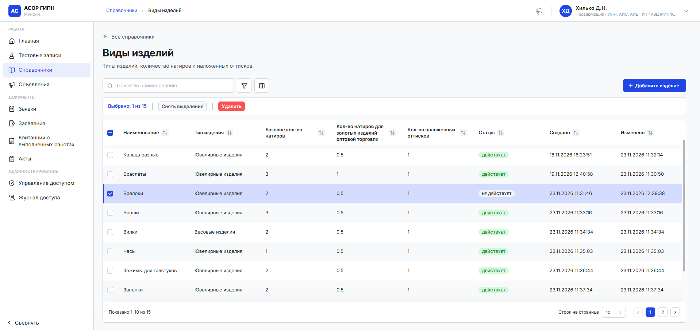
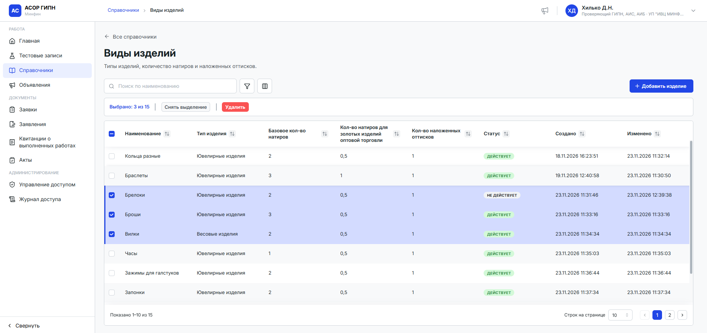
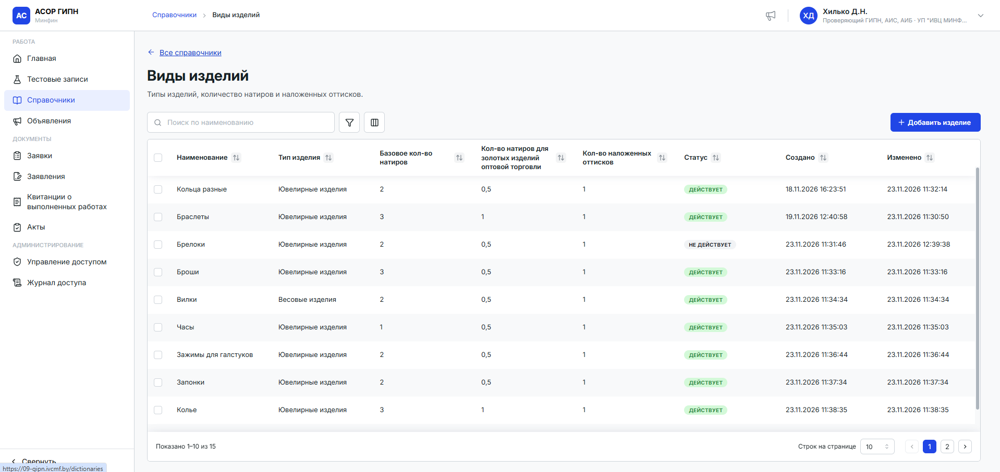
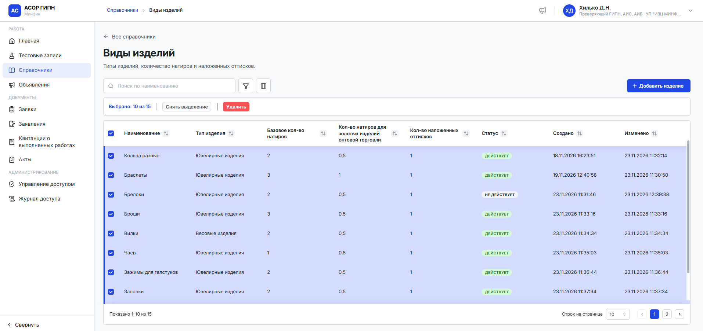

# ИНТЕРФЕЙСНЫЕ ТРЕБОВАНИЯ {#ui}

Критерии приёмки проверяются на каждом списке, который подключает функциональность. Эталонная реализация — экран
«Виды изделий» (приставка `data-testid` `pt`, действие панели — удаление) с [тестовым набором][fixture].

## UI-G-SELECT-001. Выделение строк и панель выделения {#ui-g-select-001 .collapsed}

- **Использует**: [SF-G-SELECT][], [NFR-002][], [NFR-005][], [дизайн-система][design-system] (Checkbox,
SelectionBar, Button)
- **Используется в**: [FR-PT-LIST-008][]
- **Описание**: Флажки в первом столбце таблицы отмечают строки текущей страницы; над таблицей появляется панель
с количеством выделенных записей и действиями.
- **Условие**: Открыт экран со списком, который подключает [SF-G-SELECT][]; роли пользователя разрешено хотя бы одно
действие панели. Для остальных ролей столбец флажков и панель не выводятся в DOM.
- **Результат**: Отмеченные строки выделены, панель «Выбрано: N из M» предлагает снять выделение или выполнить
действие.
- **Показатели (NFR)**: Отметка строки и появление панели — не дольше 100 мс, без запроса к API; соответствие
[NFR-002][].

### Макеты {#ui-g-select-001-mockups .collapsed}

Источник — скриншоты справочника видов изделий «02-Список видов изделий-05-Выделение записей-01…04».









### Элементы {#ui-g-select-001-elements .collapsed}

- **Флажок строки** — `<p>-list-row-checkbox` внутри строки `<p>-list-row`
    - Checkbox 16px в первом столбце, `aria-label` «Выбрать запись <наименование записи>».
    - Отметка выделяет строку: фон `bg-selected`, полоса 3px `accent` слева. Нажатие на флажок не открывает запись.
- **Флажок шапки** — `<p>-list-select-all`
    - Checkbox в заголовке столбца флажков, `aria-label` «Выбрать все записи на странице».
    - Состояния: не отмечен (на странице нет выделенных строк), «минус» (`aria-checked="mixed"`, выделена часть
      строк), отмечен (выделены все строки страницы).
- **Панель выделения** — `<p>-selection-bar`
    - SelectionBar: отдельная карточка между панелью инструментов (или строкой чипов фильтров) и таблицей; видна при
      хотя бы одной выделенной строке. Элементы разделены вертикальными разделителями.
- **Счётчик** — `<p>-selection-count`
    - Текст «Выбрано: N из M» (`accent`, 600): N — количество выделенных строк, M — `total` текущего списка.
- **Снять выделение** — `<p>-selection-clear`
    - Button Outline sm.
- **Действие** — `<p>-selection-<действие>`
    - Кнопка sm, подпись и вариант задаёт функциональность (у видов изделий — `pt-selection-delete`, Button Danger
      «Удалить»).

### Поведение (UX) {#ui-g-select-001-ux .collapsed}

1. Нажатие на флажок строки или «пробел» на нём меняет выделение строки.
2. Флажок шапки в состоянии «не отмечен» или «минус» выделяет все строки текущей страницы, в состоянии «отмечен» —
   снимает выделение со всех.
3. «Снять выделение» снимает выделение со всех строк, панель скрывается.
4. Выделение действует только в пределах текущей страницы (см. `H01`) и снимается при переходе на другую страницу,
   смене размера страницы, поиска, фильтров и сортировки и после перезагрузки списка ([SF-G-PAG][]).
5. Скрытие столбцов выделение не снимает.
6. После успешного действия список перезагружается, выделение снимается; при отказе выделение сохраняется.

### Критерии приёмки (AC) {#ui-g-select-001-ac .collapsed}

```gherkin
# language: ru
@UI-G-SELECT-001 @SF-G-SELECT @ui
Функционал: Выделение строк и панель выделения

  Предыстория:
    Дано в справочнике видов изделий записи из файла "PT.fixture.json"
    И пользователь с ролью "ais" открыл экран "Виды изделий"

  Сценарий: Выделение одной записи
    Когда пользователь отмечает "pt-list-row-checkbox" в строке "Брелоки"
    Тогда строка "Брелоки" выделена
    И "pt-selection-count" содержит текст "Выбрано: 1 из 15"
    И "pt-list-select-all" имеет aria-checked "mixed"
    И форма изменения не открыта

  Сценарий: Выделение нескольких записей
    Когда пользователь отмечает строки "Брелоки", "Броши" и "Вилки"
    Тогда "pt-selection-count" содержит текст "Выбрано: 3 из 15"

  Сценарий: Выделение всех записей страницы и снятие
    Когда пользователь нажимает "pt-list-select-all"
    Тогда выделены все 10 строк страницы, "pt-list-select-all" имеет aria-checked "true"
    И "pt-selection-count" содержит текст "Выбрано: 10 из 15"
    Когда пользователь снова нажимает "pt-list-select-all"
    Тогда нет "pt-selection-bar"

  Сценарий: Снять выделение
    Дано выделены строки "Брелоки" и "Броши"
    Когда пользователь нажимает "pt-selection-clear"
    Тогда нет "pt-selection-bar"
    И "pt-list-select-all" имеет aria-checked "false"

  Структура сценария: Смена условий снимает выделение
    Дано выделена строка "Броши"
    Когда пользователь <действие>
    Тогда нет "pt-selection-bar"

    Примеры:
      | действие                                          |
      | нажимает "pt-pagination-next"                     |
      | вводит "кольца" в "pt-list-search"                |
      | нажимает "pt-list-sort" с data-field "created_at" |
      | выбирает 25 в "pt-pagination-page-size"           |

  Сценарий: Скрытие столбцов не снимает выделение
    Дано выделена строка "Броши"
    Когда пользователь скрывает столбец "updated_at"
    Тогда "pt-selection-count" содержит текст "Выбрано: 1 из 15"

  Сценарий: Выделение недоступно роли без действий панели
    Дано пользователь с ролью "pko" открыл экран "Виды изделий"
    Тогда на экране нет "pt-list-row-checkbox", "pt-list-select-all" и "pt-selection-bar"

  @NFR @a11y
  Сценарий: Выделение с клавиатуры
    Когда пользователь переводит фокус на "pt-list-row-checkbox" в строке "Вилки" и нажимает пробел
    Тогда строка "Вилки" выделена и "pt-selection-count" содержит текст "Выбрано: 1 из 15"
```

### Допущения {#ui-g-select-001-assumptions .collapsed}

- **UI-G-SELECT-001.H01**
    - **Статус**: требует подтверждения
    - **Подтверждает**: владелец продукта
    - **Допущение**: Выделение не переносится между страницами и снимается при смене условий, чтобы пользователь не
      выполнил действие над записью, которую не видит на экране.


[fixture]: <../../features/dict-product-type/fr.md#fr-pt-fixture>
[SF-G-SELECT]: <index.md#sf-g-select>
[SF-G-PAG]: <../sf-g-pag/index.md#sf-g-pag>
[NFR-002]: <../nfr.md#nfr-002>
[NFR-005]: <../nfr.md#nfr-005>
[design-system]: <../design-system/index.md>
[FR-PT-LIST-008]: <../../features/dict-product-type/sf-list/fr.md#fr-pt-list-008>
