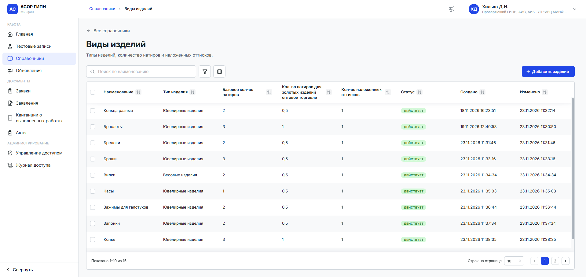
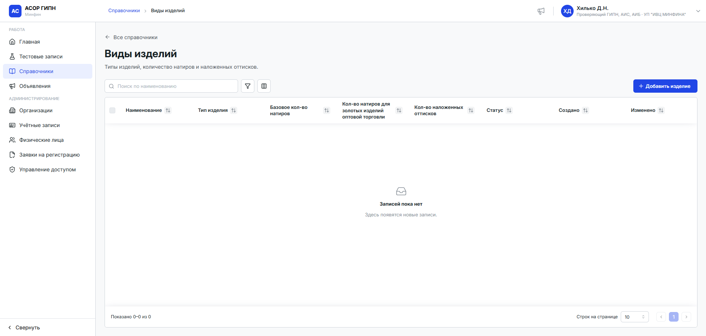

# ИНТЕРФЕЙСНЫЕ ТРЕБОВАНИЯ {#ui}

Критерии приёмки проверяются на каждом списке, который подключает функциональность. Эталонная реализация — экран
«Виды изделий» (приставка `data-testid` `pt`, столбцы — в [FR-PT-LIST-005][]) с [тестовым набором][fixture].

## UI-G-TABLE-001. Таблица записей {#ui-g-table-001 .collapsed}

- **Использует**: [SF-G-TABLE][], [NFR-002][], [NFR-004][], [NFR-005][], [дизайн-система][design-system] (DataTable,
Badge)
- **Используется в**: [FR-PT-LIST-005][]
- **Описание**: Таблица показывает записи текущей страницы в столбцах функциональности с едиными форматами значений
и открывает запись по клику на строку.
- **Условие**: Открыт экран со списком, который подключает [SF-G-TABLE][], и список вернул записи.
- **Результат**: Пользователь видит записи страницы и открывает нужную запись, если ему это разрешено.
- **Показатели (NFR)**: Соответствие [NFR-002][]; таблица — семантический `<table>` с заголовками столбцов.

### Макет {#ui-g-table-001-mockups .collapsed}

Источник — скриншот справочника видов изделий «02-Список видов изделий-01-Есть записи».



### Элементы {#ui-g-table-001-elements .collapsed}

- **Таблица** — `<p>-list-table`
    - DataTable на всю ширину рабочей области: фон `bg-surface`, рамка `border`, скругление `radius-md`. Шапка
      закреплена при прокрутке строк, футер с пагинацией прижат к низу окна.
- **Заголовок столбца** — `<p>-list-header` с `data-field`
    - Стиль `table-head`, перенос до 3 строк, выравнивание по левому краю.
- **Строка** — `<p>-list-row` с `data-pk`
    - Высота `row-height` (53px), стиль `table-cell`; чётные строки — фон `bg-row-alt`, наведение — `bg-hover`.
- **Ячейка** — `<p>-list-cell` с `data-field`
    - Значение по формату столбца (таблица ниже); длинный текст переносится по словам, не обрезается.
- **Бейдж статуса** — `<p>-list-status-badge` с `data-value="true"` или `data-value="false"`
    - Badge: «ДЕЙСТВУЕТ» (фон `success-soft`, текст `green-10`) или «НЕ ДЕЙСТВУЕТ» (фон `gray-1`, текст `text`).

| Формат | Пример | Правило |
| :--- | :--- | :--- |
| Текст | Кольца разные | Как есть, перенос по словам |
| Перечень | Ювелирные изделия | Название значения, не код |
| Десятичное число | `2`, `0,5`, `1,25` | Разделитель — запятая, незначащие нули не показываются |
| Целое число | `1` | Без разделителей разрядов до 9 999 |
| Дата и время | `18.11.2026 16:23:51` | `ДД.ММ.ГГГГ ЧЧ:ММ:СС` в часовом поясе браузера ([NFR-004][]) |
| Статус | ДЕЙСТВУЕТ | Бейдж статуса |
| Нет значения | — | Длинное тире `text-muted` |

### Поведение (UX) {#ui-g-table-001-ux .collapsed}

1. Клик по строке вне флажка выделения открывает запись действием функциональности (обычно форму изменения) —
   только ролям, которым оно разрешено; у них курсор `pointer`. Для остальных ролей строка не реагирует на клик.
2. Строка доступна с клавиатуры (`tabindex="0"`), Enter работает как клик.
3. После закрытия открытой записи фокус возвращается на её строку; после сохранения список перезагружается с
   текущими условиями.

### Критерии приёмки (AC) {#ui-g-table-001-ac .collapsed}

```gherkin
# language: ru
@UI-G-TABLE-001 @SF-G-TABLE @ui
Функционал: Таблица записей

  Предыстория:
    Дано в справочнике видов изделий записи из файла "PT.fixture.json"
    И пользователь с ролью "ais" открыл экран "Виды изделий"

  Сценарий: Форматы значений
    Тогда строка "Кольца разные" содержит значения:
      | data-field                  | текст               |
      | product_group               | Ювелирные изделия   |
      | wholesale_gold_streak_count | 0,5                 |
      | is_active                   | ДЕЙСТВУЕТ           |
      | created_at                  | 18.11.2026 16:23:51 |
    И в строке "Брелоки" "pt-list-status-badge" имеет data-value "false" и текст "НЕ ДЕЙСТВУЕТ"

  Сценарий: Клик по строке открывает запись
    Когда пользователь нажимает строку "Кольца разные" вне флажка
    Тогда открыто окно "Изменить изделие" с данными записи "Кольца разные"
    Когда пользователь закрывает окно
    Тогда фокус на строке "Кольца разные"

  Сценарий: Строка не открывается без права
    Дано пользователь с ролью "pko" открыл экран "Виды изделий"
    Когда пользователь нажимает строку "Кольца разные"
    Тогда окно записи не открыто

  @NFR @a11y
  Сценарий: Открытие записи с клавиатуры
    Когда пользователь переводит фокус на строку "Вилки" и нажимает Enter
    Тогда открыто окно "Изменить изделие" с данными записи "Вилки"
```

## UI-G-TABLE-002. Состояния таблицы {#ui-g-table-002 .collapsed}

- **Использует**: [SF-G-TABLE][], [UI-G-TABLE-001][], [UI-G-TOAST-001][], [UI-G-SESSION-001][], [NFR-005][],
[дизайн-система][design-system] (Skeleton, EmptyState, Button)
- **Используется в**: [FR-PT-LIST-005][]
- **Описание**: Тело таблицы показывает загрузку, пустой список, ошибку загрузки с повтором или отсутствие прав.
- **Условие**: Открыт экран со списком, который подключает [SF-G-TABLE][].
- **Результат**: Пользователь всегда понимает, почему в таблице нет строк, и может повторить загрузку после ошибки.
- **Показатели (NFR)**: Скелетон появляется не позже 100 мс после отправки запроса.

### Макет {#ui-g-table-002-mockups .collapsed}

Источник — скриншот справочника видов изделий «02-Список видов изделий-01-Нет записей». Состояния загрузки, ошибки и
отсутствия прав на скриншотах не показаны и построены по дизайн-системе.



### Состояния {#ui-g-table-002-states .collapsed}

| Состояние | Условие | Что видит пользователь | `data-testid` |
| :--- | :--- | :--- | :--- |
| Загрузка | Запрос отправлен, ответа нет | Скелетон строк по размеру страницы, цвет `gray-1` | `<p>-list-skeleton` |
| Есть записи | `items` не пустой | Строки [UI-G-TABLE-001][] | `<p>-list-row` |
| Пусто | `total` = 0, нет поиска и фильтров | EmptyState «Записей пока нет» | `<p>-list-empty` |
| Ничего не найдено | `total` = 0, задан поиск или фильтр | EmptyState [UI-G-SEARCH-001][] | `<p>-list-not-found` |
| Ошибка загрузки | Ответ `500` или нет связи | Уведомление и блок ошибки в теле таблицы | `<p>-list-error` |
| Нет доступа | Ответ `403` | Блок «Недостаточно прав для просмотра <объекта>» | `<p>-list-forbidden` |

- **Загрузка**: панель инструментов и шапка таблицы доступны; повторный запрос заменяет предыдущий.
- **Пусто**: иконка `inbox` 28px, заголовок «Записей пока нет» (13px, 600), пояснение «Здесь появятся новые
  записи.» (`text-secondary`); футер пагинации остаётся: «Показано 0–0 из 0», номер страницы «1» недоступен.
- **Ошибка загрузки**: уведомление «Ошибка» с текстом «Не удалось загрузить список. Повторите попытку.»
  ([UI-G-TOAST-001][]); в теле таблицы — иконка `alert`, тот же текст и кнопка Outline «Повторить»
  (`<p>-list-retry`), которая повторяет последний запрос с теми же условиями.
- **Нет доступа**: иконка `lock`, текст без кнопки; панель инструментов и пагинация не выводятся.
- **Ответ `401`**: по [UI-G-SESSION-001][].

### Критерии приёмки (AC) {#ui-g-table-002-ac .collapsed}

```gherkin
# language: ru
@UI-G-TABLE-002 @SF-G-TABLE @ui
Функционал: Состояния таблицы

  Предыстория:
    Дано пользователь с ролью "ais" вошёл в систему

  Сценарий: Загрузка
    Дано ответ API списка задерживается на 1 с
    Когда пользователь открывает экран "Виды изделий"
    Тогда виден "pt-list-skeleton" и доступно "pt-list-search"

  Сценарий: Пустой список
    Дано справочник видов изделий пуст
    Когда пользователь открывает экран "Виды изделий"
    Тогда виден "pt-list-empty" с текстом "Записей пока нет" и "Здесь появятся новые записи."
    И "pt-pagination-summary" содержит текст "Показано 0–0 из 0"

  Сценарий: Ошибка загрузки и повтор
    Дано в справочнике видов изделий записи из файла "PT.fixture.json"
    И API списка отвечает кодом 500
    Когда пользователь открывает экран "Виды изделий"
    Тогда виден "toast" с заголовком "Ошибка" и текстом "Не удалось загрузить список. Повторите попытку."
    И виден "pt-list-error"
    Когда API списка снова отвечает кодом 200 и пользователь нажимает "pt-list-retry"
    Тогда в таблице 10 строк

  Сценарий: Нет доступа
    Дано API списка отвечает кодом 403
    Когда пользователь открывает экран "Виды изделий"
    Тогда виден "pt-list-forbidden" с текстом "Недостаточно прав для просмотра справочника"
    И на экране нет "pt-list-toolbar" и "pt-pagination"
```

### Допущения {#ui-g-table-002-assumptions .collapsed}

- **UI-G-TABLE-002.H01**
    - **Статус**: требует подтверждения
    - **Подтверждает**: владелец продукта
    - **Допущение**: Тексты и вид состояний загрузки, ошибки и отсутствия прав (в том числе скрытие панели
      инструментов и пагинации при отсутствии прав) на скриншотах не показаны и достроены по дизайн-системе.


[fixture]: <../../features/dict-product-type/fr.md#fr-pt-fixture>
[SF-G-TABLE]: <index.md#sf-g-table>
[UI-G-TOAST-001]: <../sf-g-toast/ui.md#ui-g-toast-001>
[UI-G-SESSION-001]: <../sf-g-session/ui.md#ui-g-session-001>
[UI-G-SEARCH-001]: <../sf-g-search/ui.md#ui-g-search-001>
[NFR-002]: <../nfr.md#nfr-002>
[NFR-004]: <../nfr.md#nfr-004>
[NFR-005]: <../nfr.md#nfr-005>
[design-system]: <../design-system/index.md>
[FR-PT-LIST-005]: <../../features/dict-product-type/sf-list/fr.md#fr-pt-list-005>
[UI-G-TABLE-001]: <#ui-g-table-001>
