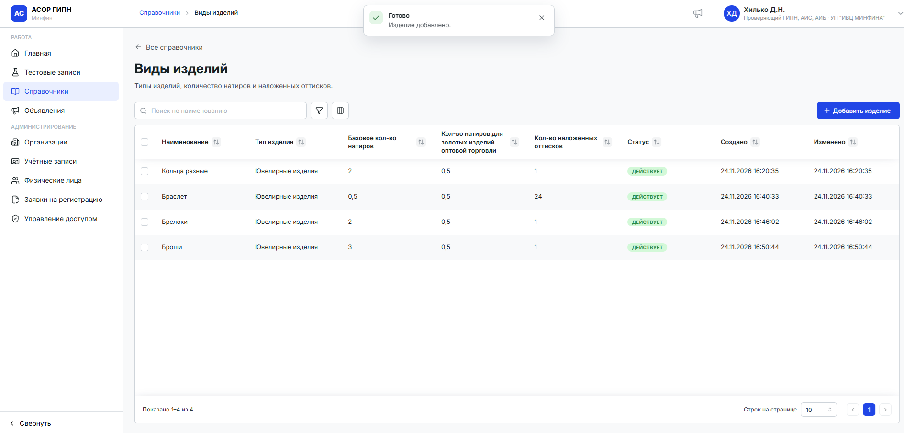
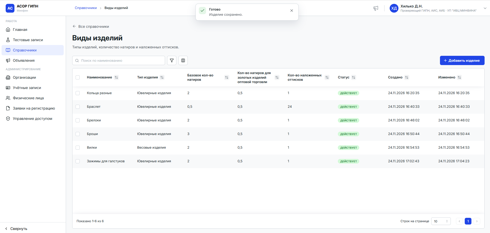
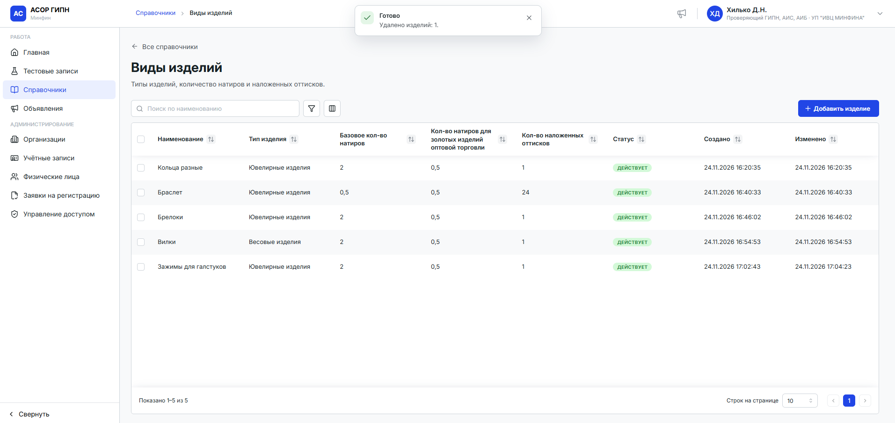
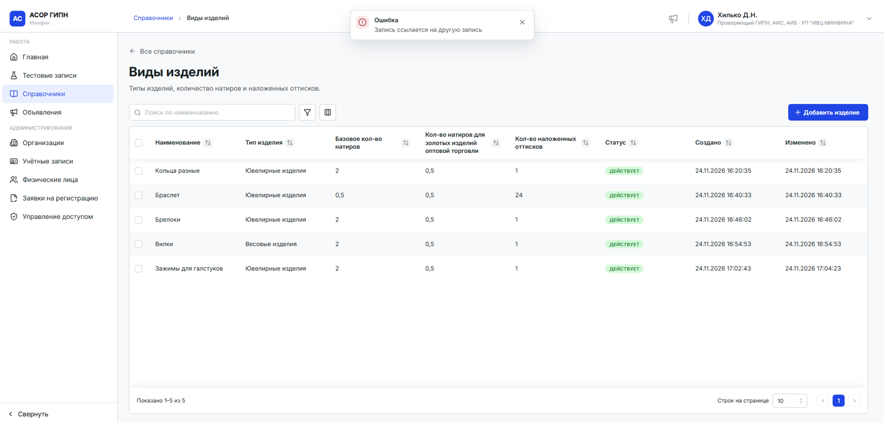

# ИНТЕРФЕЙСНЫЕ ТРЕБОВАНИЯ {#ui}

Критерии приёмки проверяются на каждом экране, который показывает уведомления. Эталонная реализация — справочник
видов изделий с [тестовым набором][fixture].

## UI-G-TOAST-001. Всплывающее уведомление {#ui-g-toast-001 .collapsed}

- **Использует**: [SF-G-TOAST][], [NFR-002][], [NFR-005][], [дизайн-система][design-system] (Toast)
- **Используется в**: FR функциональностей, которые сообщают о результате операции (см. [SF-G-TOAST][])
- **Описание**: После операции система показывает уведомление о результате: успех или ошибку с причиной.
- **Условие**: Операция, о результате которой по её FR сообщает уведомление, завершилась успешно или с ошибкой.
- **Результат**: Пользователь видит заголовок и текст уведомления, не теряя контекста экрана; уведомление об успехе
скрывается само, об ошибке — остаётся до закрытия.
- **Показатели (NFR)**: Уведомление появляется не позже 100 мс после ответа API; соответствие [NFR-002][].

### Макеты {#ui-g-toast-001-mockups .collapsed}

Источник — скриншоты справочника видов изделий «04-Создание записи-04», «05-Изменение записи-03»,
«02-Список видов изделий-08-Удаление записи из списка-04».









### Элементы {#ui-g-toast-001-elements .collapsed}

Уведомление — элемент каркаса приложения, поэтому его атрибуты `data-testid` без приставки экрана ([NFR-005][]).

- **Уведомление** — `toast` с `data-type="success"` или `data-type="error"`
    - Карточка шириной 360px: фон `bg-surface`, рамка `border`, скругление `radius-md`, тень `shadow-md`.
    - Положение: по центру по горизонтали у верхнего края окна, поверх шапки и содержимого.
    - Слева — иконка в квадрате 28px со скруглением: успех — `check` цвета `green-10` на `success-soft`, ошибка —
      `alert` цвета `danger` на `red-0`.
    - Успех: `role="status"`, `aria-live="polite"`; ошибка: `role="alert"`, `aria-live="assertive"`.
- **Заголовок** — `toast-title`
    - «Готово» для успеха, «Ошибка» для ошибки; 13px, 600, цвет `text`.
- **Текст** — `toast-message`
    - Текст из FR функциональности, 13px, цвет `text-secondary`; переносится по словам, не обрезается.
- **Закрыть** — `toast-close`
    - IconButton с иконкой `x` справа, `aria-label` «Закрыть уведомление».

### Поведение (UX) {#ui-g-toast-001-ux .collapsed}

1. Уведомление об успехе скрывается само через 4 с; наведение курсора или фокус на уведомлении приостанавливают
   отсчёт (см. `H01`).
2. Уведомление об ошибке не скрывается само: его закрывает пользователь крестиком.
3. Крестик закрывает уведомление сразу; клавиша Esc при фокусе на уведомлении действует так же.
4. Уведомление не забирает фокус: пользователь продолжает работу на экране.
5. Если появляется новое уведомление, а прежнее ещё видно, новое показывается под ним; одновременно видно не больше
   трёх, самое старое скрывается (см. `H03`).
6. Переход на другой экран не закрывает уведомление об ошибке.

### Критерии приёмки (AC) {#ui-g-toast-001-ac .collapsed}

```gherkin
# language: ru
@UI-G-TOAST-001 @SF-G-TOAST @ui
Функционал: Всплывающее уведомление

  Предыстория:
    Дано в справочнике видов изделий записи из файла "PT.fixture.json"
    И пользователь с ролью "ais" открыл экран "Виды изделий"

  Сценарий: Уведомление об успехе
    Когда пользователь создаёт запись «Подвески» через форму создания
    Тогда виден "toast" с data-type "success", role "status"
    И "toast-title" содержит текст "Готово", "toast-message" — "Изделие добавлено."
    И уведомление расположено по центру у верхнего края окна

  Сценарий: Успех скрывается сам
    Дано показано уведомление об успехе
    Когда проходит 4 с без наведения курсора на уведомление
    Тогда нет "toast"

  Сценарий: Наведение приостанавливает скрытие
    Дано показано уведомление об успехе
    Когда пользователь держит курсор на "toast" 6 с
    Тогда "toast" виден

  Сценарий: Уведомление об ошибке не скрывается само
    Дано API удаления отвечает кодом 500
    Когда пользователь удаляет выделенную запись «Брелоки»
    Тогда виден "toast" с data-type "error", role "alert" и заголовком "Ошибка"
    И через 10 с "toast" по-прежнему виден
    Когда пользователь нажимает "toast-close"
    Тогда нет "toast"

  Сценарий: Несколько уведомлений подряд
    Когда пользователь создаёт подряд записи «Подвески», «Цепочки», «Кулоны» и «Значки»
    Тогда видны три "toast", верхний — о записи «Цепочки»

  @NFR @a11y
  Сценарий: Уведомление не забирает фокус
    Дано фокус на "pt-list-search"
    Когда появляется уведомление об успехе
    Тогда фокус остаётся на "pt-list-search"
    И у "toast-close" есть aria-label "Закрыть уведомление"
```

### Допущения {#ui-g-toast-001-assumptions .collapsed}

- **UI-G-TOAST-001.H01**
    - **Статус**: требует подтверждения
    - **Подтверждает**: владелец продукта
    - **Допущение**: Уведомление об успехе скрывается через 4 с, а наведение курсора приостанавливает отсчёт; на
      скриншотах время показа не видно.
- **UI-G-TOAST-001.H02**
    - **Статус**: требует подтверждения
    - **Подтверждает**: владелец продукта
    - **Допущение**: Предупреждение (жёлтое уведомление) пока не используется ни одной функциональностью; когда
      понадобится, его вид берётся из дизайн-системы (`yellow-1` / `yellow-9`).
- **UI-G-TOAST-001.H03**
    - **Статус**: требует подтверждения
    - **Подтверждает**: владелец продукта
    - **Допущение**: Одновременно видно не больше трёх уведомлений, новые — ниже прежних; на скриншотах всегда одно.


[fixture]: <../../features/dict-product-type/fr.md#fr-pt-fixture>
[SF-G-TOAST]: <index.md#sf-g-toast>
[NFR-002]: <../nfr.md#nfr-002>
[NFR-005]: <../nfr.md#nfr-005>
[design-system]: <../design-system/index.md>
